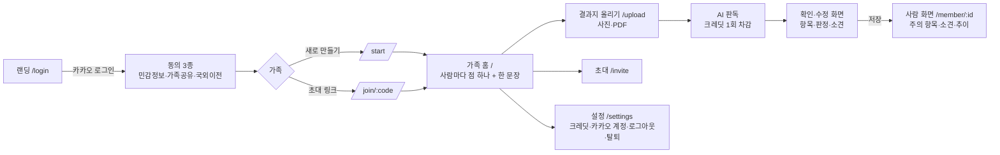
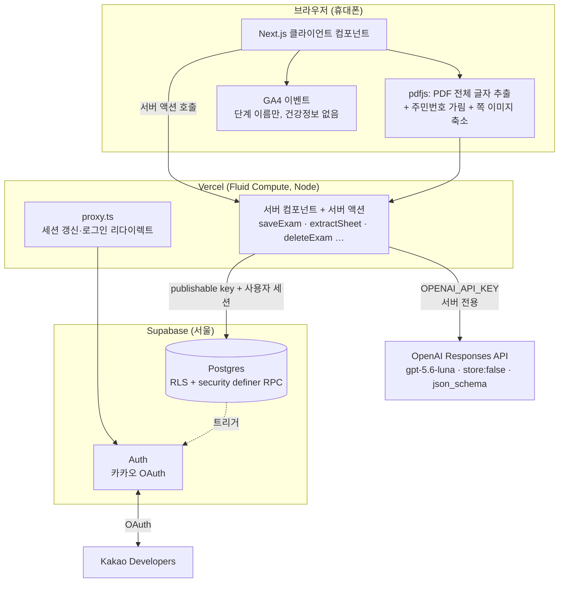
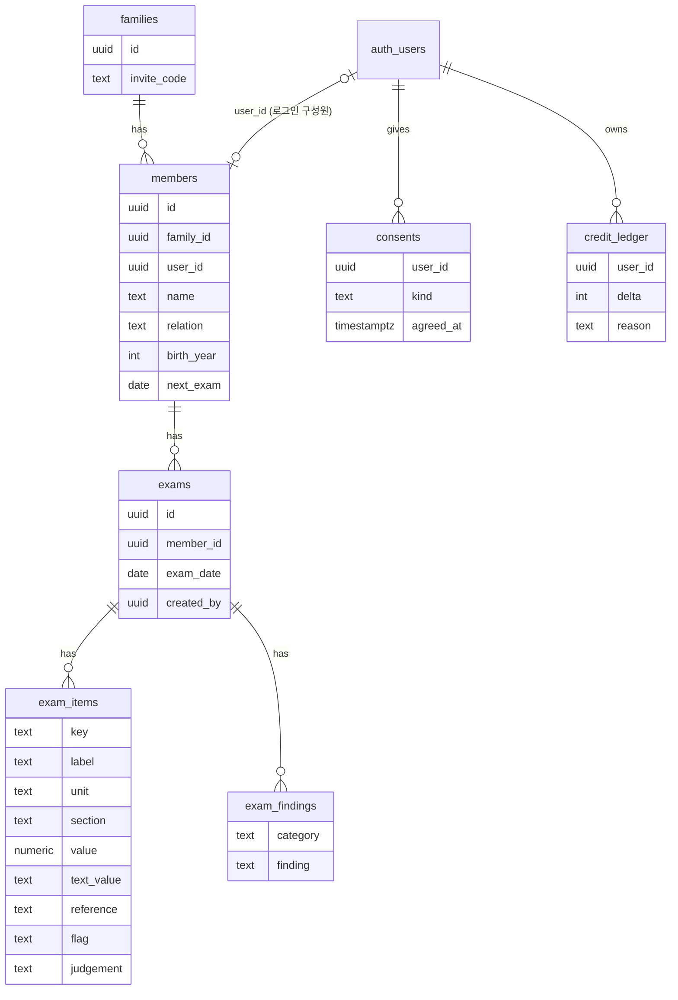
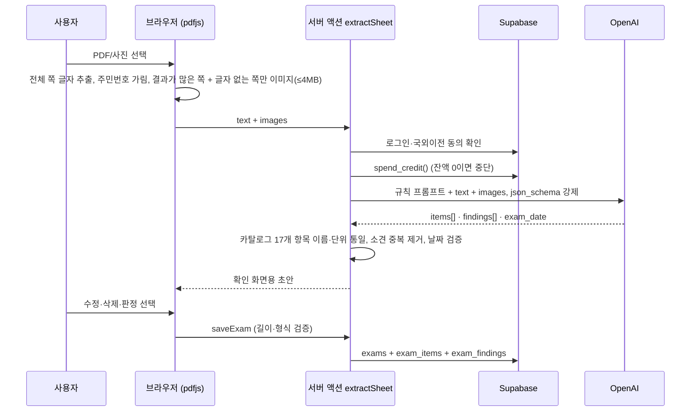
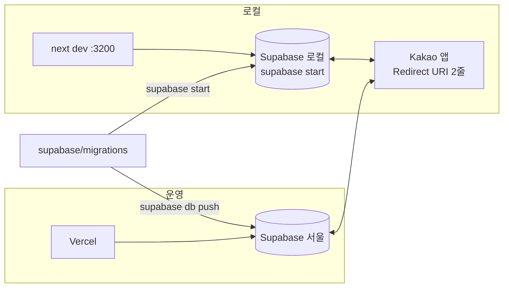

# 오래오래 아키텍처

> 가족 건강검진 기록장 **오래오래**(https://oraeorae.kro.kr)의 기능 흐름·시스템 구성·데이터 모델·판독 파이프라인을 다이어그램으로. 서버는 Next.js 서버 액션 하나, 데이터는 Supabase RLS 뒤, AI는 OpenAI 호출 한 번이 전부인 "가장 작은 상용 구조".

## 1. 기능 흐름 (사용자 여정)

- 사람이 확인해야 저장된다. AI 결과가 바로 DB에 들어가는 경로는 없다.
- 판정·H/L·참고치는 결과지에 적힌 것만 옮긴다(앱이 진단하지 않음, 헌법 III).

## 2. 시스템 구성

| 층 | 무엇 | 왜 이렇게 |
|---|---|---|
| 클라이언트 | pdfjs로 글자·이미지 준비 | 7.6MB PDF를 서버 4.5MB 제한 안으로, 주민번호는 서버에 가기 전에 가림 |
| 서버 | 서버 액션만, API 라우트 없음 | 호출 경로가 하나라 검증·크레딧 차감·키 보관이 한 곳 |
| DB | RLS + RPC, service-role 클라이언트 없음 | 서버가 뚫려도 사용자 세션 권한 이상은 못 함(헌법 IV) |
| AI | `store:false`, 구조화 출력, 이미지는 필요한 쪽만 | 결과지를 OpenAI에 남기지 않음, 토큰 ≈ 25원/건 |
| 분석 | GA4에 단계 이름만 | 건강정보·이름·id가 분석 도구로 새지 않음(헌법 I) |

## 3. 데이터 모델

- **RLS 핵심 함수** `is_family_member(family_id)`: 모든 정책이 이 한 함수로 "같은 가족인가"를 판단.
- **RPC** `create_family` · `join_family` · `renew_invite` · `delete_my_account` · `credit_balance` · `spend_credit`: 여러 테이블을 한 번에 바꾸는 일만 security definer.
- **크레딧**은 잔액 컬럼이 아니라 `delta` 합계(원장). 차감 RPC는 `pg_advisory_xact_lock`으로 동시 호출을 막고, 가입 트리거가 3회를 넣는다.
- **원본 결과지는 어디에도 저장하지 않는다.** Storage 버킷이 없다.

## 4. 판독 파이프라인

- 판독 규칙의 요점: 결과지에 **인쇄된 것만**, 판정은 체크된 칸에서만, 한 칸에 검사 여러 개면 항목을 나눔, 참고치는 한 줄, H/L은 인쇄된 경우만.
- 실패해도 비는 검진 기록이 남지 않게 저장은 항목 삽입이 실패하면 exam을 지운다.

## 5. 화면·코드 지도

| 경로 | 역할 | 핵심 파일 |
|---|---|---|
| `/login` | 랜딩 + 카카오 버튼 | `login/page.tsx` |
| `/consent` → `/start`, `/join/:code` | 동의·가족 만들기·참여 | `consent-form.tsx`, RPC |
| `/` | 가족 홈: 사람마다 점 + 개수 문장 | `(family)/page.tsx`, `lib/health.ts glance()` |
| `/member/:id` | 점 + 문장, 주의 3개 + 참고치 막대, 소견, 모든 항목 접기 | `exam-view.tsx`, `ui.tsx RangeBar` |
| `/upload` | 파일 → 판독 대기(단계·초·스켈레톤) → 확인 | `upload-form.tsx`, `sheet-image.ts`, `extract.ts`, `review-form.tsx` |
| `/settings`, `/settings/leave` | 크레딧·카카오 계정·로그아웃·탈퇴(확인 모달) | `confirm-button.tsx` |
| 공통 | 색 토큰 primary/warn/danger/ok(+soft), 다크 모드 | `globals.css` |

## 6. 운영 경계

- 환경 변수: 로컬은 `.env.development.local`, 운영 값은 `.env.local`(build)과 Vercel(Production, Sensitive). 키는 채팅·레포에 절대 안 적음.
- 카카오 앱은 하나를 공유하고 Redirect URI만 두 줄. 동의 항목 실험이 필요해지면 그때 dev 앱을 나눈다.

---
This work was created as part of the No-More-Slops group activities at Pseudo Lab.
