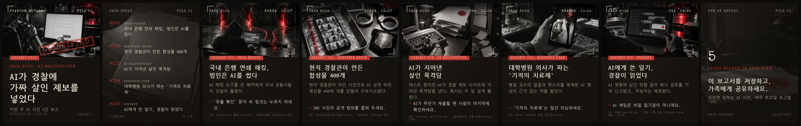
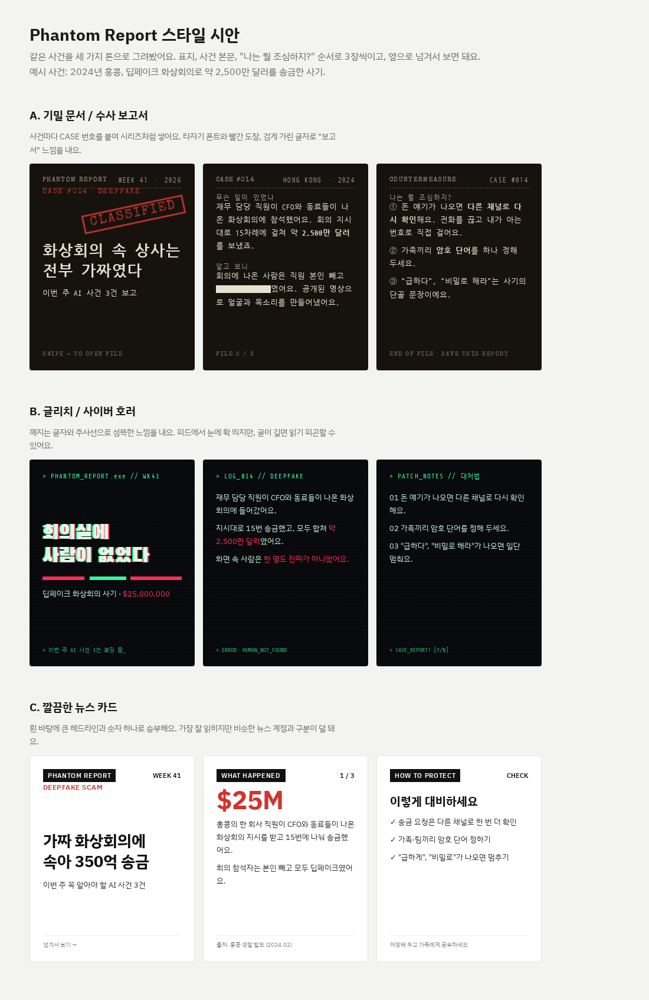
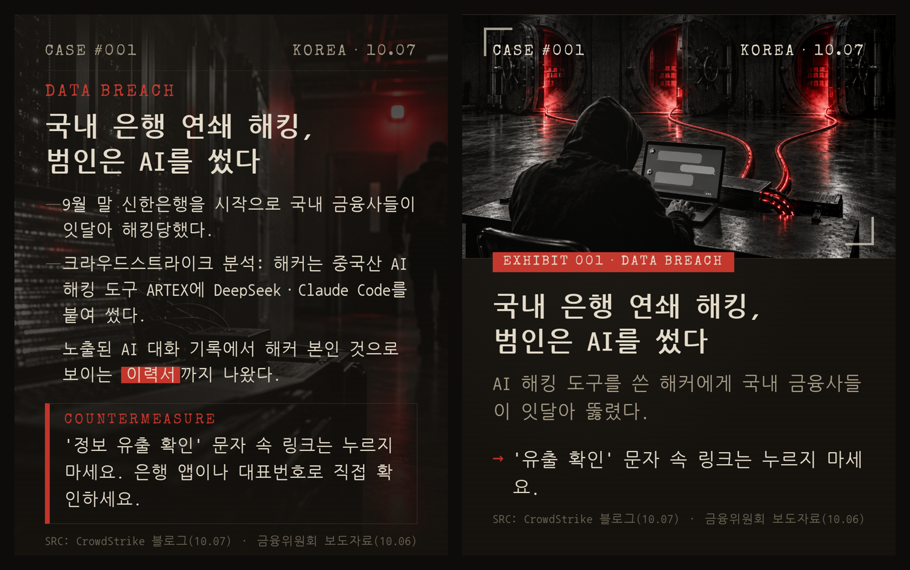
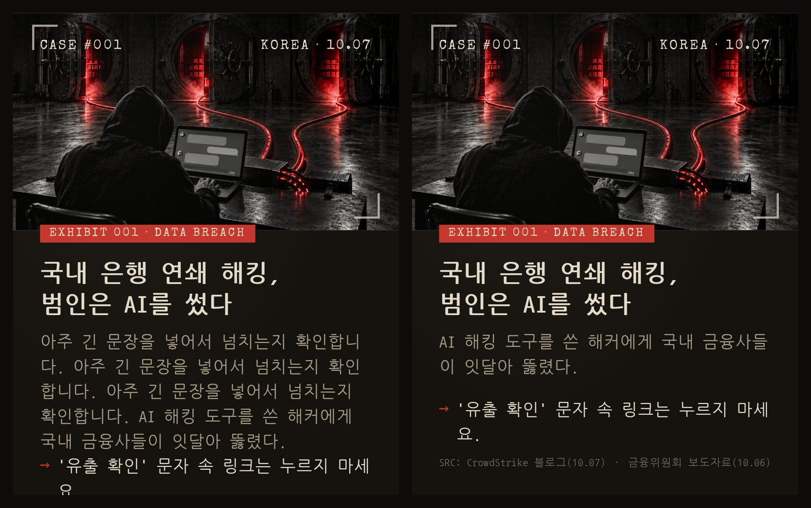
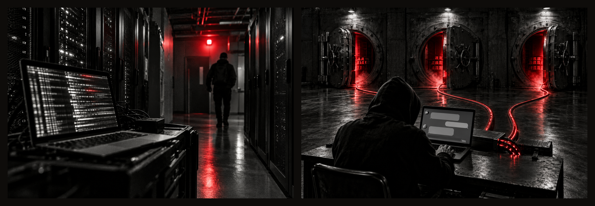

# Week 1 (2026-10-10 ~ 10-11)

FILE 01을 손으로 만들면서 드러난 문제를 하네스 초기 구성에 반영했다.

**이번 주 핵심**
1. 2차 보도를 믿었다면 틀렸을 사실 4건 → 수집과 사실 확인을 다른 에이전트로 분리하고, 1차 출처 확인을 필수 단계로.
2. 템플릿을 바꿔도 원고 규칙이 그대로면 글이 넘친다(장당 260~370px) → 원고 규칙을 템플릿에 맞추고, 넘침은 렌더링에서 자동 검사.
3. 다음 세션이 이어서 일할 수 있게 → 진행 상태를 호 파일 섹션으로 판단하고, 변경 이력은 devlog로.

## 사실 확인

- **2차 보도를 믿으면 사실이 틀린다** → 수집(scout)과 사실 확인(fact-checker)을 분리. fact-checker는 1차 출처까지 추적하고, 틀린 내용은 `주의:` 줄로 원고 표현까지 정해 준다.
  - 근거: 보도 기준으로 썼다면 틀렸을 오류 4건.

| 사건 | 보도 기준 | 1차 출처 기준 |
|---|---|---|
| #002 | 부산의 경찰관 | 서울 소속 경찰관, 부산경찰청이 검거 |
| #005 | Claude 대화 | 진술서상 Perplexity → "AI 챗봇"으로 표기 |
| #005 | 중범죄로 기소 | 정식 기소 전, 중범죄 혐의로 체포 |
| #004 | 의사와 TF1 앵커 도용 | 병원 원문에는 의사만 있음 |

- **정정이 메모에만 있고 본문에는 옛 내용이 남는다** → fact-checker가 `## 채택` 블록도 함께 고치게 함. writer는 `주의:`를 우선해서 따른다.

## 슬라이드와 원고

- **기획 결정은 말보다 보고 정하는 게 빠르다** → 톤을 시안 3종으로 띄워 비교한 뒤 기밀 문서 톤으로 확정.

- **원고 규칙과 템플릿이 따로 논다** → 2안 확정 뒤에도 규칙은 1안 분량(경위 3~4줄)으로 남아 있었다. writer 규칙을 2안 기준(요약 1문장 + `→` 행동 1줄)으로 맞추고, 세부 사실과 원본 링크는 캡션으로 보내게 함.

- **글이 슬라이드 밖으로 넘쳐도 눈으로만 잡는다** → `render.py`가 넘친 장을 `WARN`으로 알리고 실패로 끝나게 함.

## 이미지

- **분위기 이미지는 배경으로만 쓰인다** → 사건 장 이미지를 그림만 봐도 사건을 알 수 있는 설명형 장면으로 쓰게 함. 목록·마무리를 포함해 모든 장의 프롬프트를 쓴다.

- **이미지 생성에 API 키 관리가 번거롭다** → Codex CLI의 ChatGPT OAuth 로그인으로 생성하게 바꿈. 토큰이 만료되면 재로그인 명령을 안내한다.

## 진행 관리

- **호가 끝났는지 다음 세션이 알 수 없다** → 최종 대조 결과를 `## 최종 대조`에 남기고, 오케스트레이터는 각 섹션이 있는지를 보고 어느 단계부터 이어 갈지 정한다.
- **호 번호가 ISO 주차라 채널 기준으로 읽기 어렵다** → 첫 발행일(10/10) 기준 FILE NN으로 바꿈.
- **변경 이력이 CLAUDE.md에 쌓이면 매 세션 컨텍스트를 차지한다** → 이력은 `devlog/`로 옮기고 CLAUDE.md에는 트리거 규칙만 남김.

## 다음에 확인할 것

- FILE 01 최종 대조를 하네스 첫 실행 테스트로 돌린다. 2안으로 줄인 슬라이드와 새로 쓴 캡션을 아직 출처와 대조하지 않았다.
- FILE 02에서 채택과 원고 승인, 두 사용자 확인 지점이 병목인지 본다.
