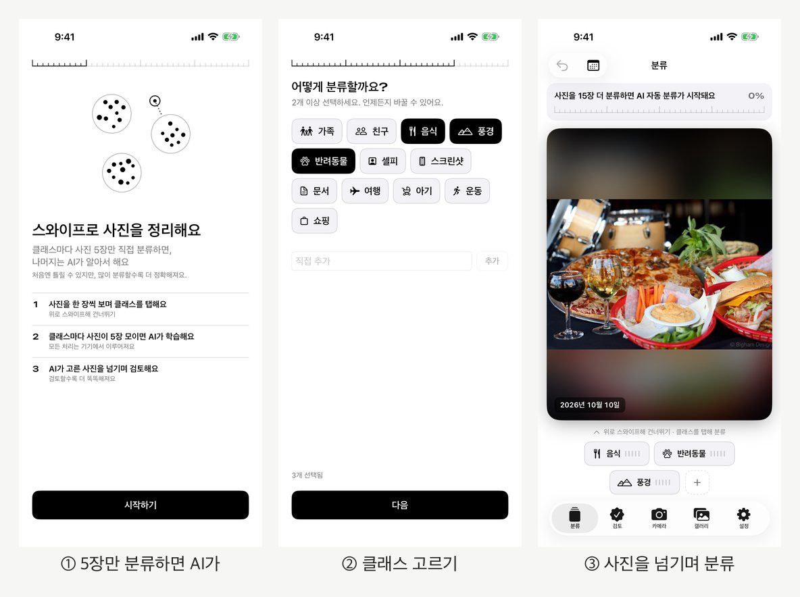
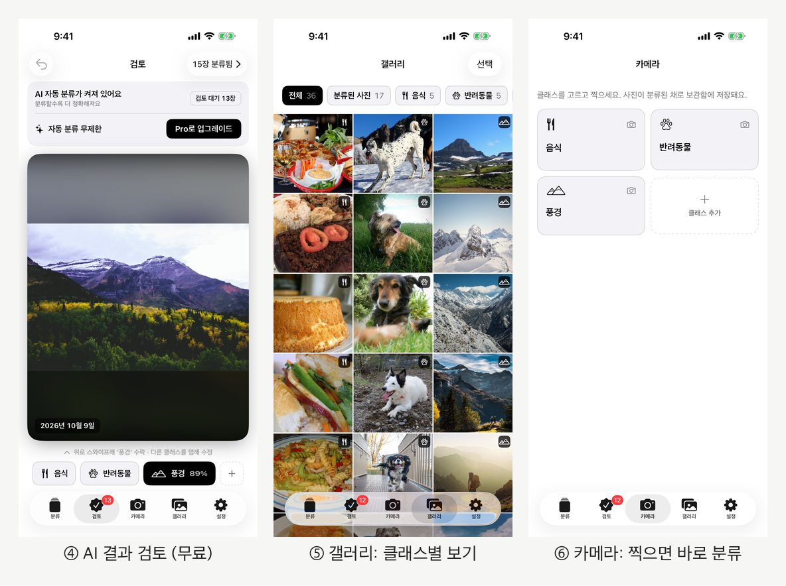
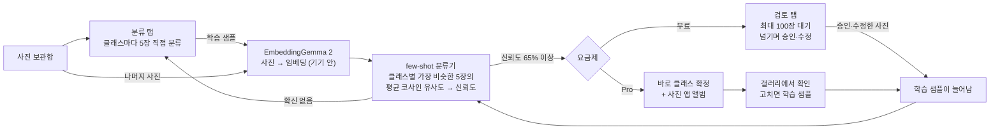
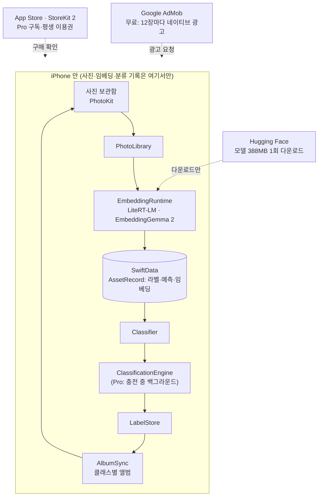
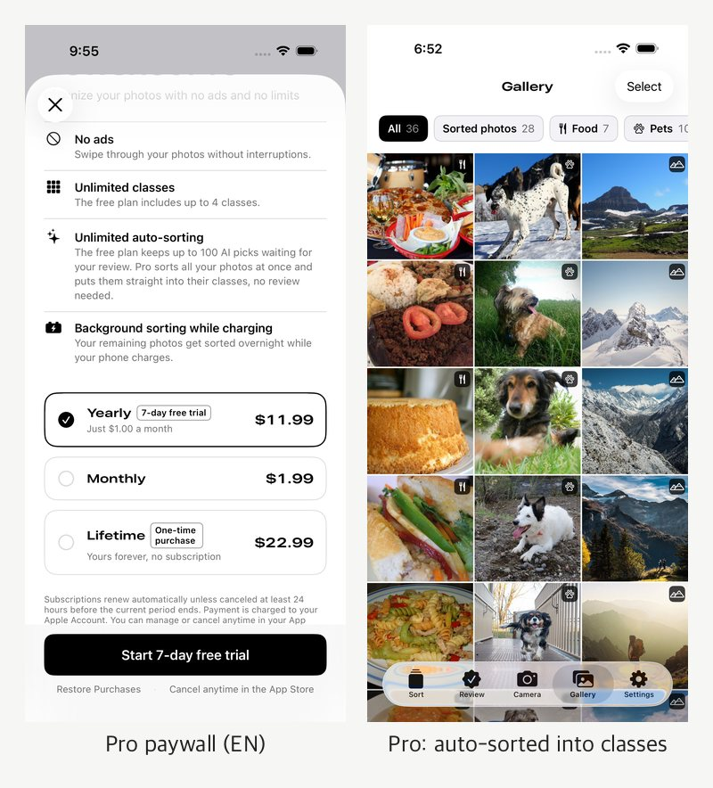
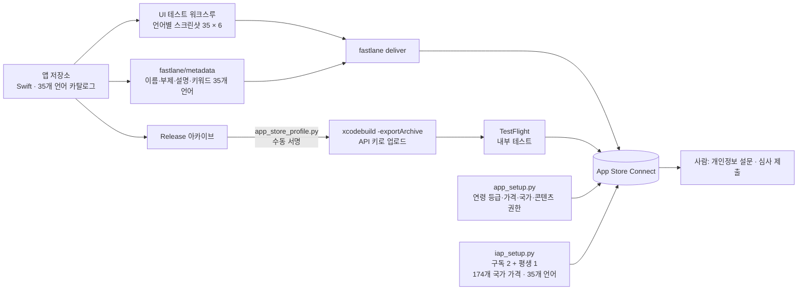

# Week 02 결과물

- 작성자: @gogoymh
- 트랙: Auto-Application
- 원본 PR: [#20](https://github.com/Pseudo-Lab/no-more-slops/pull/20)
- 결과물: Fewshot 1.0 — App Store Connect에 제출 준비 완료(빌드 1.0 (9)), TestFlight 내부 테스트 중 · [공개 페이지](https://goyo-drive.github.io/fewshot/)
- 상태: **심사 제출 전** (2026-10-18 기준). App Store 링크는 승인 후 이 문서에 추가한다.
- 사용한 스킬: [app-store-connect-api](../../../../skills/app-store-connect-api/SKILL.md) (이번 주 추가), Tonlit의 출시 스킬들(#7)

## Fewshot은 어떤 앱인가

**누구를 위해:** 사진이 수천 장 쌓였지만 앨범 정리를 미루는 iPhone 사용자.

**어떤 문제:** 사진 정리는 한 장씩 "이건 어디에 넣지?"를 판단해야 해서 끝나지 않는다. 기존 정리 앱은 중복·흐린 사진 지우기에 집중하고, 내가 원하는 기준(우리 강아지, 여행, 영수증…)으로 나눠 주지 않는다.

**어떻게:** 내가 정한 클래스마다 사진을 **5장씩만** 직접 분류하면, 기기 안에서 도는 AI(Google EmbeddingGemma 2)가 그 5장을 예시로 배워(few-shot) 나머지 보관함을 같은 기준으로 분류한다. 이름 Fewshot은 "사진 몇 장(few shots)"과 few-shot 학습을 함께 뜻한다. 사진은 기기 밖으로 나가지 않는다.

| 탭 | 하는 일 |
| --- | --- |
| 분류 | 사진을 한 장씩 보며 클래스를 탭한다. 위로 쓸면 건너뛴다. 클래스마다 5장이 모이면 AI가 시작한다 |
| 검토 | AI가 고른 사진을 넘기며 맞으면 위로 쓸어 승인, 틀리면 다른 클래스를 탭해 고친다(무료) |
| 카메라 | 클래스를 고르고 찍으면 분류된 채로 보관함에 저장된다 |
| 갤러리 | 클래스별로 본다. 여러 장 선택해 한 클래스로 옮기거나, 분류 탭으로 되돌리거나, iOS 공유 시트로 보낸다 |
| 설정 | 클래스·AI 모델·Pro·튜토리얼·개인정보 |

### 동작 원리

- 분류기는 샘플이 많은 클래스가 유리하지 않도록 **클래스별 top-5 평균 유사도**를 쓰고, 온도 0.05 softmax로 신뢰도를 만든다. 기준(느슨 50% / 보통 65% / 엄격 80%)은 설정에서 바꾼다.
- AI가 Pro에서 바로 넣은 분류는 **학습 샘플로 쓰지 않는다.** 사람이 고르거나 고친 사진만 학습에 쓰여서, 틀린 분류가 스스로 강화되지 않는다.

### 앱 구조와 개인정보 경계

### 무료와 Pro

| | 무료 | Pro (월 ₩2,900 / 연 ₩19,000·7일 무료 체험 / 평생 ₩39,000) |
| --- | --- | --- |
| 자동 분류 | 검토 대기 최대 100장, 검토하면 다시 채움 | 보관함 전체를 한 번에, **검토 없이 바로 클래스로** |
| 충전 중 분류 | ✗ | ✓ (iOS가 시점을 정함) |
| 클래스 | 4개까지 | 무제한 |
| 광고 | 분류·검토 탭 합쳐 12장마다 | 없음 |

35개 언어(앱·스토어 문구·스크린샷·결제 상품 이름)를 지원하고, 언어는 iPhone 설정을 따른다.

## 이번 주에 한 것 (출시 준비)

| 영역 | 내용 |
| --- | --- |
| 앱 | 카메라 탭(찍으면 클래스로 저장), 갤러리 여러 장 선택·모두 선택·공유(원본 파일, iOS 공유 시트), 튜토리얼(실제 화면 위 손가락 동작), Pro 자동 분류 결과를 검토 없이 바로 클래스로, 결제 진행 표시 |
| 광고 | AdMob 네이티브 광고 검사기 경고(애니메이션 도중 등록으로 에셋이 광고 뷰 밖으로 측정) 원인 확인 후 수정, 분류·검토 탭 광고 횟수 합산 |
| 이름 | Coreset(한국어로 "코르셋") → Albumate(같은 기능의 동명 앱 발견) → **Fewshot**. 이름 확인 도구가 "이름으로 시작하는 앱"만 봐서 Albumate를 놓친 것을 고쳤다 |
| 스토어 | 35개 언어 이름·부제·설명·키워드, 스크린샷 210장(6.9인치), 심사 메모, 연령 등급 4+, 무료, 중국 본토 제외, 콘텐츠 권한 |
| 결제 | 구독 2개(월 ₩2,900, 연 ₩19,000 + 7일 무료 체험)와 평생 이용권(₩39,000), 174개 국가 가격, 35개 언어 현지화, 상품별 영어 심사 스크린샷 |
| 공개 페이지 | 소개·개인정보처리방침·지원(영어·한국어), 스튜디오 조직 `goyo-drive`의 GitHub Pages, app-ads.txt |
| 배포 | API 키로 빌드 9개 업로드(수동 서명 우회), TestFlight 내부 그룹, 버전에 빌드 연결 |

### 출시 과정

## 재현 및 검증

이번에 실제 실행한 것과 결과:

- `python3 -I -m unittest discover -s tests` (스킬 폴더): 8개 통과 — JWT 서명 변환, 이름 겹침 판정, 상품 명세 글자 수.
- `python3 -I scripts/iap_setup.py references/example/iap-spec.json --validate`: 구독 2개, 앱 내 구입 1개, 35개 언어 OK.
- `python3 -I scripts/app_setup.py check --bundle-id com.minhyeong.albumate`: 버전 1.0 제출 준비 중, 빌드 9 연결, 연령 등급 4+, 콘텐츠 권한 응답, 상품 상태 출력.
- App Store Connect API로 다시 읽어 확인: 35개 언어 문구, 스크린샷 35×6장, 결제 상품 현지화 35개 언어 × 4(그룹·월간·연간·평생), 상품 심사 스크린샷 처리 완료.
- 앱 기능은 iOS 시뮬레이터 UI 테스트로 재현·확인했다(광고 검사기: 수정 전 "1 implementation issue found" → 수정 후 "No implementation issues found", Pro 자동 분류 중 검토 탭 깜빡임 없음, 갤러리 숫자 실시간 갱신 9→28 등). 이 테스트들은 앱 저장소에서 임시로 돌린 것으로 이 PR에는 없다.

확인하지 못한 것:

- App Store 심사 결과(제출 전).
- Pro 충전 중 백그라운드 분류의 실제 기기 동작(iOS가 실행 시점을 정함).
- 구독 2개는 API 상태가 `MISSING_METADATA`로 남아 있다. 웹 화면에서는 "심사에 추가"가 활성이라 준비된 것으로 판단했다.
- 33개 언어 문구는 기계 번역이며 원어민 검수를 받지 않았다.

## 지표와 레슨런

출시 전이라 사용자 지표는 아직 없다. 출시 후 1주차에 아래를 기준선으로 기록한다(앱 안에 분석 SDK를 넣지 않고 App Store Connect·AdMob 집계만 사용).

| 지표 | 계산 | 출처 |
| --- | --- | --- |
| D7 유지율 | 설치 7일 뒤에도 앱을 연 기기 / 그날 설치한 기기 | App Store Connect 앱 분석 (분석 공유 동의 사용자) |
| 무료 사용자 처리량(추정) | 네이티브 광고 노출 × 12 / 활성 기기 | AdMob, App Store Connect |
| 충돌률 | 충돌 세션 / 세션 | App Store Connect |
| Pro 전환율 | 구매·체험 시작 / 결제 화면 노출(미측정이면 활성 기기) | App Store Connect |
| 평점 | 평균·건수 | App Store |

레슨런:

1. **이름은 소리와 동명 앱을 모두 본다.** 기술적인 이름은 다른 언어에서 엉뚱하게 들릴 수 있고(Coreset), 동명 앱은 제목 끝에 브랜드를 붙인 경우가 많다(Albumate).
2. **API로 되는 범위를 먼저 나눈다.** 앱 레코드·개인정보 설문·계약·배포 인증서·제출은 사람 몫이다. 나머지를 API로 하면 35개 언어 × 상품 4개 같은 반복 입력이 사라진다.
3. **검증은 실패를 재현하고 판정 문구를 확인한다.** 광고 검사기의 성공 문구("No implementation issues found")에도 "implementation issue"가 들어 있어 처음엔 판정을 잘못했다.
4. **스크린샷은 출시 기본값으로 찍는다.** 테스트를 빨리 돌리려고 바꾼 설정(클래스당 3장)이 그대로 찍혀 스토어 이름의 "5장"과 어긋날 뻔했다.
5. **사용자 피드백이 핵심 동작을 바꿨다.** Pro 자동 분류 결과를 다시 검토하게 하던 설계를 "검토 없이 바로 클래스로"로 바꾸고, AI가 넣은 분류는 학습 샘플에서 빼서 틀린 분류가 스스로 강화되지 않게 했다.

이 결과물은 가짜연구소(Pseudo Lab) No-More-Slops 그룹 활동의 일환으로 제작되었습니다.
