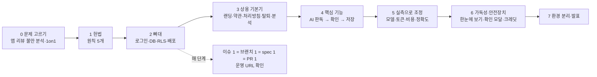

# 제작 과정 — 1주 트랙, 사람 vs Claude(스킬·CLI·MCP)

> 오래오래를 10/7~10/12 닷새 만에 상용 배포까지 간 과정을 이슈 단위가 아니라 **단계 단위**로 압축한 것. 각 단계마다 사람이 한 것 / Claude가 스킬·CLI·MCP로 한 것 / 들어가는 것 / 나오는 것을 적어 두어, 스킬 초안은 [../../skills/micro-saas-week/SKILL.md](../../skills/micro-saas-week/SKILL.md).

## 전체 트랙 (가장 빠른 경로)

| 단계 | 결과물 | 걸린 시간 |
|---|---|---|
| 0 문제 | 주제 1개, 1on1 피드백 반영 | 반나절 |
| 1 헌법 | `constitution.md` 원칙 5개 | 30분 |
| 2 뼈대 | 로그인 → 가족 → 빈 홈이 운영 URL에서 동작 | 하루 |
| 3 기본기 | 랜딩·약관·처리방침·탈퇴·GA4 퍼널·도메인 | 하루 |
| 4 핵심 | 결과지 → AI → 확인 → 저장 | 하루 |
| 5 실측 | 모델 4종 비교, 건당 비용, 긴 PDF | 반나절 |
| 6 안전·가독성 | 확인 모달, 크레딧, 한눈에 보기 UI | 하루 |
| 7 분리·발표 | 로컬 DB, 발표 노트 | 반나절 |

합계: 커밋 43, PR 13, 이슈 30, spec 9개.

## 단계별: 사람 / Claude / 도구

### 0. 문제 고르기
- **사람**: 앱스토어 리뷰 불만 분석 결과에서 주제 결정, 1on1에서 "퍼널 이탈을 측정하라" 피드백 수용, 주제 변경 결정.
- **Claude**: WebSearch·서브에이전트로 리뷰 수집·분류, 후보 3개 비교 노트.
- **도구**: WebSearch, Agent(Explore), second-brain-save.
- 나오는 것: 문제 한 문장, 핵심 사용자, 첫 화면 3개.

### 1. 헌법
- **사람**: 원칙에 들어갈 "절대 안 할 것" 결정(원본 저장 안 함, 진단 안 함).
- **Claude**: `speckit-constitution`으로 원칙 5개 문서화. 이후 모든 PR의 "Constitution Check" 근거.
- 나오는 것: `.specify/memory/constitution.md`.
- 효과: 판단이 갈릴 때마다 사람에게 묻지 않고 여기에 비춰 결정 → 왕복 횟수가 가장 많이 줄어든 장치.

### 2. 뼈대 (로그인·DB·배포)
- **사람**: Kakao Developers 앱 등록, Client Secret을 Supabase 대시보드에 입력, Redirect URI, Vercel 프로젝트 연결, 로그인해서 확인.
- **Claude**: Next.js App Router 스캐폴드, Supabase 마이그레이션(테이블·RLS·RPC), 서버 액션, `vercel deploy --prod`.
- **도구**: `supabase` CLI(`db push`, `db query`), `vercel` CLI, `gh`.
- 규칙: service-role 클라이언트를 만들지 않는다. 첫날부터 운영 URL.

### 3. 상용 기본기
- **사람**: 서비스명, 개인정보 담당 표기 방식, 도메인 등록(내도메인.한국)과 DNS 레코드 입력, GA4 속성 생성.
- **Claude**: 랜딩·약관·처리방침 초안(법 조항 리서치 포함), 탈퇴 RPC, GA4 이벤트 설계(건강정보 제외, URL 마스킹), 도메인 연결(`vercel api`로 TXT 검증), OG 이미지.
- **도구**: Vercel 플러그인, WebFetch(법령), 헤드리스 Chrome(스크린샷·GA 수집 검증).
- 나오는 것: 사람이 써도 되는 수준의 서비스 껍데기 + 퍼널 측정.

### 4. 핵심 기능 (AI 판독)
- **사람**: OpenAI 키 발급·Vercel 등록, 본인 결과지 PDF를 로컬 테스트용으로 제공, 판독 규칙 결정(`***`면 다른 쪽 수치 허용, 판정은 체크된 것만).
- **Claude**: pdfjs 클라이언트 파이프라인(글자·가림·이미지 예산), Responses API 호출(json_schema, store:false), 확인 화면, 저장 검증, 샘플 폴백.
- **도구**: spec-kit `specify → plan → tasks → implement`, 헤드리스 Chrome E2E.
- 함정: 모델이 참고치로 "정상"을 지어냄 → 규칙으로 차단. 스키마 외 필드가 insert를 깨뜨림 → 컬럼 화이트리스트.

### 5. 실측으로 조정
- **사람**: 어느 모델·어느 방향을 테스트할지, 하루 제한 수치.
- **Claude**: 같은 프롬프트를 Claude Agent SDK(Haiku·Sonnet)와 Codex CLI(`codex exec --ephemeral --output-schema`, luna·sol)로 돌려 정확도·토큰·비용 표. 36쪽 PDF 전수 추출(항목 137개·소견 12개).
- **도구**: Agent SDK(`persistSession:false, tools:[]`), Codex CLI, `openai.mjs` 직접 호출 스크립트, 토큰 계산 리서치.
- 나오는 것: 모델 결정(luna, 건당 ≈ 25원), 남용 상한.
- 원칙: 테스트 결과지·출력은 scratchpad에만, 레포·노트에 남기지 않음.

### 6. 가독성·안전장치
- **사람**: "밋밋하다", "뭘 먼저 봐야 할지 모르겠다", "삭제엔 확인 팝업", "계정당 3회, 내 계정 100회", "환불 함수는 결제 때" 같은 제품 피드백.
- **Claude**: UI 레퍼런스 조사(Function Health·건강보험공단·Apple Health) → 목업 아티팩트 → 구현(점 하나 + 한 문장, 참고치 막대, 접기), `<dialog>` 확인 모달, 크레딧 원장(advisory lock, 가입 트리거).
- **도구**: WebSearch, Artifact(목업 페이지), 헤드리스 Chrome 캡처, `supabase db query`로 데이터 보정.

### 7. 환경 분리·발표
- **사람**: Kakao Redirect URI에 로컬 주소 추가, `supabase/.env`에 키 입력, PR 머지(정책상 Claude가 못 함).
- **Claude**: OrbStack 기동 → `supabase start` → `.env.development.local` 분리, config.toml 카카오 provider, 발표·아키텍처 노트.
- **도구**: `supabase` CLI, second-brain-save, Artifact.

## 사람 몫으로 고정된 것 (스킬이 "멈추고 체크리스트로 넘길" 항목)
1. 외부 콘솔 계정·키: Kakao, Supabase 대시보드 provider, OpenAI 키, GA4 속성, 도메인·DNS
2. 법적·제품 결정: 서비스명, 개인정보 담당 표기, 요금·제한 수치, 환불 정책
3. 로그인·2FA가 필요한 모든 확인
4. PR 머지, (환경에 따라) 운영 DB push·운영 배포
5. 테스트용 개인 데이터 제공과 그 데이터의 폐기 지시

## Claude 쪽 가드레일 (스킬 본문에 넣을 규칙)
- 키·비밀은 채팅에 절대 안 붙임. `.env.local`·Vercel Sensitive·`supabase/.env`에만.
- 개인 테스트 데이터는 scratchpad에만, 레포·노트·아티팩트에 안 남김. 목업은 가상 데이터로.
- 이슈 1 = 브랜치 `NNN-name` = `specs/NNN-name/spec.md` = PR "Closes #N" + Constitution Check. 버그는 spec 생략.
- 매 PR 끝에 운영 URL에서 상태 코드·화면 캡처 확인.
- 마법 숫자·비자명 로직은 사용자에게 묻고 why-주석(Business/History/Constraint/Future).
- 에이전트 실행은 `--ephemeral` / `persistSession:false`.
- MCP보다 CLI: GitHub·Vercel·Supabase는 `gh`·`vercel`·`supabase`가 더 빠르고 확실했다. MCP는 브라우저(Chrome)·데스크톱(cmux-cua)처럼 CLI가 없는 곳에만.

---
This work was created as part of the No-More-Slops group activities at Pseudo Lab.
