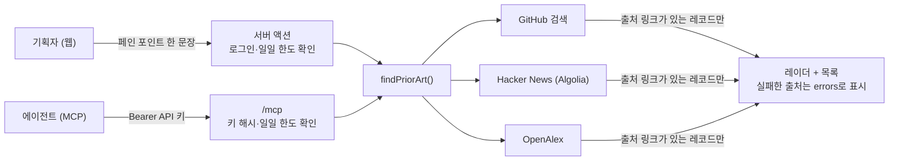

# Pain Radar

- 작성자: @Woo-Yeol
- 트랙: Auto-Application
- 서비스: https://pain-radar.kro.kr (카카오 로그인, 웹 + 에이전트용 MCP)
- 소스 코드: 비공개 저장소(Woo-Yeol/pain-radar). 이 폴더에는 서비스 소개, 결과 기록, 사용한 스킬만 둡니다.

## 무엇을 하나

서비스 기획자와 AI 에이전트가 **만들기 전에** 이미 있는 것부터 찾게 해 주는 도구입니다. 페인 포인트 한 문장을 넣으면 GitHub 저장소·Hacker News 글(솔루션)과 OpenAlex 논문을 원본 링크와 함께 레이더 화면에 찍어 줍니다.

- 결과는 세 검색 API가 그 자리에서 돌려준 레코드뿐입니다. AI가 결과를 지어내거나 요약하지 않습니다.
- 입력한 문장은 검색 API로 보내는 순간에만 메모리에 있고, DB·로그·분석 이벤트에 남기지 않습니다.
- "만들어라/말아라", 경쟁 점수 같은 결론을 내지 않습니다. 판단은 사람 몫입니다.
- 같은 검색을 에이전트가 MCP 도구 `find_prior_art(pain_point, limit)`로 씁니다. 웹에서 API 키를 발급하면 연결 명령을 바로 복사할 수 있습니다.

## 스택

Next.js 16 App Router(서버 액션, cacheComponents) · Tailwind v4 · Supabase(RLS, security definer RPC, Kakao OAuth) · Vercel(icn1) · mcp-handler.

## 사용한 스킬

이 저장소의 스킬(링크로 재사용, 사본 없음):

| 스킬 | 이 프로젝트에서 한 일 |
| --- | --- |
| [micro-saas-week](../../skills/micro-saas-week/SKILL.md) | 아래 단계 스킬을 순서대로 묶은 주간 조합 |
| [constitution-first](../../skills/constitution-first/SKILL.md) | 헌법 5조(원문 저장 금지, 출처 없는 결과 금지, 결론 금지, 경계에서 검증, 가장 작은 변경)와 MUST NOT 4개 |
| [skeleton-on-prod](../../skills/skeleton-on-prod/SKILL.md) | 첫날 Vercel + 운영 Supabase + 카카오 로그인 골격, 자체 도메인 |
| [launch-basics](../../skills/launch-basics/SKILL.md) | 약관·처리방침, 탈퇴 RPC, error/not-found, HSTS·OG, GA 퍼널 이벤트 5개 |
| [glance-and-guardrails](../../skills/glance-and-guardrails/SKILL.md) | 레이더 한눈 보기, 탈퇴·키 폐기 `<dialog>` 확인, 검색·MCP 일일 한도 RPC |
| [env-split](../../skills/env-split/SKILL.md) | 로컬 Supabase(다른 프로젝트와 포트 분리), `.env.example` |
| [ship-loop](../../skills/ship-loop/SKILL.md) | 이슈 → `NNN-name` 브랜치 → spec → PR(`Closes #N` + Constitution Check) 반복 |
| [micro-saas-audit](../../skills/micro-saas-audit/SKILL.md) | 운영 URL과 레포를 채점: 통과 23 · 실패 1 · 미확인 2 · 해당 없음 8 |
| [design-conductor](../../skills/design-conductor/SKILL.md) | **이번 PR에서 추가.** 디자인 스킬과 Playwright를 정해진 순서로 돌려 전체 화면을 검증·수정 |

`core-feature-with-review`, `model-bakeoff`는 쓰지 않았습니다. 이 서비스에는 AI 출력이 없습니다(한글 번역 AI도 넣지 않기로 결정).

외부 도구(설치해서 사용, 이 저장소에 복사하지 않음):

| 도구 | 쓴 곳 |
| --- | --- |
| [Spec Kitty](https://github.com/spec-kitty/spec-kitty) | 작업마다 `dispatch`로 헌법 맥락을 불러오고 Op 기록을 열고 닫음 |
| [Impeccable](https://github.com/pbakaus/impeccable) | `init`(PRODUCT.md), `detect`(결정적 디자인 규칙), craft floor 체크 |
| [taste-skill](https://github.com/Leonxlnx/taste-skill) · [Emil Kowalski skills](https://github.com/emilkowalski/skills) | design-conductor 안에서 다이얼·모션 품질 기준 |
| [Playwright MCP](https://github.com/microsoft/playwright-mcp) | 390/768/1440px · 라이트/다크 스크린샷, 터치 영역·콘솔 에러 수집 |
| Vercel CLI · Supabase CLI · GitHub CLI | 배포, 마이그레이션, 이슈·PR |

## 결과물

- [Week 02](outputs/week-02/README.md)

> This work was created as part of the No-More-Slops group activities at Pseudo Lab.
