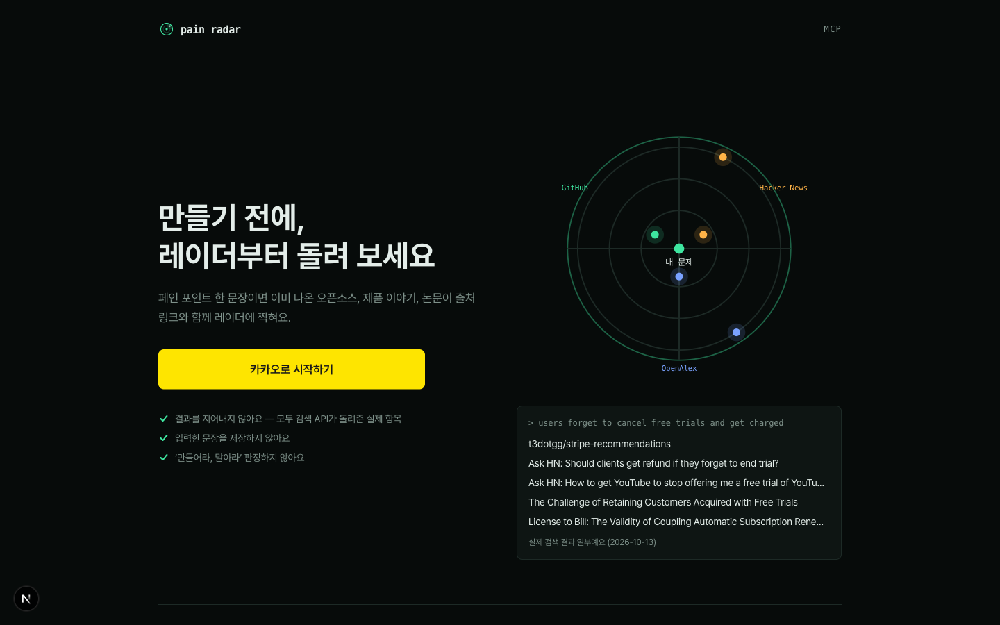
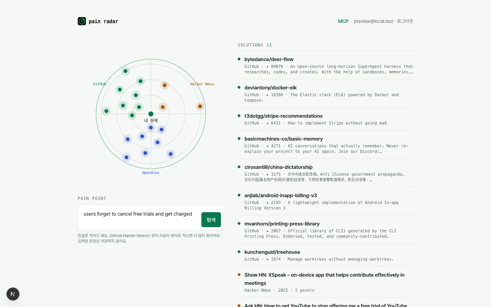
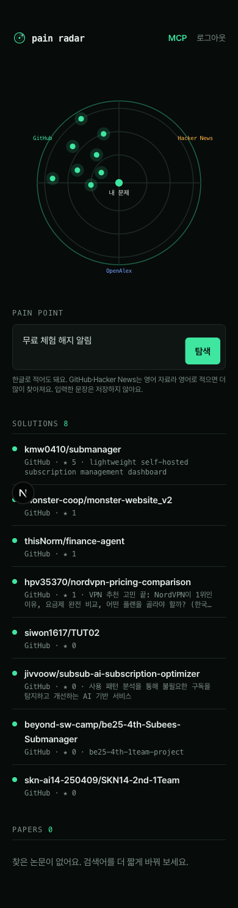
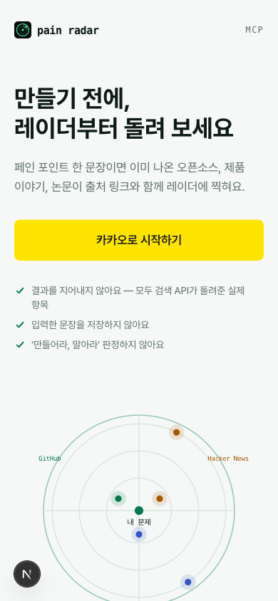
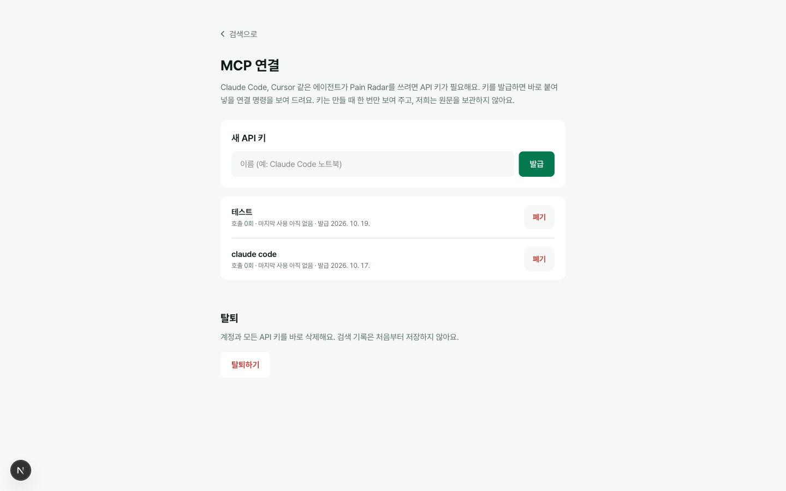

# Week 02 결과물 — Pain Radar

- 작성자: @Woo-Yeol
- 트랙: Auto-Application
- 기간: 2026-10-13 ~ 2026-10-19
- 서비스: https://pain-radar.kro.kr
- 상태: 공개 배포. **제출 시점에 운영 카카오 로그인은 설정 중**(카카오 콘솔 앱 키 확인 중, KOE101). 랜딩·약관·처리방침·`/mcp` 인증 거부는 운영에서 확인했고, 로그인 뒤 화면은 로컬에서 확인했습니다.
- 소스 코드: 비공개 저장소. 이 폴더에는 소개·기록·스크린샷만 둡니다.
- 사용한 스킬: [프로젝트 README](../../README.md#사용한-스킬)

## 화면

랜딩 (다크, 1440px). 실제 검색 결과 일부를 예시로 보여 줍니다.

검색 결과 (라이트, 1440px). 가운데가 내 문제, 가까울수록 그 출처가 먼저 돌려준 결과입니다. 색은 출처(GitHub·Hacker News·OpenAlex)입니다.

| 한글 입력 (다크, 390px) | 랜딩 (라이트, 390px) |
| --- | --- |
|  |  |

MCP 연결 화면. 헤더의 **MCP** 링크로 들어오고, 키를 발급하면 키가 들어간 `claude mcp add` 명령을 바로 복사합니다.

스크린샷은 로컬 dev 서버와 로컬 Supabase 테스트 계정(`preview@local.test`)으로 찍었습니다. 화면 왼쪽 아래 `N` 표시는 Next.js 개발 모드 표시입니다.

## 이번 주에 한 것

| 단계 | 내용 | 스킬 |
| --- | --- | --- |
| 원칙 | 헌법 5조, MUST NOT 4개. 모든 spec과 PR에 Constitution Check | constitution-first |
| 골격 | Vercel + 운영 Supabase + 카카오 OAuth, 도메인 `pain-radar.kro.kr` | skeleton-on-prod |
| 핵심 기능 | 세 출처 병렬 검색, 출처 하나가 실패해도 나머지 결과 + 실패 표시 | ship-loop |
| 에이전트 | `/mcp` 도구 `find_prior_art`, 키 해시 저장, 키당 일일 한도 | glance-and-guardrails |
| 출시 기본 | 약관·처리방침, 탈퇴, error/404, HSTS·OG, GA 퍼널 이벤트 | launch-basics |
| 보안 수정 | 로그인 사용자가 `api_keys.calls_today`를 0으로 되돌려 한도를 우회할 수 있던 문제를 UPDATE 권한 회수로 막음 | ship-loop |
| 평가 | 운영 URL·레포 채점 | micro-saas-audit |
| 디자인 검증 | 전체 화면 2회 검증·수정, 라이트 모드 추가, 앱 아이콘·로고 통일 | design-conductor (+ impeccable, Playwright) |
| 한글 입력 | 번역 AI 없이 한글 단어를 검색어에 남김 | ship-loop |

## 재현 및 검증

날짜는 실제로 실행한 날입니다. 10-17 항목은 디자인 검증 2회차 결과이고 이번 제출 때 다시 돌리지 않았습니다.

| 검사 | 날짜 | 결과 |
| --- | --- | --- |
| `npm test` (검색 로직·키·redirect) | 10-19 | 5개 통과 |
| `npx tsc --noEmit` · `npm run lint` | 10-19 | 통과 |
| 운영 `GET /login`, `/terms`, `/privacy`, `/icon.svg` | 10-19 | 200 |
| 운영 `POST /mcp` 키 없이 | 10-19 | 401 |
| `npx impeccable detect` (소스 + 로컬 `/login`) | 10-19 | 0건 |
| Playwright: 로그인 전·후 6화면 × 라이트/다크, 390·1440px | 10-17 | 44px 미만 터치 영역 0, 콘솔 에러 0, 가로 스크롤 없음 |
| 글자 대비 | 10-17 | 라이트·다크 모두 4.5:1 이상(위험 버튼 2.9:1 → 7.1:1로 수정) |
| micro-saas-audit | 10-17 | 통과 23 · 실패 1 · 미확인 2 · 해당 없음 8 |

미확인:

- 운영 카카오 로그인 전체 흐름. Supabase Kakao provider는 켰고, 카카오 콘솔 앱 키(REST API 키) 확인이 남았습니다.
- GA 실제 수집(운영 `NEXT_PUBLIC_GA_ID` 미설정).
- 실제 휴대폰 확인(브라우저 390px 에뮬레이션만).
- 약관·처리방침 법률 검토.

## 지표

실사용자 모집 전이라 측정 준비 상태입니다.

| 항목 | 값 |
| --- | --- |
| GA 퍼널 이벤트 | `login_click` → `search` → `result_click`, `search_error`, `key_create` (입력 문장은 보내지 않음) |
| 일일 한도 | 사용자당 검색 100회, API 키당 MCP 호출 100회 (UTC 기준, 임시값) |
| 한글 입력 실측 ("무료 체험 해지") | OpenAlex 4 · GitHub 70 · Hacker News 0 |
| 제작 | 커밋 31 · 머지된 PR 21 · 이슈 23(닫힘 20) · spec 18 · 자동 테스트 5 |

## 레슨런

- **한글은 AI 없이 반만 된다.** 검색어에 한글을 남기니 GitHub는 한국 저장소가 나오지만 Hacker News는 0건입니다. 번역 AI를 넣으면 헌법상 "번역·키워드 추출까지만"이라는 경계와 비용 상한을 같이 정해야 해서 이번 주에는 넣지 않았습니다.
- **별점 정렬은 관련 없는 인기 저장소를 끌어온다.** GitHub를 `sort=stars`로 받으니 검색어와 관계가 약한 대형 저장소가 위에 옵니다(결과 스크린샷 참고). 다음 주에 기본 정렬(best match)과 비교합니다.
- **로컬 Supabase가 여러 개면 포트를 이름처럼 다뤄야 한다.** 다른 프로젝트(543xx)와 분리해 544xx를 썼는데, 검증 중 한 번 다른 프로젝트 포트로 요청해 엉뚱한 DB에 테스트 계정을 만들었습니다. env-split 스킬에 "요청 전 포트와 프로젝트 이름 확인"을 넣을 계획입니다.
- **디자인 검증은 로그인 뒤 화면까지 가야 의미가 있다.** 로컬 테스트 계정으로 세션을 만들어 검색 결과·설정·탈퇴 확인창까지 찍은 뒤에야 터치 영역 12곳, 폰 헤더 넘침, 위험 버튼 대비 문제가 보였습니다.
- **GitHub 연결 없는 수동 배포는 PR 머지와 배포가 따로 논다.** Vercel에 GitHub 로그인 연결이 없어 `vercel deploy --prod`를 손으로 돌렸고, CLI 첫 시도가 "Not authorized"로 실패하는 일이 반복됐습니다.

## 동료에게 요청하는 검토

- 검색 결과 품질: 각자 페인 포인트 하나로 검색해 보고, 상위 5개 중 관련 있는 개수를 알려 주세요.
- MCP 연결: Claude Code나 Cursor에 붙여 `find_prior_art`가 동작하는지(운영 로그인 설정 후).
- [design-conductor](../../../../skills/design-conductor/SKILL.md): 다른 웹 서비스에 돌렸을 때 단계나 충돌 규칙에서 막히는 곳.

> This work was created as part of the No-More-Slops group activities at Pseudo Lab.
