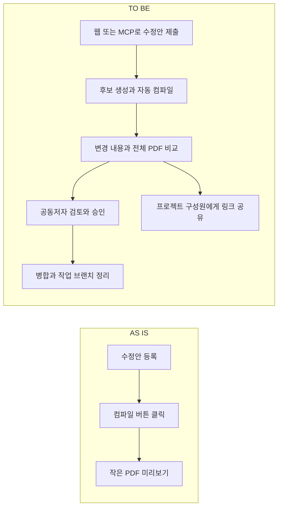
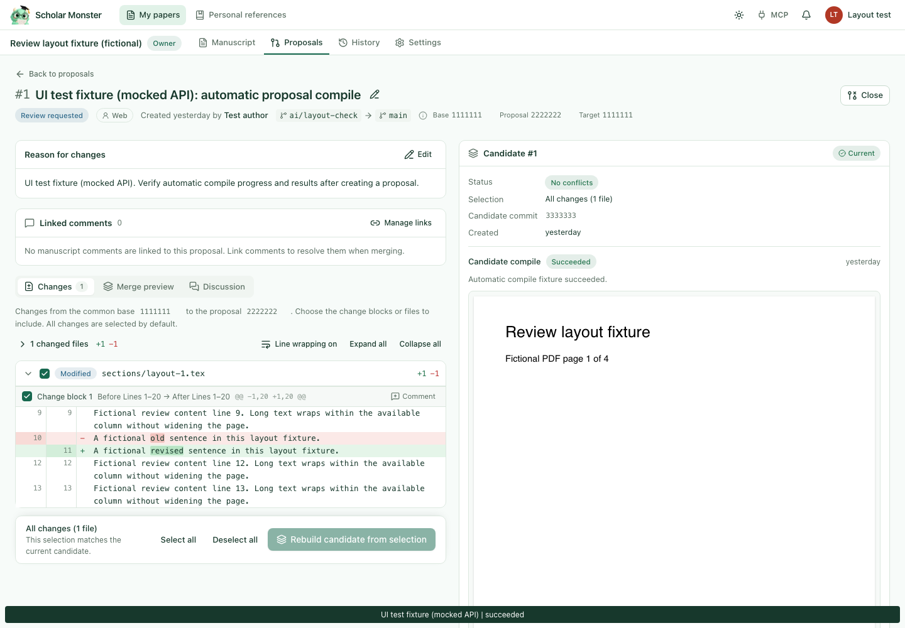
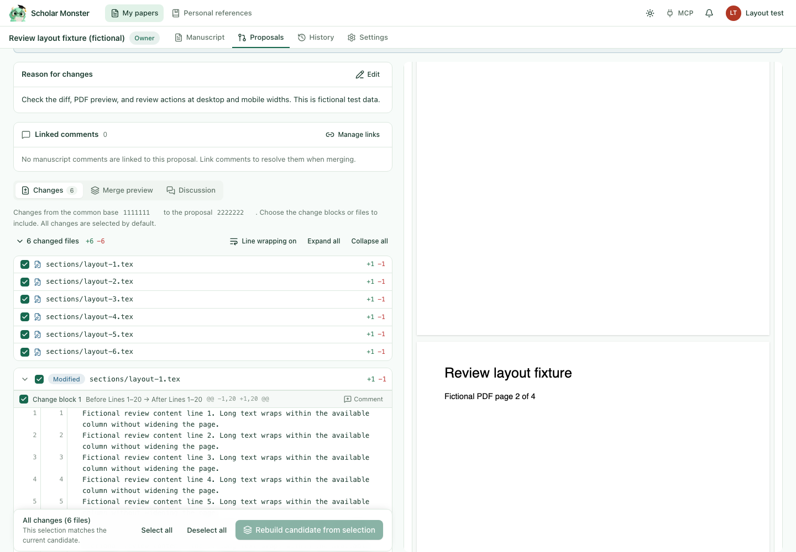
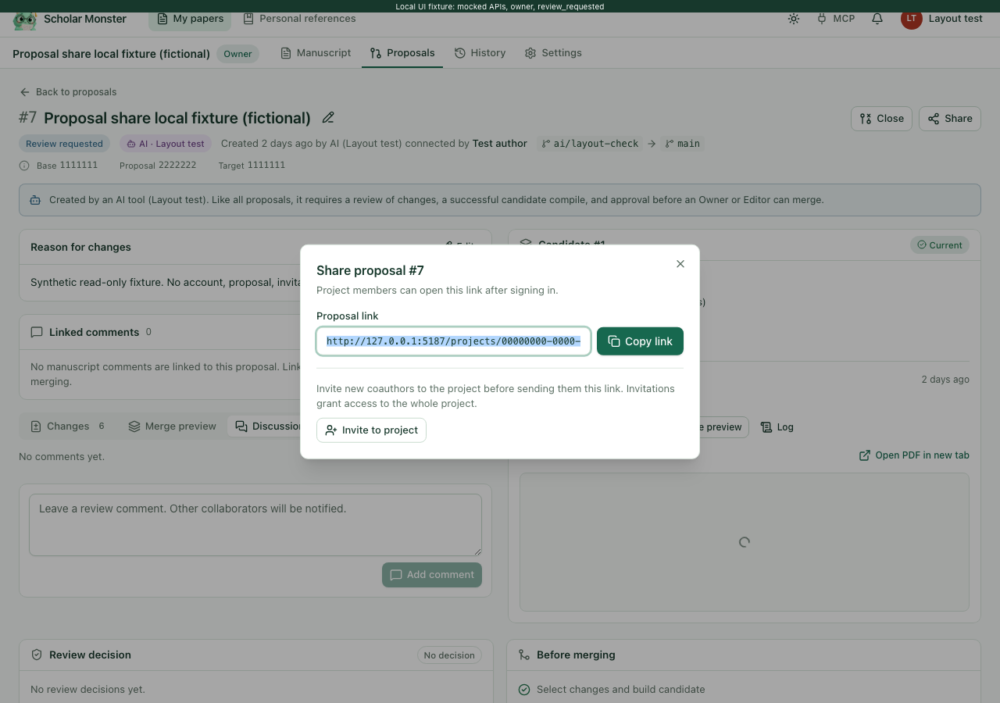

# Week 03: Scholar Monster

- 작성자: [@gogoymh](https://github.com/gogoymh)
- 트랙: Auto-Application
- 제출 기준일: 2026-10-26 (한국시간)
- 결과물: [운영 서비스](https://scholarmonster.com/), [프로젝트 소개](../../README.md), [검증 요약](verification-summary.json)
- 상태: 아래 구현 항목은 운영 배포를 마쳤습니다. 최신 Proposal 공유 기능은 2026-10-26 11:26 KST에 배포했습니다.
- 접근 조건: 서비스 소개는 공개이며, 원고와 Proposal은 로그인과 프로젝트 권한이 필요합니다. 개발 소스는 비공개입니다.

연구자가 AI의 논문 수정안을 받더라도 변경된 원고가 실제로 컴파일되는지, PDF에서 무엇이 바뀌었는지 확인하기 어려웠습니다. 이번 주에는 수정안 등록부터 컴파일, 공동 검토, 병합과 공유까지 이어지는 사용 흐름을 만들고 사용자 제보를 반영했습니다.

## AS IS / TO BE

| 사용자가 하려던 일 | AS IS | TO BE |
| --- | --- | --- |
| 수정안의 컴파일 결과 확인 | Proposal을 올린 뒤 컴파일을 따로 클릭 | 웹 등록, 변경 저장, MCP 제출 후 후보를 만들고 자동 컴파일 |
| 변경 내용과 논문 비교 | 작은 미리보기와 첫 페이지만 확인 | 같은 폭의 두 컬럼에서 변경 내용과 전체 PDF를 스크롤하며 비교 |
| PDF를 넓게 보기 | Candidate 정보가 고정되어 PDF 공간을 차지 | 오른쪽 정보와 PDF가 함께 스크롤되어 논문을 더 넓게 표시 |
| 작성자의 활동 확인 | 본인 Proposal 활동의 알림과 이메일이 제외 | 작성자도 알림과 이메일 대상에 포함 |
| arXiv 업로드 준비 | 필요한 소스 파일을 직접 정리 | 저장된 성공 컴파일의 입력 파일과 생성 파일을 ZIP으로 패키징 |
| 병합 뒤 브랜치 정리 | 병합된 작업 브랜치가 활성 목록에 남음 | 원본 커밋과 과거 결과를 보관하고 병합 브랜치를 활성 목록에서 제거 |
| 개발자에게 기능 요청 | 요청을 남길 MCP 도구가 없음 | submit_development_request로 접수하고 관리자 목록과 이메일 작업 생성 |
| 특정 Proposal 공유 | 브라우저 주소를 직접 복사 | Share → Copy link, 프로젝트 초대 바로가기 |

다음은 구현한 사용 흐름을 설명하는 도식입니다. 화면 캡처나 자동 승인 절차를 뜻하지 않습니다.



## 기능 화면

아래 세 이미지는 실제 Chromium에서 합성 논문과 모의 API로 확인한 **로컬 UI 검증 화면**입니다. 운영 화면이나 실제 사용자의 논문이 아니며, 각 이미지에는 테스트용 표기가 있습니다. 기능 개발 시점별 화면이므로 모든 이미지가 최신 화면을 나타내지는 않습니다.

자동 컴파일 결과와 변경 내용, PDF를 함께 표시합니다.



PDF 위 정보 영역까지 함께 스크롤한 뒤 두 번째 페이지를 확인한 화면입니다. 원고의 모든 페이지를 이어서 볼 수 있습니다.



Share에서 Proposal 링크를 복사합니다. 초대 바로가기는 Owner와 Editor에게 표시되며, 초대 권한은 프로젝트 전체에 적용됩니다.



## 제작과 배포 절차

1. 사용자 제보에서 막힌 동작을 찾고, 화면과 서버 권한을 함께 확인했습니다. 예를 들어 공유 버튼을 추가해도 비공개 Proposal을 누구나 열도록 접근 권한을 넓히지 않았습니다.
2. Codex 협업 에이전트로 구현과 별개인 코드 리뷰, 합성 데이터 브라우저 검증, 배포 검사를 진행했습니다. 결과를 모의 UI, 격리된 통합 검사, 운영 확인으로 구분했습니다.
3. 변경 범위에 맞는 기존 검사와 빌드를 실행했습니다. 외부 이메일이나 운영 계정이 필요한 검사는 실제 발송과 테스트 데이터 생성을 구분했습니다.
4. 서비스 변경은 squash 병합하고 작업 브랜치를 삭제했습니다. 이 제출 PR은 서비스 개발 PR과 별개로 리뷰를 받습니다.
5. 최신 화면 변경은 웹 이미지 하나만 교체했습니다. 배포 전 소스 버전, 기존 Compose 설정, API와 migrate 이미지 고정값을 확인하고 공통 배포 잠금과 변경 여부 검사를 거쳤습니다. 실패 시 원래 웹 이미지와 설정을 복구하도록 준비했습니다.
6. 배포 후 상태 확인과 공개 파일 비교를 실행했습니다. 코드 병합, 이미지 빌드, 운영 교체, 공개 응답 확인을 각각 완료 상태로 기록했습니다.

이번에 추가하거나 수정한 저장소 스킬은 없습니다. 위 절차는 개발 과정에서 실행한 작업의 기록이며, 새 SKILL.md나 범용 배포 도구를 제출한 것은 아닙니다.

## 검증과 재현

### 기능 개발 과정에서 실행한 검사

다음 수치는 비공개 개발 저장소와 보관된 검증 기록을 대조한 요약입니다. 이번 제출 브랜치에는 서비스 실행 코드가 없으므로 독자가 이 저장소에서 동일한 검사를 실행할 수는 없습니다. PR마다 반복한 테스트를 더해 누적 독립 테스트 수로 계산하지 않았습니다.

| 범위 | 실제 결과 | 해석 범위 |
| --- | --- | --- |
| 수익화 설정 구조 변경 | API 단위 276개, 격리 DB 211개, 웹 38개, 총 525개 통과 | 광고, 결제 승인이나 실제 유료 결제를 검증한 수치가 아님 |
| 최신 Proposal 공유 변경 | 웹 38개, TypeScript 검사, 운영 빌드 통과 | 서비스 개발 과정에서 실행했으며 제출 시 전체 서비스를 다시 시험하지 않음 |
| 공유 UI | Chromium 16그룹 통과 | Owner/Editor/Viewer와 열림/닫힘/병합 상태, 복사 성공/대체 경로/실패, 초대 이동, 320px와 390px, 키보드 조작을 합성 데이터로 확인 |
| 웹 배포 절차 | 15개 검사 그룹 통과 | 소스 버전, 배포 잠금, 설정 변경 여부, 중단 복구와 실패 후 롤백 경로 |
| 최신 운영 배포 | 공개 파일 108개가 실행 이미지와 일치, 상태 확인 통과 | 운영 웹 교체 확인. 다른 10개 서비스의 컨테이너, 이미지와 환경 값 유지 |
| arXiv ZIP | 영어 pdfLaTeX 3페이지와 한국어 XeLaTeX 2페이지를 ZIP만으로 재컴파일 | 원본과 페이지 수와 전체 추출 텍스트 일치. arXiv 실제 제출이나 심사 검증은 아님 |

서비스에서 동작을 확인하려면 본인에게 권한이 있는 프로젝트에 테스트 원고로 Proposal을 등록하고, 자동 컴파일 상태와 PDF 전체 스크롤을 확인합니다. Share에서 복사한 링크를 프로젝트 구성원 계정으로 열어볼 수 있습니다. 다른 사람의 원고를 테스트에 사용하거나 공개 권한을 만들 필요는 없습니다.

### 이 제출에서 다시 실행한 검사

문서 경로, 프로젝트와 주차 README, 로컬 이미지 보존, 검증 요약 JSON과 링크를 확인했습니다. 저장소의 기존 구조 검사와 테스트를 다음 명령으로 실행했습니다.

```sh
python3 scripts/check_repository.py
python3 -B -m unittest discover -s scripts -p 'test_check_repository.py' -v
git diff --check
```

구조 검사는 375개 파일과 36개 스킬에서 오류 0개, 기존 규칙 테스트는 8개 통과였습니다. 상대 링크 8개와 검증 JSON의 수치 합계를 확인했고, 이미지 3개는 공개 전 검토한 원본과 바이트 단위로 일치했습니다. 서비스 홈은 HTTP 200을 반환했습니다. 서비스 코드 검사를 다시 실행한 결과는 아닙니다.

## 운영 상태와 미확인 범위

| 항목 | 제출 당시 상태 | 남은 확인 |
| --- | --- | --- |
| Proposal 자동 컴파일, PDF 검토, 공유와 알림 | 운영 배포 완료 | 실제 수신함 도착률과 스팸 분류 방지는 미검증 |
| arXiv ZIP | 구현과 재컴파일 확인 완료 | 사용자가 arXiv 업로드. 자동 제출 기능은 없음 |
| MCP 초록 점 | 최근 15분의 인증된 MCP 사용 기록을 설명 | 실시간 연결 상태나 도구 실행 성공을 나타내지는 않음 |
| 검색 노출 | Google, Bing, 네이버 소유권 확인과 사이트맵 등록 완료 | 검색 순위와 향후 색인 노출은 미검증 |
| Google AdSense | 사이트 확인과 심사 요청 완료, 광고 비활성 | 승인 대기 |
| Lemon Squeezy | 판매 신청 접수, 본인 인증 In Review | 승인 대기 |
| Basic, Standard, Premium 결제 | 설정 구조 준비, 가격 미정, checkout 비활성 | 가격 확정과 결제 연동 |
| 계정별 MCP 호출 제한 | 일/월 사용량과 한도 설정 구조 준비, 강제 제한 비활성 | 레벨별 수치 확정 |
| Acknowledgement | 제출 문서와 프로젝트 소개에 표기 | 운영 웹 화면의 소개/크레딧 표기는 아직 반영하지 않음 |

## 지표와 레슨런

활성 사용자 수, 유지율, 결제 전환율을 집계한 자료는 이번 제출에 없습니다. 배포와 합성 UI 검증 수치는 실제 사용자 성과와 구분했습니다.

- 컴파일 성공만으로 검토 기능이 완성되지는 않았습니다. 전체 PDF와 변경 내용을 동시에 읽고 스크롤할 수 있어야 사용자가 수정안을 판단할 수 있었습니다.
- 알림 생성과 이메일 수신은 별개입니다. 작성자 수신 정책을 고쳤어도 실제 메일의 스팸 분류는 따로 확인해야 합니다.
- 외부 심사 접수와 승인, 결제 설정과 실제 과금은 다른 상태로 기록해야 했습니다.
- 같은 Compose 환경에서 웹만 배포해도 기존 API와 migrate 이미지 설정을 빠뜨리면 다른 서비스가 이전 버전으로 돌아갈 수 있습니다. 웹 이미지 교체 전후의 전체 설정과 실행 상태를 비교했습니다.

동료에게는 두 컬럼과 전체 PDF 스크롤이 논문 검토에 충분한지, 프로젝트 단위 공유 안내가 명확한지, 작성자를 포함한 알림 정책이 적절한지 검토를 요청합니다.

## Acknowledgement

이 결과물은 가짜연구소(Pseudo Lab) No-More-Slops 그룹 활동의 일환으로 제작되었습니다.
