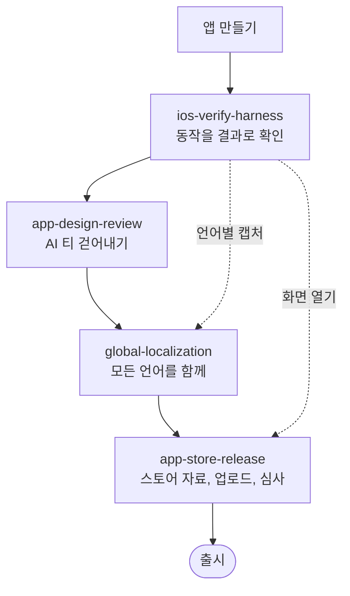
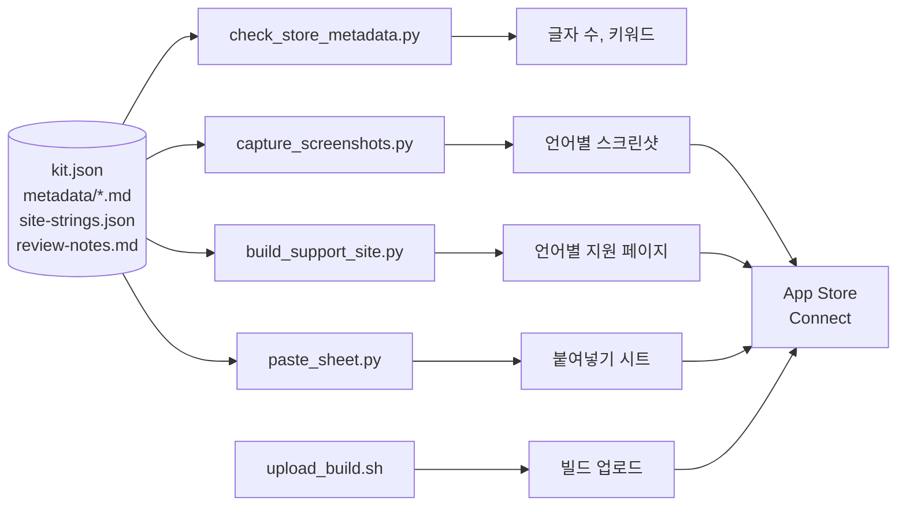
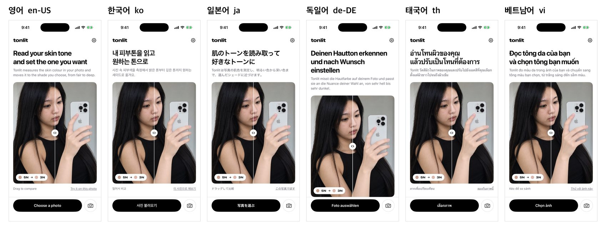
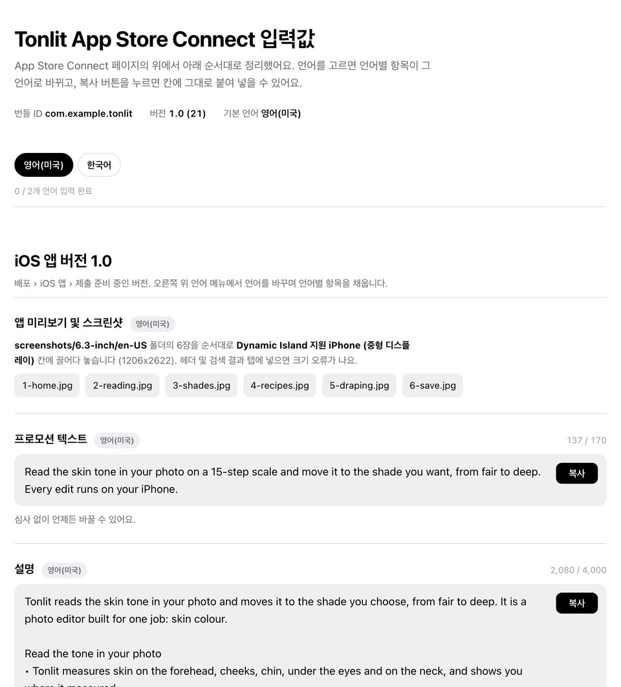
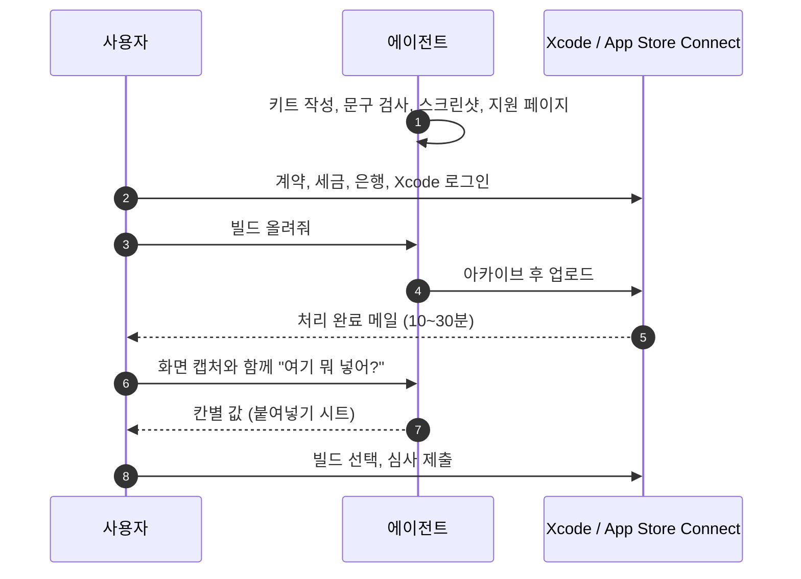
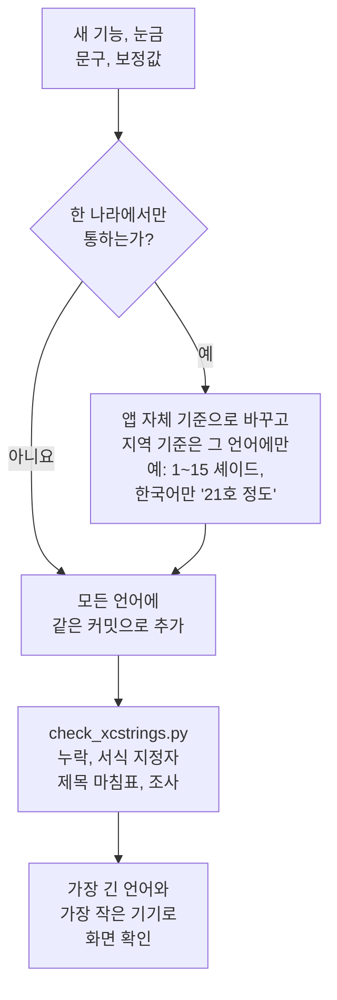
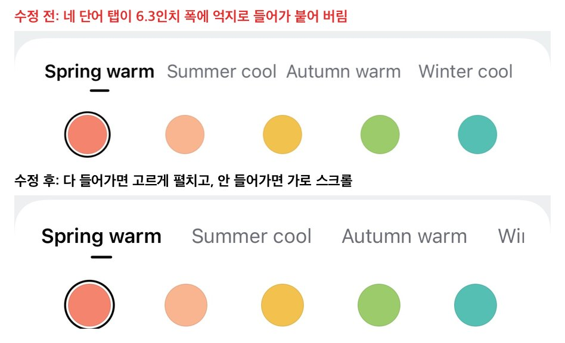
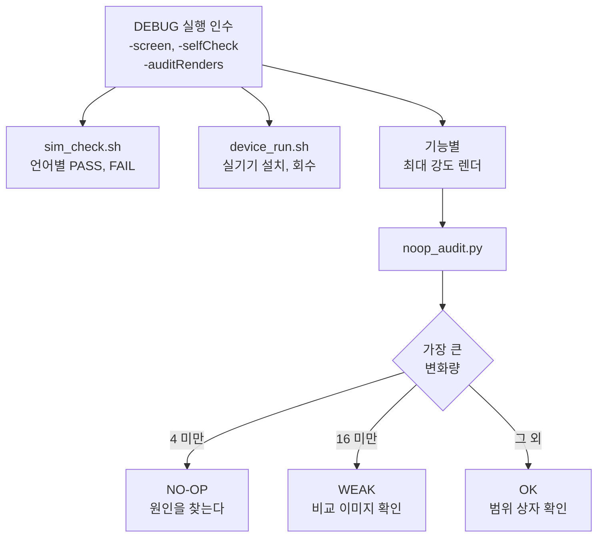
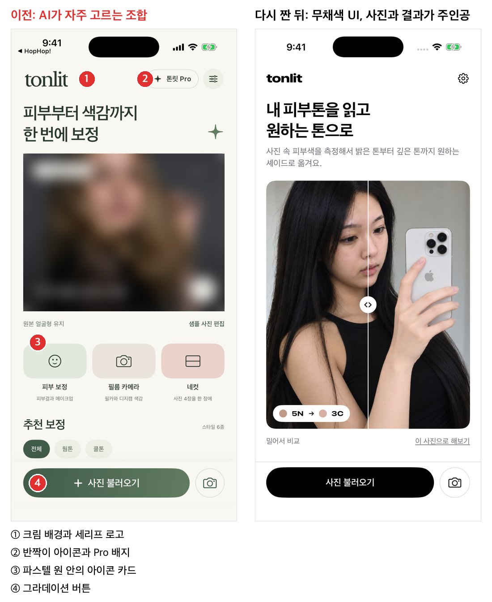
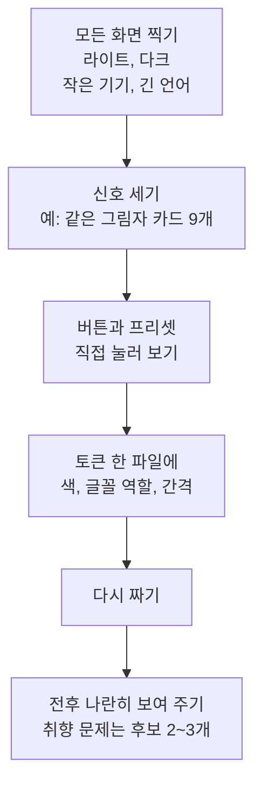

# Tonlit 출시에서 뽑은 iOS 앱 출시 스킬 4종

- **작성자**: [gogoymh](https://github.com/gogoymh)
- **제출 PR**: [#7](https://github.com/Pseudo-Lab/no-more-slops/pull/7)
- **결과물 위치**: [outputs/week-01/](outputs/week-01/README.md)
- **트랙**: Auto-Application

Tonlit은 피부톤 보정 iOS 앱입니다. 유료이고 12개 언어를 지원하며, 2026-10-11에 App Store 심사에 제출했습니다. 만들고 제출하는 동안 반복해서 요청한 일을 다음 앱에서 그대로 쓸 수 있게 스킬 4개와 스크립트로 묶었습니다. 앱 이름·언어·연락처는 작업할 때마다 넣는 값이라, 스킬에 Tonlit 전용 기본값은 없습니다.

### 앱 하나를 출시할 때 각 스킬이 맡는 단계



| 스킬 | 하는 일 | 계기가 된 요청 |
|---|---|---|
| [app-store-release](../../skills/app-store-release/SKILL.md) | 설정 파일 하나(`kit.json`)로 스토어 자료를 만들고 App Store Connect 화면을 칸별로 안내 | "출시 준비 마쳐줘", "여기 뭐라고 넣어", "언어별로 html·이미지 다 맞춰줘", "빌드 업로드 해줘" |
| [global-localization](../../skills/global-localization/SKILL.md) | 한 나라 기준이 기본값으로 굳지 않게 하고, 모든 언어를 같은 변경 안에서 채움. 문자열 카탈로그 검사기 포함 | "왜 꼭 한국인 기준이냐? 글로벌로 판매할건데" |
| [ios-verify-harness](../../skills/ios-verify-harness/SKILL.md) | 모든 화면을 실행 인수로 열고, 앱 안 자가 점검과 기능별 무변화 감사, 실기기 설치를 자동화 | "디테일 요소들 동작하는지 다 점검해줘", "내 아이폰에 설치해볼래?" |
| [app-design-review](../../skills/app-design-review/SKILL.md) | AI가 만든 티가 나는 화면 신호를 세고, 토큰부터 다시 짜고, 눌렀을 때 결과가 보이게 함 | "바이브코딩으로 만든 어설픈 느낌", "추천 보정은 티가 안 나" |

---

### 1. app-store-release: 키트 하나에서 스토어 자료까지



같은 홈 화면을 6개 언어로 찍은 결과입니다(`capture_screenshots.py`, 실제 Tonlit 제출본).



붙여넣기 시트입니다. 언어를 고르면 이름·설명·키워드·URL이 그 언어로 바뀌고, 칸마다 복사 버튼과 글자 수가 있습니다.



누가 무엇을 하는지도 나눠 두었습니다. 로그인, 계약, 심사 제출 버튼은 사용자 몫이고, 에이전트는 요청을 받았을 때만 사이트를 푸시하고 빌드를 올립니다.



### 2. global-localization: 모든 언어를 같은 무게로



검사기가 잡는 것(예시 카탈로그로 실행한 실제 출력):

```
$ python3 check_xcstrings.py Localizable.xcstrings --brand 톤릿 --titles titles.txt --only-in 'ko:호'
FAIL Localizable.xcstrings [ko] format specifiers [] vs ['%@']: Open %@
FAIL Localizable.xcstrings [ko] Korean particle after brand: 톤릿를 in '톤릿를 열어요'
FAIL Localizable.xcstrings [ja] title ends with punctuation: 保存した写真。
FAIL Localizable.xcstrings [ja] '호' outside ko: シェード %lld (21호)
FAIL Localizable.xcstrings [ja] missing: Share
```

긴 언어에서 깨지는 화면은 이렇게 고쳤고, 고치는 법과 SwiftUI 코드를 [layout.md](../../skills/global-localization/references/layout.md)에 남겼습니다.



### 3. ios-verify-harness: "동작한다"를 결과로 확인



변화량은 0~255 단위로, 바뀐 픽셀 중 상위 0.01%의 값입니다. 바뀐 픽셀이 0.05% 미만이어도 WEAK로 봅니다. 아래는 Tonlit의 예전 감사 라운드 렌더에 돌린 결과입니다. 팔 도구는 팔 둘레를 바꿨고, 코 도구는 아무것도 바꾸지 않았고, 언더톤은 바뀌었지만 폰에서 보기 어려운 수준입니다.


### 4. app-design-review: AI 티 걷어내기

왼쪽은 처음 만든 Tonlit 홈, 오른쪽은 다시 짠 홈입니다(왼쪽 사진은 흐리게 처리). 번호가 [slop-tells.md](../../skills/app-design-review/references/slop-tells.md)에 정리한 신호입니다.





조작 규칙은 사용자 피드백에서 나왔습니다([interaction-honesty.md](../../skills/app-design-review/references/interaction-honesty.md)).

| 피드백 | 규칙 |
|---|---|
| "추천 보정은 뭘 했다는 건지 티가 안 나" | 눈에 보일 만큼 바꾸고, 바꾼 내용을 짧게 말한다 |
| "또 누르면 진동만 울리고 변화가 없어" | 두 번째 탭은 되돌리기. 상태를 버튼 모양으로 보여 준다 |
| "동그라미가 뭐 하는 건지 모르겠어" | 새로 나타나는 표시는 잠깐 뜨는 설명과 함께 |
| "공유 버튼은 없는 게 낫겠어" | 요청하지 않은 출구는 붙이지 않는다 |

---

### 제작 코드

`tracks/auto-application/skills/<스킬>/`마다 다음이 들어 있습니다. 스킬을 복사하지 않고 이 경로를 원본으로 참조합니다.
- `SKILL.md`, `references/`, `assets/`(미리보기 그림)
- `scripts/`: Python 표준 라이브러리와 bash. `noop_audit.py`만 Pillow를 씁니다.
- `tests/`, `agents/openai.yaml`, `LICENSE`

### 재현 방법

```sh
# 저장소 루트에서 실행
# 설치
for s in app-store-release global-localization ios-verify-harness app-design-review; do
  cp -R tracks/auto-application/skills/$s "$HOME/.agents/skills/"   # Codex
  cp -R tracks/auto-application/skills/$s "$HOME/.claude/skills/"   # Claude Code
done

# 테스트 28개
python3 tracks/auto-application/skills/app-store-release/tests/test_release_kit.py
python3 tracks/auto-application/skills/global-localization/tests/test_check_xcstrings.py
python3 tracks/auto-application/skills/ios-verify-harness/tests/test_harness.py   # Pillow 필요

# 예시 키트(Tonlit 영어·한국어)로 돌려 보기
cp -R tracks/auto-application/skills/app-store-release/references/example /tmp/kit
python3 tracks/auto-application/skills/app-store-release/scripts/check_store_metadata.py /tmp/kit/kit.json
python3 tracks/auto-application/skills/app-store-release/scripts/build_support_site.py build /tmp/kit/kit.json
python3 tracks/auto-application/skills/app-store-release/scripts/paste_sheet.py /tmp/kit/kit.json   # /tmp/kit/paste-sheet.html
```

### 지표

Tonlit 1.0(빌드 21) 제출 기준입니다.

| 항목 | 값 |
|---|---|
| 스토어 언어 | 12개. 새 `check_store_metadata.py`로 다시 검사해 모두 PASS |
| 스크린샷 | 72장(12개 언어 × 6장), 모두 1206×2622 |
| 지원·개인정보·소개 페이지 | 36개. 게시 후 모두 200, 올바른 `lang`, 문의 이메일 포함 |
| 문자열 카탈로그 | 336개 문자열 × 11개 언어, `check_xcstrings.py` PASS |
| 무변화 감사 | 예전 감사 라운드의 도구 렌더 24개에서 NO-OP 1개(코), WEAK 8개를 골라냄 |
| 스크립트 실사용 | `capture_screenshots.py`로 Tonlit 시뮬레이터 캡처 2장(1206×2622) 확인. `upload_build.sh`는 빌드 21을 올릴 때 쓴 명령(Release 아카이브, `xcodebuild -exportArchive`, destination upload)을 옮긴 것이고, 스크립트 자체는 dry run으로만 확인 |

다음 앱에서 잴 지표: 키트 작성부터 심사 제출까지 걸린 시간, App Store Connect 화면에서 막혀 물어본 횟수, 심사 거절 횟수.

### 리뷰 요청

- 다른 iOS 앱 저장소에 키트를 만들었을 때 스크립트가 그대로 도는지
- `references/app-store-connect.md`가 지금 보이는 App Store Connect 화면과 맞는지(화면이 바뀌었으면 고쳐 주세요)
- Android·웹 앱이면 무엇을 따로 만들어야 하는지

원본 제출 당시에는 진행 중인 instagram-content 작업과 겹치지 않도록 루트 README의 "제작 스킬" 표를 수정하지 않았습니다. 현재 제출 경로와 스킬 역할은 이 프로젝트 README와 트랙 카탈로그에서 관리합니다.

이 결과물은 가짜연구소(Pseudo Lab) No-More-Slops 그룹 활동의 일환으로 제작되었습니다.

🤖 Generated with [Claude Code](https://claude.com/claude-code)
