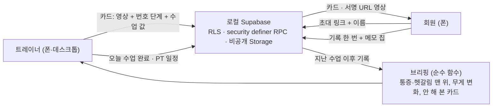

# with trainer

- 작성자: @Woo-Yeol
- 트랙: Auto-Application
- 서비스: 로컬 전용(운영 배포 없음). 트레이너와 회원이 같은 웹을 역할별로 씁니다.
- 소스 코드: 비공개 저장소(Woo-Yeol/with-trainer). 이 폴더에는 서비스 소개, 결과 기록, 사용한 스킬만 둡니다.

## 무엇을 하나

한국의 첫 PT 회원과 트레이너가 **같이 쓰는 기록장**입니다. 트레이너는 수업 뒤 자세 영상 한 개와 "기억할 것" 몇 줄을 카드로 보내고, 회원은 혼자 운동할 때 그 카드를 다시 보고 "기록" 한 번으로 남깁니다. 트레이너는 다음 수업 전에 회원이 혼자 한 운동과 "통증이 있었어요" 같은 메모를 한 화면(브리핑)으로 읽습니다.

- 로그인이 없습니다. 기기의 익명 세션이 신원이고, 회원은 트레이너의 초대 링크에 이름 하나만 넣어 연결됩니다.
- 트레이너가 카톡으로 보내던 글을 그대로 붙여 넣으면 첫 줄은 운동 이름, 나머지는 번호 단계가 됩니다. 실제 카톡 예시 1건(영상 47초 + 번호 단계 5개)을 받아 기능을 맞췄습니다.
- 수업 중에는 앱을 쓰지 않습니다. 트레이너가 "오늘 수업 완료"를 누른 시각부터 다음 브리핑이 쌓입니다.
- PT 일정은 트레이너가 잡고(한 번 / 4주 / 8주 반복) 회원은 다음 수업만 봅니다.
- 과금은 트레이너가 회원 수 구간으로 내는 구조로 정했지만, 국내 PT 앱이 왜 무료인지 조사한 뒤 결제와 요금 화면은 보류했습니다.

## 스택

Next.js 16 App Router(cacheComponents) · Tailwind v4 · Supabase 로컬(익명 세션, RLS, security definer RPC, 비공개 Storage 버킷) · Playwright(2기기 E2E·스크린샷). 운영 배포, 로그인, 결제는 없습니다.

## 사용한 스킬

이 저장소의 스킬(링크로 재사용, 사본 없음):

| 스킬 | 이 프로젝트에서 한 일 |
| --- | --- |
| [constitution-first](../../skills/constitution-first/SKILL.md) | 원칙 5개와 "4주차 소유자 결정" 절. 결정이 닫힐 때마다 이 절에 한 줄씩 추가 |
| [decision-log](../../skills/decision-log/SKILL.md) | **이번 PR에서 추가.** 소유자가 자리를 비운 사이 정하지 못한 것 16개를 문서 한 장에 모으고, 돌아온 뒤 12개를 닫음 |
| [env-split](../../skills/env-split/SKILL.md) | 로컬 Supabase 포트를 다른 프로젝트(543xx·544xx·545xx)와 분리한 546xx, `.env.example` |
| [glance-and-guardrails](../../skills/glance-and-guardrails/SKILL.md) | 브리핑 한눈 보기, 카드·일정 삭제 `<dialog>` 확인 |
| [design-conductor](../../skills/design-conductor/SKILL.md) | 390·768·1440px 라이트/다크 스크린샷을 직접 보고 고침. 모바일과 데스크톱 레이아웃 분리 |

`micro-saas-week`의 배포·로그인·결제 단계(skeleton-on-prod, launch-basics, core-feature-with-review, model-bakeoff)는 이번 주 범위(로컬 전용, AI 출력 없음)에 없어 쓰지 않았습니다.

외부 도구(설치해서 사용, 이 저장소에 복사하지 않음):

| 도구 | 쓴 곳 |
| --- | --- |
| [Emil Kowalski skills](https://github.com/emilkowalski/skills) | 모션을 넣을 곳과 뺄 곳 고르기(진행 바·저장 링·스테퍼 틱은 넣고, 숫자 카운트업·목록 순차 입장은 뺌) |
| [Ponytail](https://github.com/pstorie/ponytail) | diff 리뷰로 과잉 설계·빠진 테스트 확인 |
| Playwright · Supabase CLI · GitHub CLI | 2기기 E2E, 마이그레이션·시드, 비공개 레포 |

## 결과물

- [Week 04](outputs/week-04/README.md)

> This work was created as part of the No-More-Slops group activities at Pseudo Lab.
