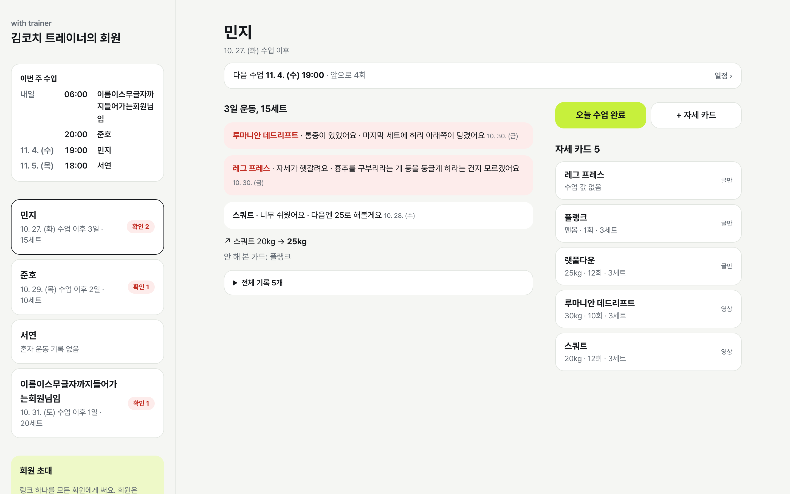
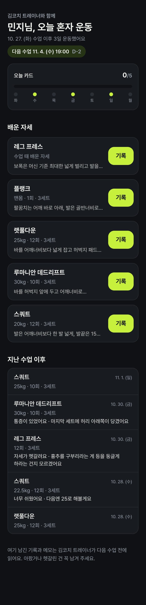
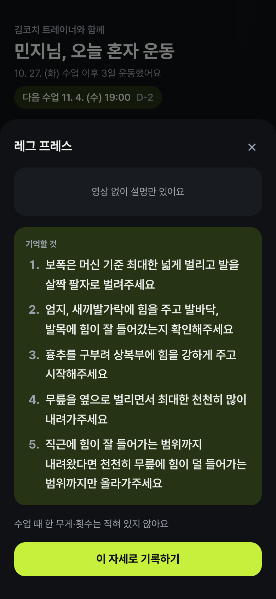
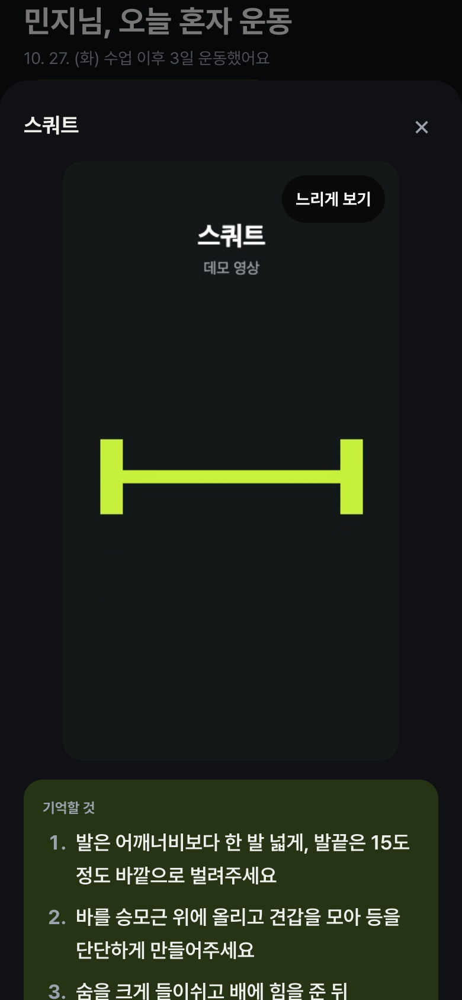
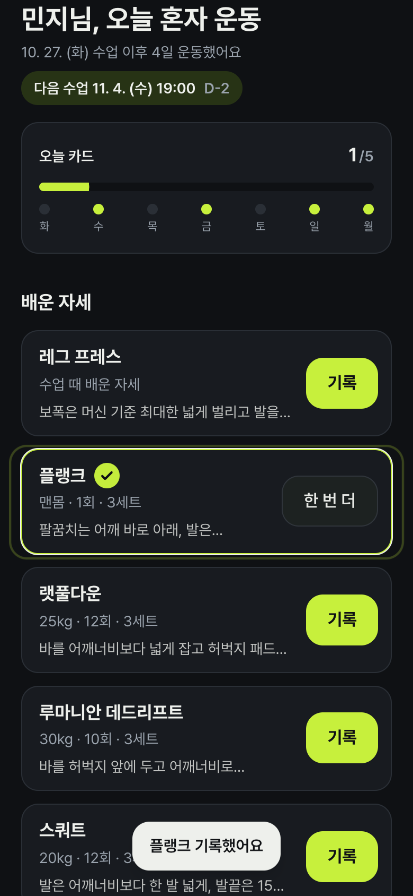
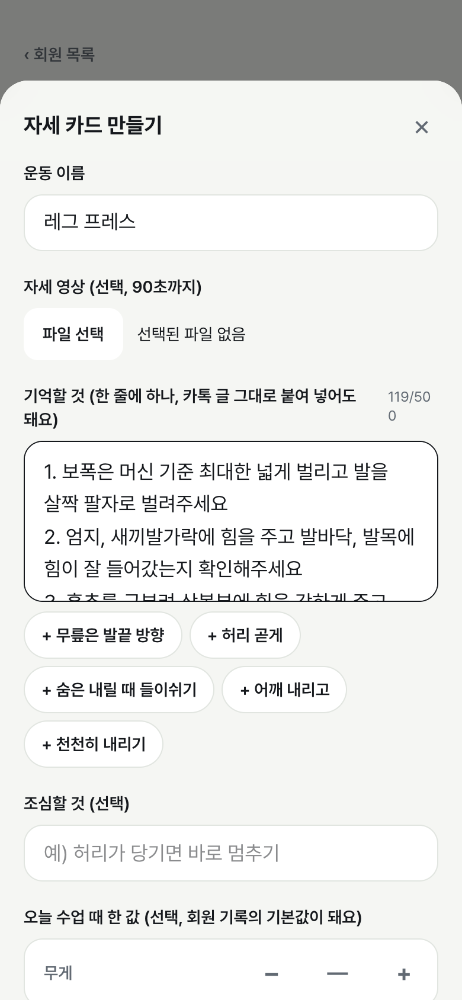
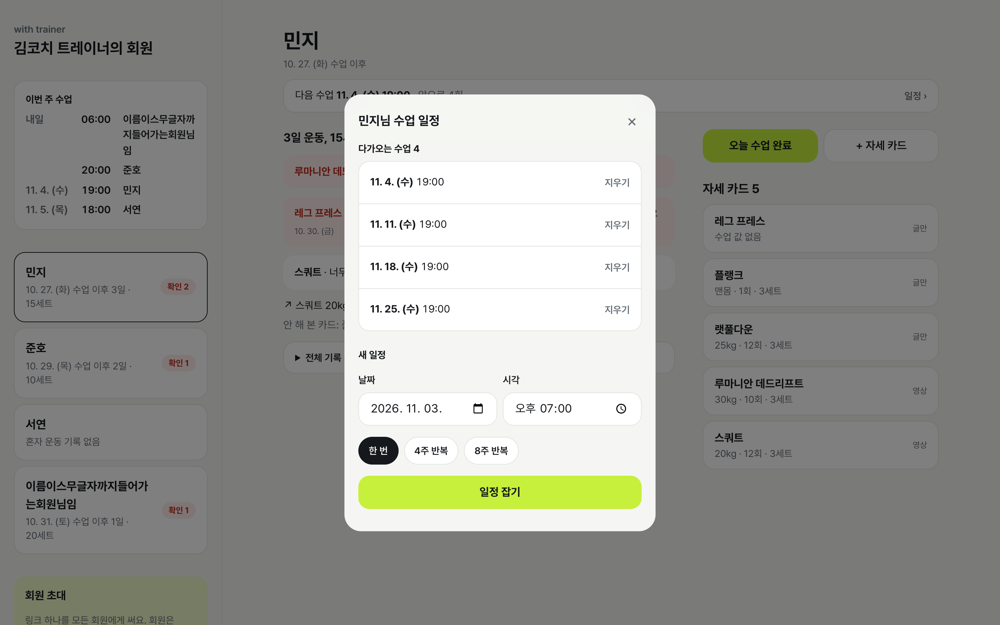

# Week 04 결과물 — with trainer

- 작성자: @Woo-Yeol
- 트랙: Auto-Application
- 기간: 2026-10-27 ~ 2026-11-02 (3주차는 쉬었습니다)
- 서비스: 로컬 전용. 운영 배포·로그인·결제 없음. `npm run seed`로 데모 계정 4명(트레이너 1 + 회원 3)과 카드·기록·일정이 들어갑니다.
- 소스 코드: 비공개 저장소. 이 폴더에는 소개·기록·스크린샷만 둡니다.
- 사용한 스킬: [프로젝트 README](../../README.md#사용한-스킬)

## 화면

트레이너 브리핑 (라이트, 1440px). 왼쪽은 이번 주 수업과 회원 목록, 가운데는 지난 수업 이후 회원이 혼자 한 운동입니다. 통증·헷갈림 메모가 맨 위에 빨갛게 옵니다.

| 회원 홈 (다크, 390px) | 자세 카드 (다크, 390px) |
| --- | --- |
|  |  |

회원 홈 위의 "오늘 카드 0/5"와 지난 7일 점이 운동 자극입니다. 자세 카드는 트레이너가 카톡에 쓰던 번호 단계를 그대로 보여 줍니다(실제 예시 글).

| 영상 보기 · 느리게 보기 (390px) | 기록 저장 순간 (390px) |
| --- | --- |
|  |  |

| 카톡 글 붙여넣기 (390px) | PT 일정 (1440px) |
| --- | --- |
|  |  |

스크린샷은 로컬 dev 서버와 시드 데이터로 찍었습니다. 영상은 캔버스로 만든 데모 클립이고, 실제 트레이너 영상은 개인 자료라 넣지 않았습니다.

## 이번 주에 한 것

| 단계 | 내용 | 스킬 |
| --- | --- | --- |
| 원칙 | 원칙 5개(로그인 없음, 카드 하나 = 운동 하나, 기록 한 번, 수업 전 30초, 경계에서 검증)와 소유자 결정 절 | constitution-first |
| DB | 테이블 6개 전부 RLS, 프로필 생성은 RPC로만, 비공개 Storage 경로 정책. 익명 사용자 4명으로 허용·차단 테스트 | env-split |
| 화면 | 트레이너(목록 → 브리핑 → 카드 만들기), 회원(카드 → 영상 → 기록), 모바일·데스크톱 레이아웃 분리 | design-conductor |
| 결정 문서 | 소유자가 없는 동안 생긴 질문 16개를 한 장에. 돌아온 뒤 6개를 한 줄 답으로 닫고 커밋 하나로 반영 | decision-log |
| 리서치 | UX 레퍼런스 → 국내 PT 앱 과금·리뷰 → 실제 카톡 예시 1건 | (서브에이전트) |
| 실제 데이터 반영 | 붙여넣기 분리, 번호 단계, 숫자 없는 카드, 영상 비율, 카드 "하나 더", 영상 90초·설명 500자 | decision-log |
| PT 일정 | 트레이너가 잡고(한 번/4주/8주) 회원은 다음 수업만. 같은 시각 중복은 DB가 막음 | glance-and-guardrails |
| 모션 | 진행 바·7일 점·저장 링·스테퍼 틱·덤벨 로딩. 숫자 카운트업·목록 순차 입장은 뺌. 모션 줄이기면 전부 끔 | Emil skills |
| 뒤로가기 | 회원 상세는 URL(`?m=`), 시트는 history 항목 하나. 같은 틱의 열림·닫힘은 합산 | ship-loop |
| 한도 데이터 | 이름 20자·운동 30자·설명 500자·메모 200자 회원을 시드에 넣고 넘침 3곳 수정 | design-conductor |

## 재현 및 검증

날짜는 실제로 실행한 날입니다. 모두 2026-11-02입니다.

| 검사 | 결과 |
| --- | --- |
| `npm test` (RLS·RPC·Storage 흐름 1 + 순수 로직 5) | 6개 통과 |
| `npx tsc --noEmit` · `npm run lint` · `npx next build` | 통과 |
| Playwright 2기기 E2E (트레이너 라이트 + 회원 다크) | 초대 → 카드+영상 → 기록 → 브리핑, 느리게 보기 0.5배, 삭제 취소 뒤 카드 유지 |
| Playwright 뒤로가기 6 시나리오 | 상세→목록, 시트만 닫힘, X 뒤 찌꺼기 없음, 저장 뒤 페이지 유지 |
| Playwright 390·768·1440 × 라이트/다크, 한도 데이터 | 가로 스크롤 0, 콘솔 에러 0 |
| 모션 줄이기(`prefers-reduced-motion`) | 애니메이션 이름 `none` 확인 |

미확인:

- 실제 휴대폰(브라우저 390px 에뮬레이션만). 카메라로 바로 찍어 올리는 `capture` 속성은 폰에서 안 봤습니다.
- 폰 원본 영상(1080p, 47초면 50~60MB)이 50MB 한도에 걸리는 경우. 카톡 압축본(12.9MB)만 확인했습니다.
- 트레이너·회원 실사용. 트레이너 1명의 카톡 글 1건만 받았습니다.

## 지표

실사용자 전이라 제작 지표만 있습니다.

| 항목 | 값 |
| --- | --- |
| 결정 문서 | 열린 항목 16 → 닫힘 12 · 남음 4 (일정 제안값, 5주차 과금 방향, Next.js 보안 업그레이드, 첫 커밋 PR 없음) |
| 실제 데이터로 바꾼 것 | 기능 5개, 한도 2개(영상 60→90초, 설명 300→500자) |
| 제작 | 커밋 13 · 마이그레이션 3 · 자동 테스트 6 · E2E 스크립트 17 · 스크린샷 67 |

## 한계점

- 운영 배포가 없어 실제 트레이너가 써 본 적이 없습니다. "기록 한 번"이 헬스장에서 정말 한 번인지는 모릅니다.
- 익명 세션이 신원이라 폰을 바꾸면 기록이 끊깁니다. 트레이너가 다시 초대 링크를 보내야 합니다.
- 회원이 일정 변경을 요청하는 경로가 없습니다(카톡으로).
- 과금은 구간 계산만 있고 결제·요금 화면이 없습니다. 국내 PT 앱이 거의 무료인 이유(센터 B2B, 트레이너 광고비, 투자금, 수익 모델 없음)를 확인한 뒤 5주차 결정으로 넘겼습니다.
- 첫 커밋이 이슈·PR 없이 main에 갔습니다.

## 레슨런

- **실제 데이터 1건이 리서치 2번보다 많이 바꿨다.** 트레이너가 보낸 카톡 글(번호 단계 5개, 숫자 없음)과 영상(47초, 9:16)을 보고 기능 5개와 한도 2개를 고쳤습니다. 칩 힌트처럼 "트레이너는 짧은 한 줄을 쓸 것"이라는 가정이 틀렸습니다.
- **자리를 비운 소유자에게는 질문 대신 결정 문서를 남긴다.** "정해 주세요"로 멈추면 하루가 비고, 멋대로 정하면 되돌리기 어렵습니다. 제안값으로 진행하고 한 장에 적으니 소유자가 한 줄 답("1: 유지 / 2: 재확인 …")으로 6개를 닫았습니다.
- **겹친 `<dialog>`는 React가 close를 위로 전파한다.** 시트 안의 확인 모달을 취소하면 시트까지 닫혔습니다. 네이티브는 안 그래서 한참 찾았습니다.
- **`history.go()`와 `pushState`를 같은 틱에 섞으면 브라우저가 순서를 꼬는다.** 시트 A를 닫고 B를 여는 전환에서 페이지를 떠나 버렸습니다. 틱 끝에 순 변화만 적용하니 풀렸습니다.
- **dev 서버가 `globals.css` 변경을 놓칠 수 있다.** 검증 스크립트는 "고쳤는데 그대로"를 반복했고, 서빙되는 CSS를 curl로 보고서야 재시작했습니다.

## 동료에게 요청하는 검토

- [decision-log](../../../../skills/decision-log/SKILL.md): 절 구조(이미 정한 것 / 정해야 할 것 / 확인 / 리서치)가 다른 트랙(논문·게시물)에서도 맞는지. 안 맞으면 어느 절을 바꿔야 하는지.
- 트레이너 쪽: 카드 만들기 폼에서 "수업 값(무게·횟수·세트)"을 비워 두고 보내는 흐름이 자연스러운지. 실제 카톡 글에는 숫자가 없었습니다.
- 회원 쪽: "기록 한 번" 뒤에 뜨는 링·체크가 자극이 되는지, 과한지.

> This work was created as part of the No-More-Slops group activities at Pseudo Lab.
