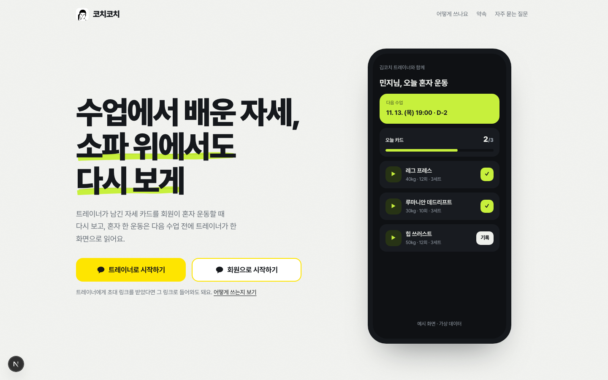
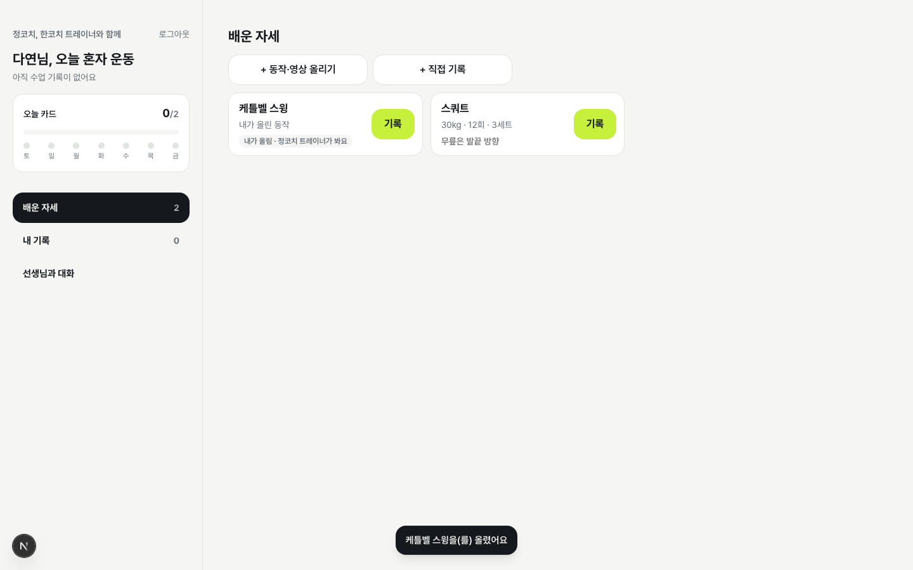
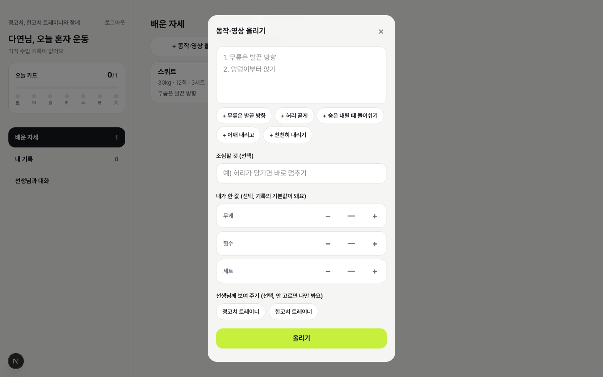
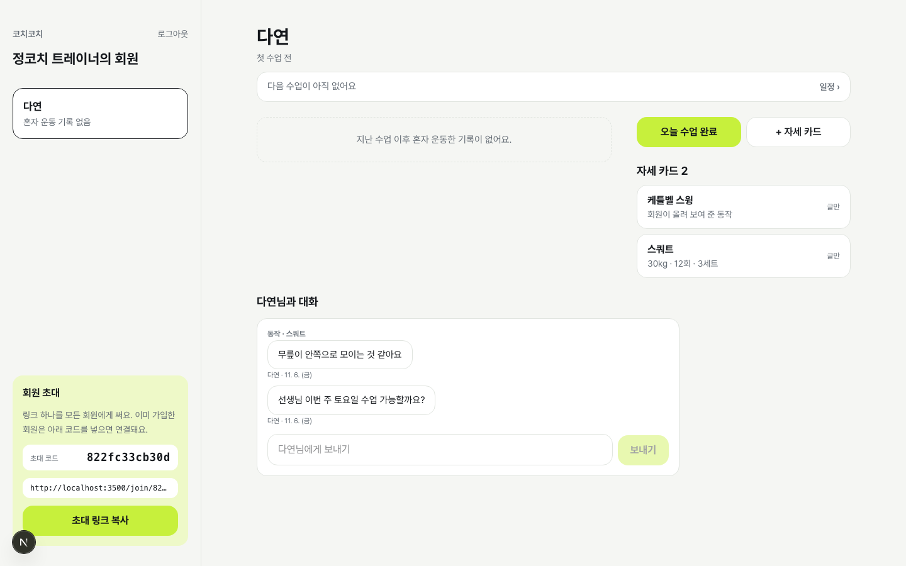
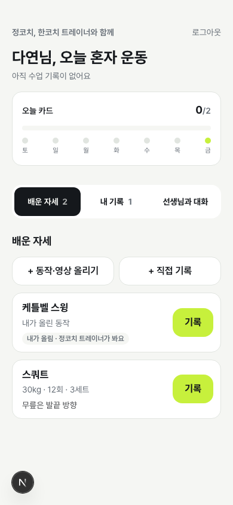
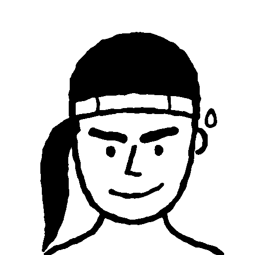

# Week 05 결과물 — 코치코치 (구 with trainer)

- 작성자: @Woo-Yeol
- 트랙: Auto-Application
- 기간: 2026-11-03 ~ 2026-11-09
- 서비스: **운영 중** https://coachcouch.kro.kr (카카오 로그인). Vercel(icn1) + 호스팅 Supabase(ap-northeast-2).
- 소스 코드: 비공개 저장소. 이 폴더에는 소개·기록·스크린샷만 둡니다.
- 이번 주에 만든 스킬: [service-mcp](../../../../skills/service-mcp/SKILL.md) · [kakao-login-console](../../../../skills/kakao-login-console/SKILL.md)

## 지난주 대비

4주차의 with trainer는 **로컬에서만 도는, 트레이너가 회원에게 카드를 보내는 일방향 기록장**이었습니다. 5주차의 코치코치는 **실제 주소에서 카카오로 들어오는, 회원이 자기 운동을 쌓고 선생님과 주고받는 공간**입니다.

| | 4주차 with trainer | 5주차 코치코치 |
| --- | --- | --- |
| 이름 | with trainer | 코치코치: 코치(coach, PT 선생님) + 코치(couch, 소파 위 회원). 슬러그 `coachcouch` |
| 실행 | 로컬 Supabase만 | 운영 주소 + 호스팅 DB. 로컬은 테스트·데모용으로 유지 |
| 신원 | 기기마다 익명 세션(폰 바꾸면 끊김) | 카카오 로그인. 처음 들어오면 트레이너/회원을 고름 |
| 연결 | 회원 1명 = 트레이너 1명, 초대 링크로만 | 다대다. 링크로 바로, 또는 먼저 가입한 뒤 초대 코드로. 양쪽 다 끊을 수 있음 |
| 회원이 넣는 것 | 배운 카드에서 "기록" 한 번만 | 직접 기록(배우지 않은 운동), 동작·영상 올리기 |
| 누가 무엇을 보나 | 연결된 트레이너가 회원 기록 전부 | 트레이너마다 자기 카드 + 회원이 그 트레이너에게 공유한 것만. 회원이 올린 건 기본 비공개 |
| 소통 | 기록에 남긴 메모 한 방향 | 동작·기록 댓글 + 트레이너별 대화방(댓글도 대화방에 보임) |
| AI | 없음 | MCP 서버: 회원 개인 키로 Claude 등이 기록 넣기·카드 읽기·영상 올리기 |
| 회원 화면 | 모바일 한 줄 흐름 | 배운 자세 / 내 기록 / 선생님과 대화. 모바일은 위쪽 탭, 웹은 왼쪽 메뉴 |
| 브랜드 | 없음 | 잉크 마커 캐리커처 로고, 연필 스케치 느낌 랜딩, 카카오 콘솔용 앱 아이콘 |
| 원칙 I | 회원 기록은 트레이너 한 명만 본다 | 회원 기록은 **회원이 고른 트레이너만** 본다(1.1.0 개정, 경계는 여전히 RLS·Storage 정책) |

## 화면

랜딩 (1440px). 트레이너·회원 버튼이 따로 있고, 둘 다 카카오 로그인으로 갑니다.



| 회원: 배운 자세 + 내가 올린 동작 (1440px) | 회원: 동작·영상 올리기, 보여 줄 선생님 고르기 (1440px) |
| --- | --- |
|  |  |

| 트레이너: 회원이 보여 준 동작 + 댓글이 섞인 대화 (1440px) | 회원 모바일 (390px) |
| --- | --- |
|  |  |

로고: 

스크린샷은 로컬 dev 서버와 테스트 계정(정코치·한코치·다연)으로 찍었습니다. 실제 트레이너 영상·카톡 글과 개인 키가 보이는 화면은 넣지 않았습니다.

## AI 비서(MCP)로 쓰는 모습

회원이 앱의 "내 기록 › AI 비서로 기록하기"에서 키를 만들면 붙여 넣을 명령이 한 번만 나옵니다.

```
claude mcp add --transport http coachcouch https://coachcouch.kro.kr/api/mcp --header "Authorization: Bearer <키>"
```

| 도구 | 하는 일 |
| --- | --- |
| `list_cards` | 배운 자세와 내가 올린 동작 |
| `recent_logs` | 마지막 수업 이후 기록 |
| `add_log` | 기록 하나. 카드 이름과 같으면 수업 때 무게·횟수·세트가 채워지고, 처음 보는 운동은 나만 보는 기록 |
| `start_video_upload` | 1시간·한 번 쓰는 업로드 경로 + curl 명령(영상은 MCP 서버를 거치지 않음) |
| `add_card` | 회원 동작 카드(기본 비공개, `share_with`로 트레이너 이름 지정) |

소유자가 실제로 트레이너에게 받은 카톡 글 9개와 영상(17~58초, 4~16MB)을 이 경로로 올렸습니다. 글을 붙여 넣고 파일 경로를 주면 길이·용량 확인 → 업로드 → 카드 생성까지 한 번에 끝납니다.

## 이번 주에 한 것

| 단계 | 내용 | 스킬 |
| --- | --- | --- |
| 배포 | Vercel 프로젝트·리전(icn1), 호스팅 Supabase 생성·마이그레이션, 도메인 coachcouch.kro.kr(DNS A·TXT) | skeleton-on-prod |
| 카카오 로그인 | 콘솔(REST API 키·Redirect URI·동의항목), 키는 숨김 입력 스크립트로, `config diff` 후 운영 값 고정하고 `config push` | **kakao-login-console**(이번 PR) |
| 이름·브랜드 | 이름 세 번 변경(Vercel·GitHub·문서), 로고 5번 다시 그림, 연필 느낌 랜딩 | design-conductor |
| 가입 | 트레이너/회원 직접 가입, 회원 먼저 가입 → 초대 코드 연결 | constitution-first(원칙 III 개정) |
| 회원의 공간 | 다대다 연결, 직접 기록, 동작·영상 올리기, 트레이너별 공유, 댓글·대화방 | constitution-first(원칙 I 개정), glance-and-guardrails(연결 끊기·삭제 확인 창) |
| AI 비서 | MCP 라우트, 개인 키(해시), 일회용 업로드 경로, 키 발급 화면 | **service-mcp**(이번 PR) |

## 재현 및 검증

| 날짜 | 검사 | 결과 |
| --- | --- | --- |
| 11-06 | `npm test` (RLS·RPC·Storage 흐름 + 공유 범위 + AI 키 + AI 영상 + 순수 로직) | 12개 통과 |
| 11-06 | `npx tsc --noEmit` · `npm run lint` · `npm run build` | 통과 |
| 11-06 | Playwright: 회원 업로드·공유 → 직접 기록 → 댓글 → 대화 → AI 키, 트레이너 두 명 시점 | 공유받은 트레이너만 동작·댓글·대화가 보임, 다른 트레이너 0건, 콘솔 에러 0, 가로 스크롤 0 |
| 11-06 | 공식 MCP SDK 클라이언트(`@modelcontextprotocol/sdk` 1.x)로 연결 | initialize·tools/list·tools/call 통과, 키 없음·틀린 키 401 |
| 11-06 | MCP로 실제 mp4 업로드 → 공유받은 트레이너 계정에서 내려받기 | 바이트 수 일치 |
| 11-06 | 운영: 홈 200, `/api/mcp` 키 없음·틀린 키 401, 로그인 없이 테이블 조회 | 빈 결과 또는 401(데이터 0건) |
| 11-06 | 운영: 소유자가 실제 카카오 계정으로 회원 가입 | 연결 전 회원 홈까지 확인 |
| 11-09 | `service-mcp`의 `verify-mcp.mjs`를 로컬 코치코치에 | 9개 항목 통과 |
| 11-09 | `kakao-login-console`의 `check-kakao.mjs`를 운영에 | client_id 32자·redirect_uri·scope 확인 |
| 11-09 | `service-mcp` SQL 템플릿을 로컬 DB에 트랜잭션으로 적용 후 되돌림 | 키 발급·도구 호출·틀린 키 거부·`ai_member` 직접 호출 차단 확인 |

미확인:

- 트레이너 계정과 회원 계정을 **서로 다른 실제 카카오 계정 두 개**로 연결하는 흐름. 테스트 계정으로만 확인했습니다.
- 앱에서 MCP로 올린 영상 9개가 재생되는지(업로드·카드 생성까지만 확인).
- 실제 휴대폰에서 영상 올리기(브라우저 390px 에뮬레이션만).
- claude.ai 웹 커넥터(OAuth가 필요해 지원하지 않음). Claude Code처럼 헤더를 넣는 클라이언트만 확인했습니다.

## 지표

실사용자 전이라 제작 지표와 소유자 실사용만 있습니다.

| 항목 | 값 |
| --- | --- |
| 제작 | 커밋 19 · 마이그레이션 5 · 자동 테스트 6 → 12 |
| 실사용 | 소유자가 MCP로 올린 동작 카드 9개(영상 포함) |
| 결정 | 원칙 1.0.0 → 1.1.0(원칙 I·II·III 개정, "회원의 공간" 결정 절 추가) |

## 한계점

- 새 메시지가 실시간으로 오지 않습니다. 열 때와 보낼 때만 다시 읽습니다.
- AI로 올린 영상의 90초 제한은 서버가 막지 못합니다(버킷은 50MB만). 도구 설명으로 AI에게 확인을 맡겼습니다.
- 회원·트레이너 수가 많아질 때의 성능(공유 판정 함수가 행마다 돌아감)은 재 보지 않았습니다.
- 같은 주에 별도 브랜치에서 한 계정 두 역할, 운영자 화면, 부위별 분류, 이메일 가입을 진행 중입니다. 아직 main·운영에 없어 이번 결과물에서 뺐습니다.

## 레슨런

- **`revoke … from public`만으로는 Supabase 함수가 안 막힌다.** Supabase는 public 스키마의 새 함수에 anon·authenticated 실행 권한을 따로 줍니다. 스킬 템플릿을 실제 DB에 돌려 보다가 코치코치의 `ai_member`가 열려 있던 걸 찾았고, 세 역할에서 모두 거두는 마이그레이션을 추가했습니다. 테스트에 "직접 부르면 permission denied"를 넣지 않았던 게 원인입니다.
- **큰 파일은 MCP로 싣지 않는다.** Vercel 함수 본문 한도가 4.5MB라 영상을 도구 인자로 받을 수 없습니다. 일회용 Storage 경로를 주고 AI가 curl로 올리게 하니 서버에 비밀 키 없이 끝났습니다.
- **마이그레이션이 운영에 안 들어가면 화면이 아니라 링크가 깨진다.** 카카오 배포 때 초대 정보 함수의 anon 권한 마이그레이션을 빠뜨려 초대 링크가 401이었습니다. 이후로는 "마이그레이션 먼저, 배포는 그다음"을 지키고, 권한이 막히면 커밋만 하고 배포를 멈췄습니다.
- **카카오 KOE 오류는 로그인한 뒤에만 보인다.** 가짜 client_id로도 로그인 화면까지는 정상으로 갑니다. 자동 점검은 Supabase가 넘기는 주소(client_id 길이·redirect_uri·scope)까지만 하고, 나머지는 오류표로 사람이 확인하게 했습니다.
- **작은 아이콘에서는 그림이 단순해야 한다.** 코치와 소파 위 회원을 함께 그린 로고는 32px에서 뭉개졌습니다. 얼굴 하나로 줄이고서야 소유자가 "이걸로 가자"고 했습니다.

## 동료에게 요청하는 검토

- [service-mcp](../../../../skills/service-mcp/SKILL.md): 개인 키 + security definer 함수 구조가 다른 서비스(오래오래, pain-radar 등)에 그대로 맞는지. 키 대신 OAuth가 꼭 필요한 경우가 있는지.
- [kakao-login-console](../../../../skills/kakao-login-console/SKILL.md): 콘솔 메뉴 이름이 지금 화면과 같은지(카카오 콘솔이 자주 바뀝니다). 이메일 동의항목이 잠기는 경우를 겪은 분이 있는지.
- 회원 화면: "기본 비공개, 트레이너마다 공유"가 회원에게 자연스러운지, 공유를 매번 고르는 게 번거로운지.

> This work was created as part of the No-More-Slops group activities at Pseudo Lab.
