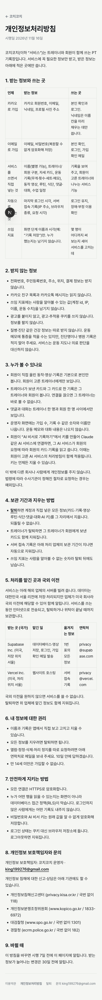
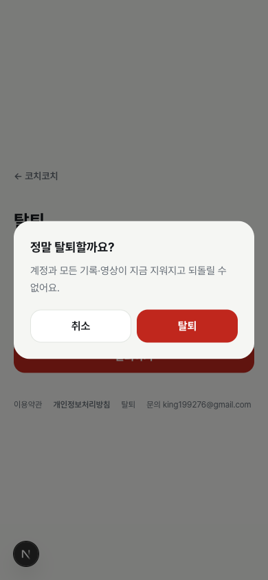
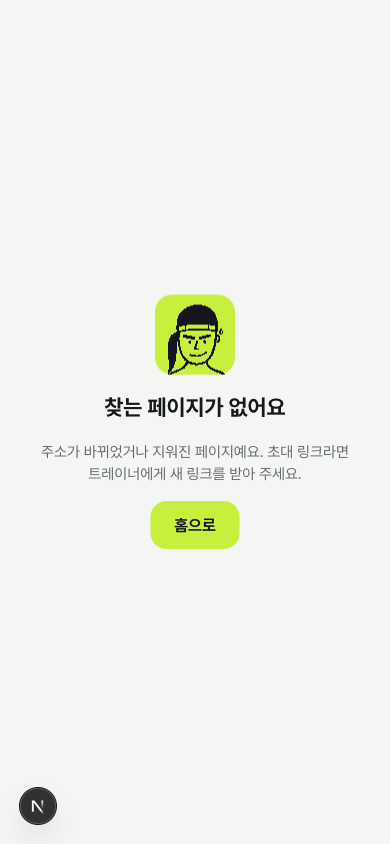
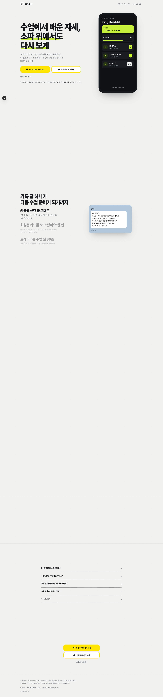

# Week 06 결과물 — 코치코치: 출시 기본기

- 작성자: @Woo-Yeol
- 트랙: Auto-Application
- 기간: 2026-11-10 ~ 2026-11-16
- 서비스: **운영 중** https://coachcouch.kro.kr (카카오·이메일 로그인). Vercel(icn1) + 호스팅 Supabase(ap-northeast-2).
- 소스 코드: 비공개 저장소. 이 폴더에는 소개·기록·스크린샷만 둡니다.
- 이번 주에 고친 스킬: [launch-basics](../../../../skills/launch-basics/SKILL.md) — 점검 스크립트 `scripts/check-launch.mjs`, SQL 템플릿 `references/launch-basics.template.sql` 추가

## 지난주 대비

5주차 체크리스트(OT 자료 "5주~: 출시")에서 코치코치에 **없던 것**이 넷이었습니다: 개인정보처리방침, 이용약관·문의처, 사용자 정의 에러 화면, 쓰임 지표. 이번 주에 넷을 채우고, 탈퇴(계정·기록·영상 전부 삭제)를 더했습니다.

| | 5주차 | 6주차 |
| --- | --- | --- |
| 법적 표기 | 없음 | `/privacy` `/terms`. 받는 정보 표, 받지 않는 정보, 국외 이전 표(Supabase·Vercel), 보호책임자 연락처(소유자 결정: 지메일 공개) |
| 동의 | 없음 | 가입 화면 버튼 아래 "시작하면 약관·처리방침에 동의한 것으로 봐요" |
| 탈퇴 | 메일로 요청 | `/account`에서 버튼 하나 + 확인 창. 내 영상 → 계정(cascade) 두 단계 |
| 에러 화면 | Next.js 기본 404 | `not-found.tsx`(초대 링크가 깨졌을 때 안내), `error.tsx`(저장 중이던 기록 확인 안내) |
| 쓰임 지표 | 없음 | 우리 DB `events`에 단계 이름만(랜딩 → 로그인 시작 → 가입 → 카드 보냄 → 기록 저장 → 공유). 운영자 화면에 7일·30일 숫자 |
| 링크 위치 | — | 랜딩 바닥, 트레이너·회원 메뉴 맨 아래, 처리방침·약관 끝 |

같은 주에 운영에 들어간 다른 기능(커밋 25개, 마이그레이션 13개): 루틴·식단 붙여 넣기, 세트별 무게·횟수, 몸 그림에 운동한 부위 칠하기, Supabase Realtime 채팅, 운영자 화면 회원별 표, 가입 없이 둘러보기(`/tour`), 이번 주 기록 공유 이미지, 카톡 초대·회원이 트레이너 초대하기. 이 결과물은 출시 기본기에만 집중합니다.

## 화면

| 개인정보처리방침 (390px) | 탈퇴 확인 창 (390px) | 404 (390px) |
| --- | --- | --- |
|  |  |  |

랜딩 (1440px). 바닥에 약관·처리방침·탈퇴·문의 링크가 붙었습니다.

스크린샷은 로컬 dev 서버와 테스트 계정(서연)으로 찍었습니다.

## 소유자 결정 (2026-11-16)

| 물음 | 결정 | 이유 |
| --- | --- | --- |
| 보호책임자·문의처 표기 | 지메일 주소만 공개 | 개인 서비스라 따로 둘 메일이 없다 |
| 지표를 어디에 | 우리 DB에 단계 이름만 | 외부 서비스·쿠키가 없어 처리방침이 짧고, 바로 된다. GA는 속성 생성·국외 이전 고지가 더 필요 |
| 탈퇴를 지금 넣나 | 넣는다 | 처리방침의 "삭제 요청 방법"이 버튼 하나가 된다 |

## 재현 및 검증

| 날짜 | 검사 | 결과 |
| --- | --- | --- |
| 11-16 | `npm test` (출시 기본기 2개 추가: 지표 넣기만·읽기 차단, 탈퇴 cascade) | 34개 통과 |
| 11-16 | `npx tsc --noEmit` · `npm run lint` · `npx next build` | 통과 |
| 11-16 | Playwright(로컬): 테스트 계정으로 `/account` → 탈퇴하기 → 확인 창 → "탈퇴했어요" | 통과, 콘솔 에러 0(탈퇴 뒤 logout 403은 계정이 이미 없어서 나는 것) |
| 11-16 | 랜딩 열면 `events`에 POST 201 | 통과(dev는 StrictMode라 2건) |
| 11-16 | `check-launch.mjs` 로컬(dev 서버 + 로컬 Supabase) | 16개 항목 모두 통과 |
| 11-16 | 운영: `supabase db push`(마이그레이션 2개) → `vercel deploy --prod` 순서 | 통과 |
| 11-16 | `check-launch.mjs` 운영(https://coachcouch.kro.kr) | 16개 항목 모두 통과(HSTS 포함) |
| 11-16 | 운영: `ai_member`·`issue_ai_key` 익명 호출 | 401 permission denied(5주차에 빠졌던 권한 수정 반영) |

미확인:

- 약관·처리방침 법률 검토. 개인정보 보호법 제30조·제28조의8의 항목 순서로 썼지만 사람이 읽지 않았습니다.
- 실제 카카오 계정의 탈퇴. 테스트 계정으로만 확인했습니다.
- 영상이 있는 트레이너 계정의 탈퇴는 자동 테스트로만 확인했습니다(파일 삭제 → 계정 삭제).

## 지표

| 항목 | 값 |
| --- | --- |
| 제작 | 이번 주 커밋 27 · 마이그레이션 15 · 자동 테스트 12 → 34 |
| 퍼널 | 운영 반영 뒤부터 쌓입니다. 운영자 화면 "퍼널" 칸 |

## 한계점

- 지표는 로그인 없이도 넣을 수 있어 숫자를 부풀릴 수 있습니다. 사람이 늘면 하루 상한이나 서버 경유로 바꿉니다.
- 처리방침의 "쓰임 지표는 탈퇴 뒤에도 남는다"는 사람을 알아볼 수 없는 숫자라서 그렇게 두었습니다.
- 5주차에 적었던 "ai_member 권한 거두기" 마이그레이션이 로컬에만 있고 운영에 없던 것을 이번 주에 찾아 함께 올렸습니다. 5주차 결과물의 그 문장은 11-16까지 운영과 달랐습니다.

## 레슨런

- **Storage 파일은 SQL이 못 지운다.** `delete from auth.users`는 행을 cascade로 지우지만 버킷 파일은 남습니다. 내 파일 경로를 주는 함수를 하나 두고 앱이 먼저 `storage.remove()`를 부르게 했습니다. 파일 삭제가 실패하면 계정은 그대로 둡니다.
- **클라이언트 렌더링 페이지는 첫 HTML로 점검하면 안 된다.** 홈의 바닥 링크를 HTML에서 찾는 검사가 실패했습니다. 홈은 로그인 상태를 본 뒤 그려집니다. 처리방침·약관·탈퇴가 서로 잇는 링크로 바꿨습니다.
- **"운영에 올렸다"는 `migration list`로 확인한다.** 11-09에 "권한 마이그레이션을 추가했다"고 적었지만 커밋이 로컬 main에만 있었습니다. 결과물에 적기 전에 `supabase migration list --linked`의 remote 열을 봅니다.
- **지표를 우리 DB에 두면 처리방침이 짧아진다.** 쿠키·국외 이전 항목이 없고, "누가 했는지 남기지 않는다"를 한 줄로 끝낼 수 있습니다.

## 동료에게 요청하는 검토

- [launch-basics](../../../../skills/launch-basics/SKILL.md)의 `check-launch.mjs`: 다른 서비스(오래오래, pain-radar)의 운영 URL에서도 그대로 도는지. 처리방침 문구 검사(`받지 않|저장하지 않|수집하지 않`)가 너무 좁은지.
- 처리방침 국외 이전 표: 서울 리전의 Supabase·Vercel을 국외 이전으로 적는 게 맞는지, 겪어 본 분의 의견.

> This work was created as part of the No-More-Slops group activities at Pseudo Lab.
