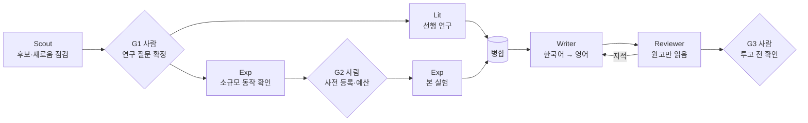

# 논문 작성 파이프라인 운영 방식

역할별 AI 에이전트가 초안과 근거를 만들고, 핵심 판단은 사람(연구 책임자)이 내리는 논문 작성 작업 공간의 운영 방식을 요약한다. 연구 주제와 결과는 익명 심사 중이라 이 문서에 담지 않는다.

## 1. 구조

- 논문 하나는 `paper/<ID>/` 폴더 하나에 모든 기록을 둔다. 새 논문은 템플릿 폴더를 복사하는 스크립트(`scripts/new-paper.sh <ID>`)로 만든다.
- 여러 논문이 함께 쓰는 벤치마크 코드는 `paper/shared/bench/`에 두고, 축(조건, 횟수, 모델 등)을 늘려 더 큰 규모로 확장할 수 있게 설계한다.
- 역할 지시문의 원본은 `agents/<역할>.md` 한 곳에만 두고, 에이전트 실행 설정은 이 원본을 참조만 한다.
- 투고처 공식 양식은 `templates/`에 원본 그대로 두고, Writer가 `draft/`로 복사해 쓴다.

## 2. 역할별 에이전트

에이전트끼리는 **파일로만 소통**한다. 각 역할은 정해진 경로에만 쓰고, **다른 역할의 파일은 수정하지 않는다.**

| 역할 | 하는 일 | 읽는 것 | 쓰는 것 |
|---|---|---|---|
| Scout | 연구 질문·가설 후보 제시, 새로움 점검. 결정하지 않고 선택지와 근거만 낸다 | `lit/related.md`, 웹 | `00_direction.md`, `candidates/`(주제 요약서, 이전 판은 `.vN.md`로 보존) |
| Lit | 선행 연구 검색·정독, 관련 연구 표, BibTeX | `00_direction.md`, 웹·arXiv | `lit/related.md`, `lit/search_log.md`, `lit/refs.bib` |
| Exp | 벤치마크·실험 코드 작성과 실행, 표·그림·본문 수치 생성. 해석하지 않고 숫자만 보고한다 | `00_direction.md`, `00_prereg.md` | `paper/shared/bench/`, `exp/configs/`, `exp/results/`, `00_prereg.md`(초안) |
| Writer | 스토리 설계 → 한국어 원고 → 영어 LaTeX, 주장-근거 대응표 | `00_direction.md`, `refs.bib`, `exp/results/`, `templates/` | `draft/`, `claims.md` |
| Reviewer | 원고를 처음 보는 학회 리뷰어로서 비판, 점수, 채택 여부 판단 | **빌드된 원고 PDF 하나만**(주제 모의 심사 때는 요약서 하나만) | `reviews/roundN.md` |

사람은 `decisions.md`(날짜, 결정, 이유, 버린 대안)를 쓰고, 게이트 승인과 병합을 맡는다.

- **실행 방식:** 짧은 작업(Scout, Writer, Reviewer)은 메인 세션의 서브에이전트로, 며칠 걸리거나 비용이 드는 작업(Lit, Exp)은 별도 브랜치의 워크트리 세션으로 돌린다. 사람이 diff를 보고 병합한다. 쓰기 경로가 역할별로 나뉘어 충돌이 드물다.
- **Reviewer 격리:** 매번 새 컨텍스트로 시작하고 이전 리뷰·작성 과정·공통 지시문을 받지 않는다. 도구는 읽기·쓰기·웹 검색만 허용하고, 실행 전 훅이 읽기 경로를 원고 PDF로, 쓰기 경로를 리뷰 파일로 제한한다. 가능하면 Writer와 다른 모델을 쓴다. 약점을 먼저 쓰고(치명적·보통·사소), 사소함, 실험의 현실성, 일반화, 통계, 익명화 위반을 반드시 점검한다.

## 3. 흐름과 사람 승인 게이트

- **G1 연구 질문 확정:** `00_direction.md`에 차별점 한 문장("X는 A를 했지만 B는 하지 않았다. 본 연구는 B를 한다")과 가장 가까운 논문 3편 표가 채워졌을 때 사람이 승인한다.
- **G2 본 실험 전:** 사전 등록 문서(`00_prereg.md`)와 예산 상한이 확정되기 전에는 소규모 동작 확인(시나리오 2~3개)만 한다. 확정 후 수정은 변경 기록에 남긴다.
- **G3 투고 전:** Reviewer의 치명적 지적이 모두 해결되고, `claims.md`의 모든 주장을 사람이 근거와 대조한 뒤 제출한다.

집필은 단계별로 나뉜다. 양식 세팅 → 스토리 설계(사람 승인) → 한국어 원고 → 사람의 내용 검토 → 영어 전환(문단마다 한국어 원고 위치를 주석으로 대응) → 자동 점검(빌드, 분량, 익명화, 인용 키 존재, 손으로 쓴 숫자 없음) → 리뷰 2회 → 사람의 최종 수정. 영어 전환은 사람이 한국어 원고를 승인한 뒤에만 한다.

## 4. 공통 규칙

1. **인용:** arXiv ID나 DOI로 존재를 확인한 논문만 `refs.bib`에 등록한다. 원문에서 확인한 수치와 2차 자료에서 본 수치를 구분하고, 2차 자료의 수치는 인용하지 않는다. 검색어와 날짜는 `search_log.md`에 남긴다.
2. **수치는 스크립트로만:** 표, 그림, 본문 수치는 모두 `exp/results/`에서 스크립트로 만든다. 본문 수치는 스크립트가 생성한 LaTeX 매크로 이름으로만 쓰고, 숫자를 손으로 옮기지 않는다.
3. **근거 있는 주장만:** Writer는 `refs.bib`와 `exp/results/`에 있는 것만 근거로 쓴다. 근거가 없으면 빈자리 표시(`[TODO: 근거]`, `\todo{}`)로 남기고, 주장을 추가할 때마다 `claims.md`에 근거 위치를 적는다.
4. **Reviewer는 원고만 읽는다:** 작성 과정, 다른 파일, 이전 대화를 보지 않는다.
5. **재현성:** 실행마다 설정, 시드, 모델 버전과 날짜, 원본 출력, 토큰 비용을 자동으로 기록한다. 채점 코드에는 단위 테스트를 붙인다.
6. **부정적 결과 보존:** 가설과 다른 결과, 중단한 실행도 지우지 않고 `exp/results/`에 이유와 함께 남긴다.
7. **중복 투고 금지:** 논문끼리 연구 질문, 실험 조건, 그림이 달라야 한다.
8. **익명화:** double-blind 원고에는 저자 정보, 소속, 자기 인용 표현, 실명 코드 링크를 넣지 않고 익명 모드로 컴파일한다.
9. **키 관리:** API 키는 git에서 제외한 `.env`에만 둔다. 출력, 로그, 커밋에 키를 남기지 않는다. 돈이 드는 실행은 직전에 예상 비용을 사람에게 보이고, 예산 상한을 넘기지 않는다.

## 5. AI 판정 운용 원칙

규칙으로 결정할 수 없는 판정(예: 자유 서술 응답의 의미 판정)에 AI 판정자를 쓸 때는 다음을 따른다.

- **판정자 2명 합의:** 서로 다른 계열의 AI 판정자 2명이 독립적으로 판정하고, 둘이 일치한 판정을 채택한다. 판정 규칙(예: "둘 다 예일 때만 예")과 그 반대 기준의 상한을 함께 보고한다.
- **불일치 시 3번째 판정자:** 두 판정이 엇갈린 사례만 3번째 판정자에게 넘긴다.
- **신뢰도 점검:** 판정자 간 일치도(질문별 κ와 양성 비율), 같은 판정자의 반복 판정 일치, 두 판정자가 합의한 항목 일부를 3번째 판정자에게 다시 보여 공동 오류의 상한을 낸다. 판정 실패·미해결 항목은 전부 예/전부 아니오로 채운 범위를 함께 보고한다. 작은 사람 표본 확인은 선택 사항이며, 하지 않았다면 그 사실을 원고 한계에 적는다.
- **이해 충돌 회피:** 판정자와 같은 계열의 모델을 실험 대상으로 쓰지 않는다.
- 결정적으로 판정할 수 있는 항목(정해진 형식·값의 일치 등)은 AI 판정 없이 코드로 판정한다.

## 6. 주간 내보내기

비공개 작업 공간의 결과물은 매주 허용 목록에 적은 파일만 공개 PR 저장소로 내보낸다.

1. `exports/week-NN.txt`에 `<작업 공간 경로> => <대상 경로>`를 한 줄에 하나씩 적는다. 대상은 트랙의 `skills/` 또는 `projects/<프로젝트>/` 아래여야 한다. 스킬을 고친 주에는 무엇을 왜 바꿨는지 주석으로 남긴다.
2. `scripts/export-week.sh NN`을 실행한다. 스크립트는 절대 경로와 `..`를 거부하고, `.env`·키 파일·에이전트 설정·원본 로그 같은 공개 금지 경로를 목록에 있어도 막는다. 복사 후 10MB가 넘는 파일과 PR 저장소의 변경 상태, 저장소 규칙 검사 결과를 보여 준다.
3. 목록에 없는 파일(진행 중인 원고, 원본 실험 로그 등)은 내보내지 않는다. 커밋과 PR 생성은 사람이 PR 저장소에서 확인한 뒤에 한다.

재사용 가능한 절차는 `skills/<스킬명>/SKILL.md`로 다듬어 내보내는 주 대상으로 삼는다. 스킬은 특정 논문의 비공개 데이터, 원고 문장, API 키에 의존하지 않게 쓴다.
