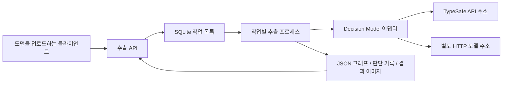

# 도면 추출 API

도면 한 장을 업로드하면 작업 ID를 반환합니다. 처리 상태를 조회하고, 완료된 작업의 JSON 그래프와 판단 기록, 결과 이미지를 받을 수 있습니다. 도면 추출 API와 Decision Model 주소는 별도로 설정합니다.

기존 `experiments/`를 수정하지 않고 논문에 사용한 `geometry-local-route-v12` 소스 22개를 `cad_api/vendor/v12/`에 고정했습니다. 기본 실행은 이 객체 추출 코드에 공유 선분과 점선/교차부 의미 검사를 적용한 `geometry-local-route-v15-semantics`입니다. 확정하지 못한 경로와 접점은 검토 후보로 따로 저장합니다. 각 작업에서 원본 소스 해시를 확인하고 실제 실행 버전과 보완 파일 해시를 기록합니다. 서버는 모델 연결과 리소스 경로를 분리하고, 프로세스 종료와 캐시 파일 복구를 관리합니다. [현재 의미 검사](CONNECTION_SEMANTICS.md), [v14 공유 그래프와 결과 형식](CONNECTION_GRAPH.md), [이전 v13 보완](CONNECTION_REVISION.md)을 확인할 수 있습니다.



## 실행

Python 3.11 이상과 `uv`를 사용합니다.

```sh
cd tracks/auto-paper/projects/cad-decision-model/app
uv sync --extra test
uv run uvicorn cad_api.app:create_app --factory --host 127.0.0.1 --port 8087 --workers 1
```

호출 문서는 <http://127.0.0.1:8087/docs>에서 열 수 있습니다. 기본 모델은 TypeSafe의 `jev-1.14.0`이며, 서버 `.env`와 상위 프로젝트 폴더의 `.env`에서 환경 변수를 읽습니다. 이미 프로세스에 설정된 값은 덮어쓰지 않습니다. 모델 API 키의 기본 환경 변수 이름은 `TYPESAFE_API_KEY`입니다.

설정을 바꾸려면 `.env.example`을 `.env`로 복사해 필요한 값을 입력합니다. 추출 API의 접근 키인 `CAD_API_KEY`와 모델 서비스의 접근 키는 별개입니다. `CAD_API_KEY`를 설정하면 아래 `/v1/` 호출에 `Authorization: Bearer <CAD_API_KEY 값>` 헤더를 보냅니다. `/health`는 모델 호출 없이 서버 상태만 반환합니다.

Uvicorn 프로세스는 하나만 실행합니다. `CAD_WORKERS`는 이 프로세스 안에서 실행할 추출 작업 수이며, 각 작업은 별도 프로세스로 격리됩니다. 같은 데이터 폴더를 쓰는 두 API 프로세스는 시작할 수 없습니다.

## API 호출

```sh
curl -X POST http://127.0.0.1:8087/v1/extractions \
  -F image=@drawing.png \
  -F kind=pid
```

응답은 HTTP 202이며 `id`, `status_url`, `result_url`, `trace_url`을 포함합니다. 작업 상태는 `queued`, `running`, `succeeded`, `failed` 중 하나입니다. 응답에서 받은 ID를 아래 `JOB_ID` 자리에 넣습니다.

```sh
curl http://127.0.0.1:8087/v1/extractions/JOB_ID
curl http://127.0.0.1:8087/v1/extractions/JOB_ID/result
curl http://127.0.0.1:8087/v1/extractions/JOB_ID/trace
curl http://127.0.0.1:8087/v1/backends
```

| 요청 | 역할 |
|---|---|
| `POST /v1/extractions` | 도면을 업로드하고 작업을 등록합니다 |
| `GET /v1/extractions/{id}` | 상태, 객체/연결 수, 오류와 다운로드 주소를 조회합니다 |
| `GET /v1/extractions/{id}/result` | 성공한 작업의 `objects`, `relations`, `meta`를 받으며, v14와 v15 결과에는 `connection_review`도 포함됩니다 |
| `GET /v1/extractions/{id}/trace` | 후보, 응답과 채택/거절 기록을 받습니다 |
| `GET /v1/extractions/{id}/artifacts/{name}` | 응답에 나열된 JSON, PNG, HTML과 요약 파일을 다운로드합니다 |
| `GET /v1/backends` | 등록된 연결 이름과 모델, 설정 상태를 확인합니다 |

업로드 필드는 `image`, `kind`, `backend`, `legend`입니다. `kind`는 `pid`(기본값), `logic`, `auto`를 지원합니다. `backend`를 생략하면 기본 연결을 사용하며, URL이나 API 키를 업로드 요청에 넣지 않습니다.

기본 P&ID 범례는 논문 실험과 같은 공개 PID2Graph 범례와 예시 이미지입니다. CLD 범례는 기존 프로젝트의 클래스 설명을 사용하며 비공개 도면 이미지를 포함하지 않습니다. 다른 분류 체계를 쓰려면 `legend`에 아래처럼 **설명만 담은 JSON 문자열**을 보냅니다. 2–255개 클래스를 지원하며 `other`가 있어야 합니다. 이 개수는 입력 형식의 한도이고 모델 정확도를 보장하는 수치가 아닙니다.

서버에서 관리하는 범례 이미지까지 사용하려면 `CAD_RESOURCES_DIR`을 리소스 루트의 절대 경로로 설정합니다. 그 아래 `experiments/legend_pid.json`, `experiments/legend_cld.json`과 범례가 참조하는 `image/` 파일이 있어야 합니다. 기본 포함 리소스는 공개 PID2Graph 범례와 텍스트 기반 CLD 범례입니다. 설정은 다음 서버 시작부터 적용되며 업로드 요청에서 임의의 리소스 경로를 지정할 수는 없습니다.

```json
{"classes":[{"key":"valve","text":"A valve symbol."},{"key":"other","text":"Not one of the listed symbols."}]}
```

입력은 PNG/JPEG, 기본 최대 20 MiB, 2,500만 픽셀입니다. 회전 정보와 투명 배경을 정리한 `input.png`를 기준으로 좌표를 반환합니다. 반환한 정규화 이미지도 다운로드할 수 있습니다. 성공 전의 결과 요청은 409, 용량 초과는 413, 대기열이 가득 차면 429입니다. 모델 응답이 누락되거나 유효하지 않으면 성공으로 처리하지 않고 `failed`를 반환합니다. 일부 결과가 생성된 경우 판단 기록은 확인할 수 있습니다.

동기식 호출 도구는 작업 등록, 상태 조회, 결과 다운로드를 이어서 처리합니다.

```sh
uv run python examples/client.py drawing.png --out ./downloaded
```

## 폴더 전체 처리와 결과 화면

폴더 안의 PNG/JPEG를 모두 등록하고 결과를 모으려면 다음 도구를 실행합니다. 기본 서버 주소는 `http://127.0.0.1:8087`이며 다른 서버는 `--server`로 지정합니다.

```sh
uv run python examples/batch.py ../image --out ~/cad-jev-folder-results --kind auto
```

파일 내용의 SHA-256이 같은 이미지는 한 번만 추론하고, 결과 화면에는 원래 파일 이름을 모두 표시합니다. `index.html`에서 심볼과 글자 영역, 연결 경로를 원본 위에 표시한 이미지와 개별 결과 화면, JSON, 판단 기록을 볼 수 있습니다. 원본과 정규화 이미지도 함께 저장합니다. `manifest.json`에는 각 작업 ID, 상태, 사용량과 비용 계산 근거가 남습니다.

썸네일을 클릭하면 전체 해상도 이미지가 확대 창에 열립니다. 휠과 확대/축소 버튼으로 크기를 조절하고 드래그로 이동할 수 있습니다. 원본과 추출 결과를 같은 위치에서 전환하며, 화면 맞춤, 100% 보기, 이전/다음 이미지 이동을 지원합니다. Esc 또는 닫기 버튼으로 돌아갑니다.

연결 보완 결과와 기존 결과가 함께 저장된 갤러리에서는 개선 전과 개선 후를 같은 확대 위치에서 비교할 수 있습니다. 이번 폴더 결과는 전체 객체와 글자 배열을 유지하고 연결 단계만 다시 검사했습니다.

같은 명령을 다시 실행하면 저장된 작업 상태를 조회하고 빠진 다운로드를 이어받습니다. 실패한 작업은 자동으로 새로 등록하지 않습니다. 원인을 해결한 뒤 `--retry-failed`를 붙이면 실패한 이미지만 새 작업으로 등록하며, 이전 시도의 보고된 사용량도 합계에 포함합니다. 접수 중 연결이 끊겨 작업 ID를 받지 못한 항목은 `submission_unknown`으로 남기므로 서버 작업 목록을 확인한 뒤 처리해야 합니다.

동시에 대기하거나 실행할 작업 수는 `--max-running`(기본 1)로 지정합니다. 모델 요청 동시 처리 수는 서버의 `CAD_MODEL_CONCURRENCY` 설정입니다. 비용은 판단 기록의 모델 보고 입력 토큰에 `--rate-per-million` 값을 곱한 추정이며 청구서 금액은 아닙니다. 기본값 `$0.042/1M`은 Jev 1.14의 [공식 입력 토큰 가격](https://docs.typesafe.ai/models)입니다. 모델을 교체할 때는 단가도 바꿉니다.

## 모델 주소를 교체하거나 여러 모델을 등록하기

단일 연결은 다음 환경 변수로 설정합니다.

```dotenv
CAD_MODEL_PROVIDER=typesafe
CAD_MODEL_ENDPOINT=https://api.typesafe.ai
CAD_MODEL_NAME=jev-1.14.0
CAD_MODEL_API_KEY_ENV=TYPESAFE_API_KEY
```

TypeSafe와 같은 API를 제공하는 다른 주소는 `CAD_MODEL_ENDPOINT`만 바꿀 수 있습니다. 이 값은 SDK의 API 루트 주소입니다. 모델 버전은 `CAD_MODEL_NAME`으로 바꿉니다.

TypeSafe API 형식과 다른 서버는 아래 Decision HTTP 계약을 구현하고 `decision_http`를 선택합니다. 이때 주소는 요청을 받을 **전체 엔드포인트 URL**입니다.

```dotenv
CAD_MODEL_PROVIDER=decision_http
CAD_MODEL_ENDPOINT=http://127.0.0.1:9000/v1/decide
CAD_MODEL_NAME=decision-model-v1
CAD_MODEL_API_KEY_ENV=CUSTOM_DECISION_API_KEY
```

인증 없는 내부 모델 서버는 `CAD_MODEL_API_KEY_ENV`를 설정하지 않습니다. 여러 모델을 등록하려면 `models.example.json`을 `models.json`으로 복사한 뒤 `.env`에 `CAD_MODEL_BACKENDS_FILE=./models.json`을 설정합니다. 다음 서버 시작부터 적용되며, 기존 작업은 등록 당시 설정을 유지합니다. 업로드에 `backend=jev` 또는 `backend=custom`을 넣어 연결을 선택합니다.

```sh
curl -X POST http://127.0.0.1:8087/v1/extractions \
  -F image=@drawing.png -F kind=pid -F backend=custom
```

캐시는 연결 이름, 제공자, 주소, 모델, 실행 설정과 인증 계정으로 분리됩니다. 질문과 이미지가 같더라도 다른 연결의 답변을 재사용하지 않습니다. 같은 연결을 사용하는 동시 작업은 원본 캐시의 쓰기가 겹치지 않도록 순차 실행하고, 서로 다른 연결은 병렬 실행할 수 있습니다.

## 별도 Decision HTTP 서버의 계약

추출 서버는 등록된 URL로 다음 형식의 JSON을 POST합니다. 아래는 형식 예시이며 측정 결과가 아닙니다.

```json
{
  "model": "decision-model-v1",
  "state": {"task":"Judge drawing evidence."},
  "questions": {
    "box_A": {
      "type":"choice",
      "instructions":{"view":{"type":"image","mime_type":"image/png","data":"BASE64_PNG_BYTES"}},
      "criteria":{"1":"First existing box.","2":"Second existing box."}
    },
    "link_A": {
      "type":"noul",
      "instructions":"Are the two symbols connected?",
      "criteria":{"true":"Source pixels support a connection.","false":"No supported connection."}
    }
  }
}
```

이미지는 `state`, `instructions`, `criteria`의 원래 위치에 개별 이미지 객체로 전달합니다. 두 이미지를 한 장으로 합치지 않습니다. `criteria`의 선택지 순서를 유지해야 하며, A/B 질문은 독립적인 답변을 반환해야 합니다.

```json
{
  "model":"decision-model-v1",
  "answers":{"box_A":{"1":0.8,"2":0.2},"link_A":0.9},
  "usage":{"input_tokens":1234}
}
```

`choice`는 모든 선택지의 유한한 0–1 확률을 반환하고 합이 1에서 0.02 이내여야 합니다. `noul`은 유한한 0–1 숫자 하나를 반환합니다. 모든 질문에 답해야 합니다. `model`은 실제 응답 모델 식별자이며, `input_tokens`는 모델 서비스가 보고한 사용량입니다. 토큰을 계산하지 않는 서비스도 계약상 음수가 아닌 정수 값을 제공해야 하며, 값의 측정 의미는 그 서비스가 정의합니다. 형식을 맞췄다는 사실만으로 모델의 성능이나 보정 수준이 확인되는 것은 아닙니다.

토큰 한도를 넘긴 서버가 400과 `max_tokens_exceeded`를 반환하면 원래 추출기의 질문 묶음 분할을 적용합니다. 그 밖의 오류 응답 본문이나 인증 값은 공개 작업 오류와 로그에 넣지 않습니다.

## 저장과 검증 범위

데이터는 `CAD_DATA_DIR`에 저장됩니다. 서버 재시작 후 완료된 결과를 다시 조회하고 대기 작업을 이어서 처리합니다. 실행 중 중단된 작업은 `failed`로 남으며 새 작업으로 다시 요청합니다. 작업별 시간 제한 기본값은 30분입니다. API 프로세스가 강제로 종료되면 작업 프로세스도 종료 감시로 중단됩니다. 중단된 캐시 쓰기로 손상된 파일은 다음 요청에서 제거하고 해당 질문을 다시 판단합니다.

```sh
uv run pytest -q
```

테스트는 모델 주소와 이름 변경, 분리된 이미지 전달, 잘못된 응답, API 인증, 업로드/대기열 한도, 재시작과 시간 제한을 검사합니다. 실제 v12 추출 프로세스에 합성 도면을 넣어 객체와 연결, JSON과 PNG가 생성되는지도 확인합니다. 모델 답변은 로컬 시험 서버로 대체하며 이 테스트는 새로운 정확도 실험이나 유료 모델 호출이 아닙니다.

글자는 영역과 줄 묶음까지 추출합니다. OCR 문자열, DXF/DWG 변환은 구현하지 않았습니다. 논문의 (f) 보존 감사는 이전/새 출력 두 개를 비교하는 별도 작업이며 이 단일 도면 API가 자동으로 수행하지 않습니다. 모델을 바꿔도 같은 판단 입력과 후처리를 사용하지만, 새 모델의 추출 정확도는 별도 평가가 필요합니다.

## 컨테이너 실행

```sh
docker build -t cad-decision-api .
docker run --rm -p 8087:8080 --env-file .env -v cad-api-data:/data cad-decision-api
```

외부에서 접근하는 배포에는 `CAD_API_KEY`를 설정합니다. `.env`와 작업 데이터는 이미지에 포함하지 않습니다. 여러 연결 파일을 사용하는 컨테이너는 해당 JSON을 읽기 전용으로 마운트하고 `CAD_MODEL_BACKENDS_FILE`을 컨테이너 안의 경로로 지정합니다.

