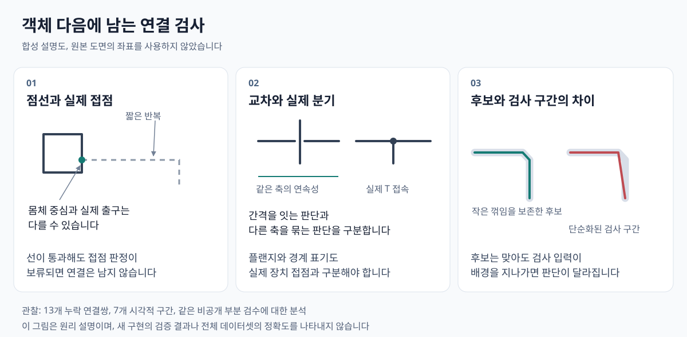

# 연결 누락 사례 분석

객체가 검출되어도 연결은 선의 이어짐, 실제 기호 접점, 경로 전체의 검사 조건에서 빠질 수 있습니다. 이번에 살펴본 누락 13쌍은 양끝 객체가 모두 검출되어 있었으며, 원본의 7개 구간에 모여 있었습니다. 우선 확인할 문제는 작은 꺾임을 검사 구간으로 변환할 때 경로가 달라지는 현상과, 회색 점선의 짧은 단말 및 실제 접점에 대한 보류 판정입니다.

분석 기준은 2026-10-26에 저장된 `geometry-local-route-v15-semantics`의 12장 결과와 기존 비공개 부분 검수입니다. 같은 구간에 속한 연결쌍은 하나의 실패 지점을 공유할 수 있습니다. 아래 수치는 이미 확인한 사례의 집계이며, 독립 표본 13개나 전체 데이터셋의 실패 분포 또는 정확도를 뜻하지 않습니다. 이 문서에는 비공개 원본 도면, 크롭, 내부 객체 ID, 좌표를 포함하지 않았습니다.

*그림 1. 원본 도면의 좌표를 사용하지 않은 합성 설명도입니다. 오른쪽은 실제 후보와 파생 검사 구간의 차이를 설명하며, 새 알고리즘의 검증 결과를 나타내지 않습니다.*

## 관찰한 특징

| 특징 | 누락 연결쌍 | 시각적 구간 | 저장 기록에서 확인한 제한 |
|---|---:|---:|---|
| 회색 점선과 계기 접점 | 8 | 3 | 짧은 점선 팔이나 실제 기호 접점을 단절 또는 미확정으로 판정했습니다. |
| 플랜지 간격과 작은 T 분기 | 2 | 1 | 분기 의미를 확정하지 못했고, 한 경로에는 실제 접점의 미확정도 남았습니다. |
| 배관 경계 표기와 중간 객체 | 2 | 2 | 연속 배관이 표기에서 분절되거나, 실제 접촉이 없는 표기가 검사할 객체 접점으로 바뀌었습니다. |
| 작은 꺾임의 검사 경로 단순화 | 1 | 1 | 잉크 위의 후보를 배경을 가로지르는 대각선 검사 구간으로 축약했습니다. |
| 합계 | 13 | 7 | 한 연결 경로에 여러 제한이 함께 남을 수 있습니다. |

**점선에서는 선 전체의 판정과 포트 판정이 다릅니다.** 두 신호망의 직선 구간은 A/B 판단에서 각각 0.93/0.90과 0.96/0.96으로 통과했지만, 실제 접점의 `attached` 확률은 0.39/0.44와 0.50/0.49로 보류되었습니다. 다른 짧은 점선 팔은 `disconnected` 0.90/0.78로 거절되었습니다. 가까운 글자와 평행선, 짧은 점선 반복, 몸체 중심과 실제 출구의 차이를 관찰했지만, 어느 요소가 모델 내부의 오판 원인인지는 이 확률 기록만으로 확인할 수 없습니다.

**표기와 장치의 역할이 섞이면 경로 표현도 바뀝니다.** 플랜지의 흰 간격 아래 실제 T 분기가 있어도 선 의미와 포트 판정을 모두 통과해야 연결을 확정합니다. 배관 경계 표기는 실제 장치처럼 처리될 때 연속 경로를 분할하거나 관측할 수 없는 접점을 만들 수 있습니다. 이를 해결하기 위해 모든 장치 본체를 통과시키면 서로 다른 배관을 잘못 연결할 수 있으므로, 표기 역할을 구분하는 검증이 필요합니다.

**작은 꺾임에서는 후보가 아니라 검사 입력이 달라졌습니다.** 저장된 후보의 해당 하위 경로는 잉크 표본 14개 중 14개를 따랐지만, 단순화된 대각선 검사 구간은 같은 비교에서 14개 중 6개(42.9%)만 잉크 위에 있었습니다. 두 끝점의 실제 접점은 이미 확인되어 있었습니다. 이 사례는 모델에 더 많은 후보를 주기 전에, 검사 구간이 후보의 원본 하위 경로를 보존하는지 확인할 근거입니다. 중복으로 표시된 체크포인트가 필수 그래프 조건으로 남는 구조도 함께 점검해야 합니다.

보류 가설을 임시로 포함해 경로의 존재만 확인하면 13쌍 중 11쌍이 보였습니다. 이는 확정 연결의 회복량이 아닙니다. 이 진단에는 정답에서 선택 사항으로 지정한 경계 표기만 통과시키는 평가 규칙이 포함되므로, 일반적인 장치 본체 통과 규칙으로 적용할 수 없습니다.

## 질문 예산의 영향

K9는 점선의 이어짐, 접속하지 않는 교차, 분기, 단절을 판정합니다. K10은 실제 기호 포트를 판정하며, K11은 앞 단계가 모두 확정된 새 경로를 원본의 겹치는 창으로 나누어 검사합니다. A/B는 색과 선택지 순서를 바꾼 두 요청입니다. 아래의 대상 수는 선 구간 또는 포트의 개수이며, A/B 요청을 따로 센 모델 호출 수가 아닙니다.

| 단계 | 관찰된 검사량 | 상한으로 빠진 대상 |
|---|---|---:|
| K9, 선 표기 | 유효한 기하 가설 2,365개 중 2,040개를 질문했습니다. 12장 중 8장에서 장당 192개 상한에 도달했습니다. | 325개 구간 |
| K10, 실제 접점 | 대상 포트 884개를 모두 질문했습니다. | 0개 포트 |
| K11, 경로 전체 | 장당 준비 경로는 최대 16개, 검사 창은 최대 71개였습니다. 상한은 각각 96개와 384개입니다. | 0개 경로 |

325개 미질문 구간은 확인된 누락 연결 수가 아닙니다. 실제로 한 누락 구간의 꺾임은 질문 순위가 상한 밖에 남았지만, 현재 유효한 경로 가설 중 상한 때문에 빠진 조건 하나만 확인하면 완성되는 경로는 없었습니다. 이미 거절되거나 미확정인 구간과 포트, 질문 대상 자체가 아닌 구간도 남아 있습니다. 따라서 질문 상한을 늘리는 것만으로 알려진 누락을 회복한다고 결론 내릴 수 없습니다.

## 현재 동작과 다음 검증

v15는 점선 반복과 끊긴 선의 연속성에 대한 기하 가설을 만들고, Decision Model의 선 의미와 실제 접점 판정, 경로 전체 검사를 거쳐 연결을 확정합니다. 닫힌 도형 외곽을 배관처럼 따라가는 경로와 접속점 없이 다른 축으로 넘어가는 교차 경로는 보류하는 동작을 유지합니다. 이 분석에서 소스 변경, 추출 재실행, 새 모델 호출은 하지 않았습니다.

다음 항목은 후속 실험 제안이며, 이번 제출에서 구현하거나 성능을 다시 측정한 변경은 아닙니다.

1. **검사 경로를 원본 후보와 일치시킵니다.** 짧은 꺾임을 보존하고, 중복 체크포인트가 필수 조건으로 다시 들어가는 관계를 확인합니다. 후보와 검사 경로의 픽셀 일치, 해당 연결의 TP/FN, 기존 음성 사례의 FP를 함께 측정합니다.
2. **점선의 짧은 단말과 실제 포트를 따로 평가합니다.** 점선 첫 조각, 반복 문맥, 실제 기호 외곽 출구를 함께 보여 주고 기호 내부 선, 가까운 글자와 평행선을 대조 사례에 포함합니다. 현재 8쌍의 판정 기록과 새로운 동일 스타일 도면의 독립 검수를 구분해 보고합니다.
3. **배관 표기와 장치 본체를 구분합니다.** 플랜지와 경계 표기 옆의 연속 배관을 가짜 장치 접점으로 바꾸지 않도록 후보 표현을 점검합니다. 실제 분기의 회복과 장치 본체 관통, 교차 오연결을 함께 확인합니다.
4. **경로 완성에 맞춰 질문을 배분합니다.** 현재도 미확정 조건 수와 공유 수로 정렬하지만 선 질문 대상은 한 번에 선택합니다. 판정 후 우선순위를 다시 계산하거나 경로 묶음별로 예산을 배정하는 방식을 동일 총 호출 및 토큰 제한에서 비교합니다. 완성된 연결 수와 미질문 구간 수, 시간, 토큰을 기록합니다.

판정 기준을 낮추거나 보류 연결을 확정으로 바꾸는 것만으로 개선을 계산하지 않습니다. 새로운 양성 사례와 접속점 없는 교차, 닫힌 기호 외곽 등의 음성 사례를 함께 검수해야 실제 연결 회복과 오연결 증가를 구분할 수 있습니다.
