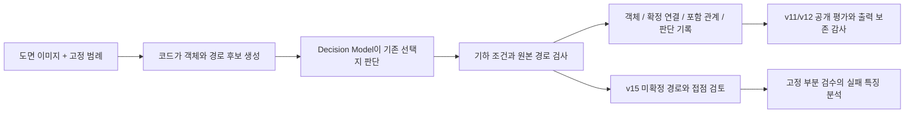

# Week 03 결과물

도면 추출 방법을 수식과 프레임워크 그림으로 정리하고, 공개 PID2Graph/OPEN100 도면 전체 12장으로 평가했습니다. 이어서 모델 연결을 바꿀 수 있는 API를 만들고, 점선과 교차부 검사를 추가한 뒤 남은 연결 누락을 분석했습니다. 공개 평가에서는 객체와 연결의 재현율이 낮았으며, 연결 F1은 v11보다 v12에서 낮아졌습니다. 이 한계를 논문과 제출 기록에 함께 남깁니다.

- 작성자: [@gogoymh](https://github.com/gogoymh)
- 트랙과 주차: Auto-Paper, Week 03
- 논문 저자: Minhyeong Yu, Seunghyun Lee (Enhans)
- 상태: 투고 전 논문 초안, 로컬 API 구현과 검증 완료. 운영 배포와 v15 공개 벤치마크 재평가는 수행하지 않았습니다.
- 추가하거나 수정한 스킬: 없음.
- 관련 기여: [Week 02 JBFC, #24](https://github.com/Pseudo-Lab/no-more-slops/pull/24)는 별도 함수 호출 논문입니다. 이번 프로젝트는 도면 그래프 추출이며, #24의 병합에 의존하지 않습니다.

## 결과물

| 자료 | 확인할 내용 |
| --- | --- |
| [논문 PDF](paper.pdf), [LaTeX 원문](paper-source/main.tex) | 방법의 수식, (a)–(f) 프레임워크, 공개 평가와 보존 실패 |
| [공개 벤치마크 합계](benchmark-results.json) | v11/v12의 평가 범위, 정답/오답/누락 수와 지표 |
| [데이터 출처](DATA_ATTRIBUTION.md) | CC BY-SA 4.0 데이터와 그림의 출처, 수정 내용 |
| [API 소스와 실행 안내](../../app/README.md) | 도면 업로드, 독립적인 모델 연결, 결과와 판단 기록 |
| [연결 누락 분석](../../docs/failure-analysis.md) | 13개 연결쌍, 7개 구간의 관측 사실과 다음 실험 |
| [API 테스트 기록](api-tests.json) | 제출한 소스 사본에서 다시 실행한 검사와 소스 해시 |

## 제작 방법의 변화

| 항목 | AS IS | TO BE: 이번 주 구현과 결과 |
| --- | --- | --- |
| 논문 설명 | 단계 이름만으로 입력과 출력, 검사 조건을 이해하기 어려움 | 그림 (a)–(f), Method 소절, 수식과 질문 ID를 연결 |
| 실험 근거 | 사용자 도면의 시각적 확인 중심 | 공개 OPEN100 12장의 v11/v12 정량 평가와 원본 예시 |
| 실행 | 로컬 실험 코드 직접 실행 | 이미지 업로드 API와 설정으로 분리한 Decision Model 연결 |
| 연결 검토 | 끊어진 선과 실제 단절을 구분하기 어려움 | v15의 점선/교차부 의미 검사, 실제 접점 검사, 전체 경로 원본 검사와 검토 후보 저장 |
| 다음 수정의 근거 | 객체는 잡히지만 연결이 누락된다는 관찰 | 누락 13쌍을 7구간으로 묶어 선 표기, 접점, 중간 객체, 검사 경로를 구분 |

아래 그림은 구현과 평가의 관계를 나타낸 설명도입니다. 논문의 프레임워크 그림과 공개 벤치마크 예시는 PDF에 있습니다.

## 공개 평가: 논문에 사용한 v11/v12

2026-10-24에 저장한 실행과 평가 기록을 기준으로 합니다. 모든 OPEN100 도면 12장을 사용했으며, 정답은 물리 객체 1,439개와 별도로 유도한 객체 간 연결쌍 1,882개입니다. 객체 평가는 클래스 구분 없이 IoU ≥ 0.50에서 일대일 매칭합니다. 연결 평가는 connector/crossing을 통과하되 물리 객체를 통과하지 않고 만든 네트워크의 연결쌍을 비교합니다. PID2Graph 논문의 native edge mAP와 다른 지표입니다.

| 지표 (%) | 버전 | Precision | Recall | F1 |
| --- | --- | ---: | ---: | ---: |
| 객체 위치 | v11 | 51.71 | 20.99 | 29.86 |
| 객체 위치 | v12 | 51.71 | 21.06 | 29.93 |
| 유도한 객체 간 연결 | v11 | 22.06 | 7.28 | 10.95 |
| 유도한 객체 간 연결 | v12 | 22.49 | 7.01 | 10.69 |

v12는 객체 정답 303개, 오답 283개, 누락 1,136개를 기록했습니다. 연결은 정답 132쌍, 오답 455쌍, 누락 1,750쌍입니다. v11 → v12에서 엄격한 전체 출력 보존을 통과한 도면은 2/12장입니다. 대응된 객체 사이의 직접 연결 14쌍과 같은 네트워크 안의 연결쌍 57개가 사라졌습니다. 객체 위치 F1의 0.07%p 상승만으로 전체 성능 향상을 주장할 수 없습니다.

공개 합성 도면 0/2에서 고른 범례와 설명을 추출 입력으로 사용했습니다. OPEN100 정답과 평가용 그림의 덧그림은 추출 입력에 넣지 않았습니다. 24회 실행은 캐시를 공유하므로 독립 반복 실험이 아닙니다. 모델의 사전 학습 데이터는 확인할 수 없으며, 외부 방법과의 동일 조건 비교도 수행하지 않았습니다.

## 후속 API와 실패 분석: v15

추출 API는 작업 ID를 반환하고, 완료 후 `objects`, `relations`, `connection_review`, 판단 기록과 결과 이미지를 제공합니다. 모델 서비스 주소와 모델 이름은 서버 설정으로 분리하며 업로드의 `backend`로 등록된 연결을 선택합니다. 일반 모델 계약은 원래 이미지 객체의 위치를 보존합니다. K10처럼 주변 그림과 접점 확대를 한 화면에 묶는 질문은 추출기가 질문별로 구성합니다.

v15는 공유 선분 검사를 유지하면서 선 표기의 의미(K9), 실제 객체 접점(K10), 겹치는 국소 창으로 전체 경로(K11)를 확인합니다. v15가 새로 추가하는 경로는 모든 필요한 근거가 확인되지 않으면 확정하지 않고 검토 후보로 남깁니다. 이전 v14에서 확정한 관계는 유지합니다. 글자는 영역과 포함 관계를 추출하며 OCR 문자열과 DXF/DWG 변환은 제공하지 않습니다. 논문의 별도 출력 보존 감사는 단일 도면 API에서 자동 실행하지 않습니다.

후속 부분 검수에서 남은 13개 연결쌍은 7개 구간을 공유했습니다. 회색 점선과 계기 접점이 8쌍, 플랜지 간격과 작은 T 분기가 2쌍, 배관 경계 표기와 중간 객체가 2쌍, 작은 꺾임의 검사 경로 단순화가 1쌍입니다. 이미 확인한 같은 사례를 분석한 결과이므로 전체 오류 비율이나 새 검증 세트의 정확도로 해석할 수 없습니다. 현재 v15의 공개 OPEN100 정확도는 측정하지 않았습니다.

## 재현과 검증

API 실행은 [app/README.md](../../app/README.md)를 따릅니다. API 키는 환경 변수로 설정하며 이 제출물에 포함하지 않습니다. 기본 공개 범례의 이미지 라이선스는 [출처 문서](DATA_ATTRIBUTION.md)에 기록했습니다.

논문은 `paper-source/`에서 `pdflatex main.tex`, `bibtex main`, `pdflatex main.tex` 두 회로 컴파일할 수 있습니다. 제출 PDF와 원문은 기존에 컴파일한 공개 평가 초안을 그대로 보존했습니다. 제출 당시 사본의 해시와 기존 실험에서 계산한 합계는 [benchmark-results.json](benchmark-results.json)에 있습니다. 공개 평가의 전체 호출 캐시는 이 제출물에 포함하지 않아, 이 자료만으로 모델 예측을 재생하거나 논문 수치를 처음부터 재산출할 수는 없습니다.

이번 제출 사본에서 API 테스트 285개가 통과했으며(17.07초), 저장소 구조 검사와 공백 검사도 통과했습니다. 기존 ACM 파일의 공백과 API 사본 8개 파일의 끝 빈 줄은 원본 해시를 보존하기 위해 프로젝트의 `.gitattributes`에 검사 예외로 명시했습니다. [api-tests.json](api-tests.json)과 [제출 자료 검사](submission-checks.json)에 실행 범위와 소스 해시, 링크와 지표 계산 확인을 기록했습니다. 이전 로컬 개발에서 수행한 컨테이너, 실제 도면 API와 갤러리 검증은 후속 개발 기록이며, 공개 벤치마크 정확도 검증과 구분합니다. 이번 제출 과정에서는 유료 모델을 호출하지 않았습니다.

## 배운 점과 리뷰 요청

객체와 경로 후보가 있어도 검사 입력이 실제 선의 작은 꺾임이나 접점을 놓치면 연결이 거절될 수 있습니다. 다음 작업은 후보 경로에서 검사 구간을 파생할 때 원본 획을 보존하는지부터 확인하고, 점선의 짧은 팔과 접점 표본, 배관 경계 표기의 역할을 따로 검증하는 것입니다. 호출 한도를 늘리는 효과도 이미 있는 실패 원인과 분리해 측정해야 합니다.

다음 두 가지를 리뷰받고 싶습니다.

1. 논문의 객체 위치, 유도한 연결쌍, 출력 보존 감사가 서로 다른 평가라는 점이 충분히 명확한지.
2. 실패 분석의 우선순위가 작은 꺾임과 점선 연결을 회복하면서 잘못된 교차 연결을 늘리지 않는 검증으로 이어지는지.

이 결과물은 가짜연구소(Pseudo Lab) No-More-Slops 그룹 활동의 일환으로 제작되었습니다.
