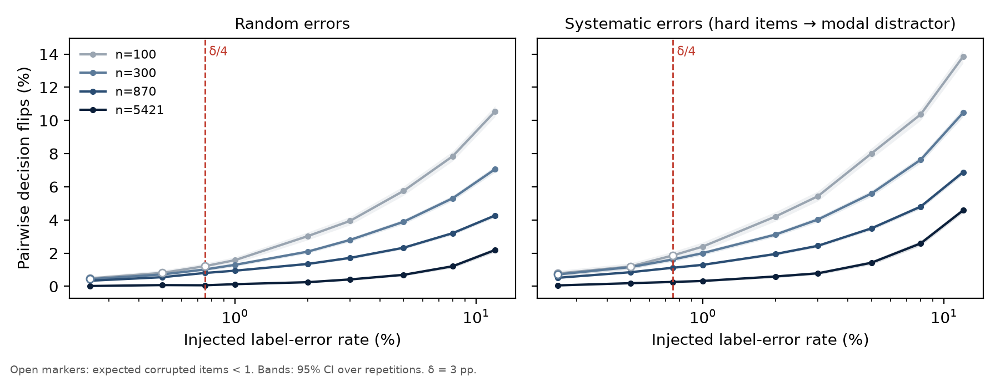
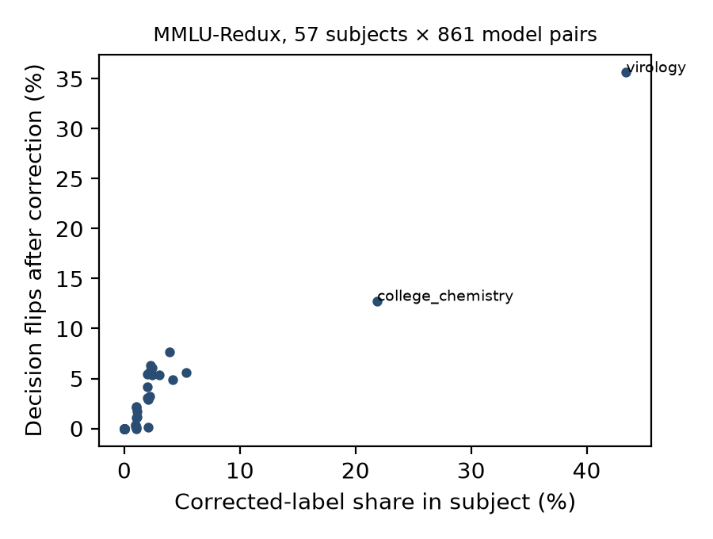
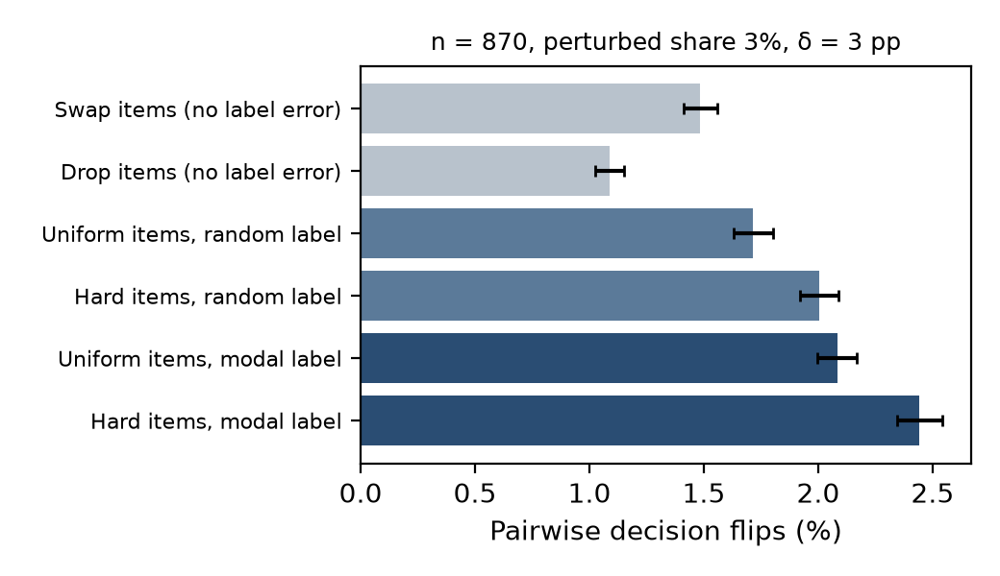

## 초록

선행 리뷰는 평가셋 오류가 배포 결정에 미치는 영향이 순위 변화 사례를 넘어 정량화되지 않았다고 지적하였다. 본 연구는 이를 두 실험으로 측정하였다.

첫째, MMLU-Redux 2.0의 전문가 수정 정답으로 MMLU 원래 정답을 고치고, 공개 모델 42종의 쌍 비교 결정(861쌍)이 바뀌는 비율을 계산하였다. 둘째, 수정된 5,421문항에서 오류를 주입하였다. 오류는 문항 선택(균일/어려운 문항)과 바꿀 라벨(무작위/대표 오답)의 2×2 조합으로 넣었고, 대표 오답과 난이도는 평가 대상이 아닌 다른 절반의 모델에서 계산하였다. 라벨 오류 없이 같은 수의 문항을 교체하거나 제거하는 기준선과도 비교하였다.

전체 셋에서 라벨 수정은 순위를 거의 바꾸지 않았다(Kendall τ 0.991–0.992). δ=3%p 규칙에서 반전은 861쌍 중 8건이었다. 과목 단위 셋(76–100문항)에서는 반전율이 과목의 수정 문항 비율과 함께 증가하였고(Spearman ρ=0.97), virology에서 36%에 이르렀다. 모든 조건에서 우세 방향의 역전은 한 건도 없었다.

오류 주입에서 무작위 라벨 오류의 반전율은 같은 수의 문항을 교체한 기준선의 1.0–1.2배에 그쳤다. 반면 어려운 문항의 라벨을 대표 오답으로 바꾸는 체계적 오류는 무작위 오류의 1.4–1.6배(n≤870), 기준선의 약 1.6배였다. 라벨 오류는 모델 간 격차를 압축하므로 반전은 결정 상실 쪽으로 치우쳤다.

실제 오류의 43%가 모델들의 대표 오답과 일치하였다(우연 기댓값 33%, 단측 p=0.028, 95% CI 34–53%). 선행 리뷰의 감사 기준(오류율 δ/4=0.75%)에서 870문항 셋의 반전율은 0.8%(무작위)–1.1%(체계적)였다.

## Abstract

We measure how golden-set label errors change model-selection decisions. We use MMLU-Redux 2.0 expert corrections and per-item MMLU predictions of 42 open models (861 pairs).

On the full set, correcting labels barely changed rankings (Kendall τ 0.991–0.992). Under a δ = 3 pp rule it flipped 8 of 861 pairwise decisions. In 76–100-item subject sets, flips rose with the subject's corrected-label share (Spearman ρ = 0.97), reaching 36% in virology. No flip ever reversed the winner.

In cross-fitted injection experiments, random label errors flipped only 1.0–1.2× as many decisions as replacing the same number of items without any label error. Systematic errors — hard items relabelled to the models' modal distractor — produced 1.4–1.6× the flips of random errors (n ≤ 870). Label errors compress gaps between models, so their flips skew toward lost decisions. 43% of real wrong labels matched the modal distractor (chance 33%, one-sided p = 0.028). At the review's audit threshold (error rate δ/4 = 0.75%), an 870-item set flipped 0.8–1.1% of decisions.

## 1. 서론

골든 데이터셋은 모델 교체·배포 결정의 근거이다. 오류가 있다는 보고는 많다.
- Northcutt 등(2021): 공개 평가셋 10종에 평균 3.3% 이상의 라벨 오류가 있었다. 수정된 라벨에서는 모델 순위가 바뀔 수 있었다.
- MMLU-Redux(Gema 등, 2025): MMLU 문항의 약 6.5%에 오류가 있다고 추정하였다.
- Vendrow 등(2025): 정답을 정제한 "platinum" 벤치마크에서 최신 모델의 남은 실패가 드러남을 보였다.

평가 결론의 불확실성도 주로 표본 변동과 검정력 측면에서 다뤄졌다(Card 등, 2020; Madaan 등, 2024). 그러나 라벨 오류의 양과 종류가 "B가 A보다 δ 이상 낫다"는 쌍 결정을 얼마나, 어떤 방향으로 바꾸는지를 표본 변동과 분리해 측정한 연구는 드물다. 선행 리뷰는 맹검 감사의 통과 기준으로 오류율 95% Wilson 상한 ≤ δ/4를 제안하였으나, 이 기준은 문헌 합의가 아닌 운용 기준이었다.

본 연구의 질문은 다음 네 가지이다.
- RQ1: 실제 라벨 오류를 고치면 쌍 결정이 얼마나 바뀌는가?
- RQ2: 실제 오류는 무작위인가?
- RQ3: 오류율, 오류 메커니즘, 셋 크기에 따라 반전은 어떻게 변하며, 라벨 오류 없는 문항 교란과 비교하면 어떤가?
- RQ4: δ/4 감사 기준은 어떤 오류율을 걸러내는가?

## 2. 방법

**데이터.** MMLU-Redux 2.0(57과목 × 100문항)의 오류 주석을 사용하였다. 모델 예측은 Open LLM Leaderboard v1에 공개된 모델 42종의 MMLU 5-shot 문항별 선택지 로그확률이며, argmax를 예측으로 삼았다. 문항은 과목과 프롬프트 문자열로 결합하였다. 5,690문항이 결합되었고, 리더보드 정답과 Redux 원래 정답은 100% 일치하였다.

후보 48종 중 6종은 제외하였다. 3종은 해당 이름의 리더보드 저장소가 없었고, 그중 OLMo는 실제 저장소 2종(OLMo-7B-hf, OLMo-1.7-7B-hf)으로 대체하였다. Llama-2 chat 3종은 리더보드가 MMLU 문항별 결과를 공개하지 않았다(`docs/excluded-models.md`).

**라벨 조건.** 문항을 세 가지로 나누었다.
- 오류 없음(ok)
- 수정 가능: 정답 오류이면서 수정 정답이 명시된 100문항
- 미해결: 질문 불명확, 복수 정답 등 269문항

기준 라벨은 S = ok ∪ 수정 가능(5,421문항)의 수정 정답이다. 관측 라벨은 두 가지이다. (a) 같은 S의 원래 정답은 라벨 효과만 반영한다. (b) 전체 5,690문항의 원래 정답은 공개 점수와 같은 조건으로, 라벨 효과와 미해결 문항 포함 효과가 섞인다. 과목의 "수정 문항 비율"은 S 안에서 수정 가능 문항이 차지하는 비율이며, Redux의 전체 오류율과 다르다.

**결정 규칙.** 모델 쌍마다 쌍체 정확도 차 d와 정규근사 95% CI를 계산하였다. d ≥ δ이고 CI가 0을 포함하지 않으면 우세, 아니면 보류로 판정하였다(δ ∈ {0, 1, 2, 3, 5}%p). 민감도 분석으로 정확 McNemar 검정에 861쌍 전체에 대한 Holm 보정을 적용한 규칙도 계산하였다.

반전은 기준과 관측의 판정이 다른 경우이며 세 가지로 나눈다.
- 결정 상실: 우세 → 보류
- 허위 결정: 보류 → 우세
- 역전: 우세 방향이 뒤바뀜

**오류 주입.** S에서 n ∈ {100, 300, 870, 5,421}문항을 뽑았다(반복 300회, 전체 셋은 60회). 오류 문항 수는 k ~ Binomial(n, e)로 정하여, 작은 셋에서도 낮은 오류율이 기댓값으로 반영되게 하였다. 메커니즘은 문항 선택(균일 / 모델 오답률에 비례)과 새 라벨(무작위 오답 / 대표 오답)의 2×2이다. 대표 오답은 모델들이 가장 많이 고른 오답이며, 동점이면 선택지 순서가 앞선 것을 고른다. 이 중 "어려운 문항 + 대표 오답"을 체계적 오류라 부른다.

평가 대상 모델이 자기 오답에서 이득을 보는 순환을 피하기 위해 교차 적합을 썼다. 모델을 무작위로 두 절반(21종씩)으로 나누고, 한 절반의 쌍을 평가할 때는 대표 오답과 난이도를 다른 절반에서 계산하였다.

기준선은 라벨 오류 없이 같은 k개 문항을 다른 정답 문항으로 교체하는 조건(swap)과 제거하는 조건(drop)이다. 모든 조건은 같은 표본의 무오류 판정과 비교한다. 따라서 반전은 "같은 문항에서 라벨이나 문항 구성을 바꾼 효과"이며, 표본 추출 변동은 포함하지 않는다. 반전율에는 반복 간 95% CI를 붙였고, 메커니즘 간 배율에는 반복 단위 부트스트랩 CI(1,000회)를 붙였다.

## 3. 결과

**RQ1: 실제 오류의 수정.** 라벨 수정으로 모델 정확도는 평균 0.63%p 올랐다(−0.11–+0.96%p). 순위는 거의 유지되었다(Kendall τ: S의 원래 정답 0.992, 공개 점수 0.991).

전체 셋에서 δ=3%p일 때 반전은 S 기준 861쌍 중 8건이었다(결정 상실 2건, 허위 결정 6건, 역전 0건). 공개 점수 기준은 10건이며, S 기준보다 많은 2건은 미해결 문항 포함 효과로 볼 수 있다. McNemar–Holm 규칙에서도 반전은 8건, 역전은 0건이었다.

과목 단위 셋(평균 95문항, 76–100)에서는 49,077쌍 중 1,086건(2.2%)이 반전되었다(결정 상실 764건, 허위 결정 322건, 역전 0건). 이 크기에서는 CI 조건이 판정을 지배하여 δ를 0–5%p로 바꿔도 반전 수가 같았다. 즉 소형 셋에서 δ 규칙은 사실상 유의성 검정으로만 작동한다. McNemar–Holm 규칙에서는 우세 판정 자체가 줄어 반전이 447건이었다.

과목별 반전율은 수정 문항 비율과 함께 증가하였다(Pearson r=0.95, Spearman ρ=0.97, 그림 2). 다만 57과목 중 32과목은 반전이 0건이었고, Pearson r은 virology를 빼면 0.81, college_chemistry까지 빼면 0.88이었다. virology(76문항, 수정 비율 43%)는 36%, college_chemistry(22%)는 13%가 반전되었다.

**RQ2: 실제 오류의 성격.** 원래의 틀린 라벨 100건 중 43건이 모델들이 가장 많이 고른 오답과 같았다(우연 기댓값 33%, 단측 이항검정 p=0.028, Wilson 95% CI 34–53%). 수정 대상 문항에서 모델 예측과 원래 라벨의 일치율은 19%, 수정 라벨과의 일치율은 53%였다. 실제 오류가 대표 오답 쪽으로 치우친다는 증거는 있으나, 표본이 100건이어서 그 크기는 불확실하다.

**RQ3: 오류 주입.** 반전율은 오류율이 클수록, 셋이 작을수록 증가하였다(그림 1). δ=3%p, 오류율 3%에서의 반전율은 다음과 같다.

| n | 무작위 오류 | 체계적 오류 | swap 기준선 |
| --- | --- | --- | --- |
| 100 | 3.9% | 5.4% | 3.4% |
| 870 | 1.7% | 2.4% | 1.5% |
| 5,421 | 0.4% | 0.8% | (해당 없음) |

체계적 오류는 무작위 오류의 1.4–1.6배였다(n ≤ 870, 오류율 1–5%, 부트스트랩 CI 하한 ≥ 1.28). 2×2 소거 실험에서 두 요소는 각각 기여하였다. 대표 오답 라벨만 쓰면 1.2–1.3배, 어려운 문항 선택만 쓰면 1.1–1.3배였고, 둘을 합치면 효과가 더해졌다(그림 3).

라벨 오류 없는 교란과 비교하면 해석이 달라진다. n ≤ 870에서 무작위 라벨 오류의 반전율은 같은 수의 문항을 교체한 기준선의 1.0–1.2배였다. 즉 무작위 오류가 만드는 반전의 대부분은 판정 경계 근처의 쌍이 작은 교란에 흔들리는 데서 온다.

라벨 오류의 고유한 신호는 방향에 있었다. n=870, 오류율 3%에서 반전은 다음과 같이 나뉘었다.
- 무작위 오류: 결정 상실 1.1%, 허위 결정 0.6%
- 체계적 오류: 결정 상실 1.6%, 허위 결정 0.9%
- swap 기준선: 결정 상실 0.7%, 허위 결정 0.8%로 거의 대칭

라벨 오류가 만든 쌍 차이 편향은 실제 격차와 음의 상관을 보였다(오류율 3%: 무작위 −0.46 – −0.98, 체계적 −0.21 – −0.67, n이 클수록 강함). 이는 격차 압축을 뜻한다. 우세로 판정된 쌍 중 상실된 비율은 n=870, 오류율 3%에서 1.3%(무작위)와 1.9%(체계적)였다. 모든 조건에서 역전은 0이었다.

**RQ4: δ/4 기준.** 오류 0건 감사의 95% Wilson 상한은 z²/(n+z²)이다. 이 값이 δ/4 이하가 되는 최소 감사 크기는 δ=3%p에서 509문항이다(δ=1, 2, 5%p에서 각각 1,533, 765, 304문항). 따라서 리뷰의 "509문항 오류 0건" 규칙은 Wilson 기준과 동치이다.

이 감사의 통과 확률은 다음과 같다. 이 값은 작동 특성일 뿐이며, 통과한 셋의 오류율 분포는 사전분포 없이 말할 수 없다.

| 실제 오류율 | 통과 확률 |
| --- | --- |
| 0.25% | 28% |
| 0.5% | 7.8% |
| 0.75% | 2.2% |
| 1% | 0.6% |

오류율이 δ/4=0.75%인 셋에서 반전율은 다음과 같았다.
- n=870: 0.8%(무작위), 1.1%(체계적), 0.7%(swap)
- n=100: 1.2%(무작위), 1.9%(체계적)

## 4. 논의

**오류는 승자를 바꾸기보다 결정을 흐린다.** 4지선다 정확도에서 라벨 오류는 해당 문항을 맞힌 모델의 점수를 깎고, 오류 라벨과 같은 오답을 고른 모델에게 점수를 준다. 강한 모델일수록 깎이는 문항이 많으므로 격차가 압축되고, 반전은 결정 상실 쪽으로 치우친다. 실험 범위에서 "B가 A보다 낫다"는 결론의 방향은 한 번도 뒤집히지 않았다. 대신 작은 차이를 판정할 검정력을 잃었다.

**무작위 오류의 위험은 문항 교란 수준이다.** n ≤ 870에서 무작위 라벨 오류가 만든 반전은 같은 수의 문항을 교체할 때와 비슷하였다. 따라서 무작위 노이즈만 가정하면 라벨 품질 관리의 이득은 셋 구성 변동을 줄이는 것과 비슷한 크기로 평가된다. 실제 오류에서 관찰된 대표 오답 쪽 치우침이 위험을 키우는 핵심 요인이다. 체계적 오류의 반전율은 swap 기준선의 약 1.6배였다. 오류 허용치를 정할 때는 무작위가 아닌 체계적 오류를 가정해야 한다.

**작은 셋과 오류가 집중된 층이 취약하다.** 오류율 3%에서 100문항 셋의 반전율은 5,421문항 셋의 약 7–9배였다. 소형 셋에서는 CI가 넓어 δ가 판정에 관여하지 못한다. 그래서 오류는 대개 "판정 불가"로 이어진다. virology처럼 오류가 집중된 층은 전체 오류율이 낮아도 층별 결정을 무력화하므로, 층별 감사가 필요하다.

**δ/4 기준.** 509문항 오류 0건 규칙은 Wilson 기준과 동치이다. 이 규칙은 오류율 0.75% 셋을 2.2% 확률로만 통과시킨다. 그 오류율에서 870문항 셋의 반전은 1% 안팎이고 역전은 없었다. 따라서 이 기준은 결정 안정성 측면에서 보수적이며, 반전의 상당 부분은 문항 교란 수준이다. 100문항 셋에서는 같은 오류율에서도 체계적 오류의 반전이 1.9%로, 셋 크기에 따른 조정이 필요하다.

**한계.**
- 과제: MMLU는 4지선다 정확도 과제이며, 생성형·RAG 채점에서는 오류가 격차를 압축하지 않을 수도 있다.
- 모델: MMLU 문항별 결과가 공개된 2023–24년 모델로 한정되며, Llama-2 chat 같은 공식 대화형 모델이 빠졌다.
- 표본: 미해결 오류 269문항은 기준에서 제외되었고, Redux 재주석 자체의 오류는 고려하지 않았다. 실제 오류의 체계성 추정(RQ2)은 100건에 기반한다.
- 결정 규칙: 결과는 규칙에 의존한다. McNemar–Holm 규칙에서 과목 단위 반전 수는 절반 이하로 줄었다.
- 측정 범위: 반전 지표는 같은 표본 안의 교란 효과만 측정하며, 표본 추출 변동에 의한 결정 불안정은 따로 다루지 않았다.

## 5. 결론

공개 모델 42종과 전문가 수정 라벨을 이용한 실험에서, 골든셋 라벨 오류는 순위를 거의 바꾸지 않았고 승자를 뒤집지도 않았다. 대신 모델 간 격차를 압축해 결정을 보류로 바꾸었다.

무작위 라벨 오류의 효과는 같은 수의 문항을 교체하는 교란과 비슷하였다. 어려운 문항이 대표 오답으로 잘못 표시되는 체계적 오류는 그보다 약 1.5배 큰 효과를 냈고, 실제 오류도 이 방향으로 치우쳤다. 효과는 작은 셋과 오류가 집중된 층에서 커졌다. 선행 리뷰의 감사 기준(509문항 오류 0건, Wilson 상한 ≤ δ/4)은 870문항 셋에서 결정 반전을 1% 안팎으로 억제하였다.

## 그림

<!-- wide -->
**그림 1.** 주입 오류율에 따른 쌍 결정 반전율(δ=3%p, 교차 적합, 모델 21종 × 2절반). 띠는 반복 간 95% CI, 빈 원은 기대 오류 문항 수가 1 미만인 조건, 점선은 선행 리뷰 기준 δ/4.

**그림 2.** MMLU-Redux 과목별 수정 문항 비율과 라벨 수정 후 결정 반전율(δ=3%p, 861쌍).

**그림 3.** 2×2 오류 메커니즘과 라벨 오류 없는 기준선(n=870, 교란 비율 3%, δ=3%p). 오차 막대는 반복 간 95% CI.

## 참고문헌

1. Gema AP, Leang JOJ, Hong G, et al. Are we done with MMLU? Proceedings of NAACL 2025. (MMLU-Redux)
2. Northcutt CG, Athalye A, Mueller J. Pervasive label errors in test sets destabilize machine learning benchmarks. NeurIPS Datasets and Benchmarks Track 2021.
3. Vendrow J, Vendrow E, Beery S, Madry A. Do large language model benchmarks test reliability? arXiv:2502.03461, 2025.
4. Madaan L, Singh AK, Schaeffer R, et al. Quantifying variance in evaluation benchmarks. arXiv:2406.10229, 2024.
5. Card D, Henderson P, Khandelwal U, Jia R, Mahowald K, Jurafsky D. With little power comes great responsibility. Proceedings of EMNLP 2020.
6. Hendrycks D, Burns C, Basart S, et al. Measuring massive multitask language understanding. ICLR 2021.
7. Beeching E, Fourrier C, Habib N, et al. Open LLM Leaderboard (2023–2024). Hugging Face. 문항별 결과: `open-llm-leaderboard-old/details_*`.
8. 선행 리뷰: 골든 데이터셋 미니 리뷰(Week 03), `tracks/auto-paper/projects/golden-dataset-review`.
