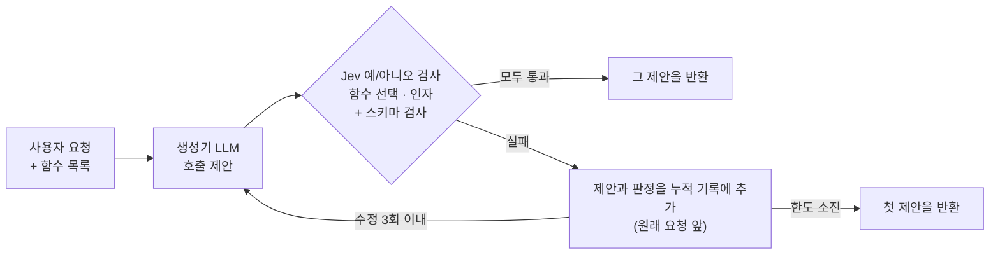

# Jev-Backed Function Calling (JBFC)

- 작성자: @gogoymh
- 트랙: Auto-Paper
- 코드·논문 원본: <https://github.com/gogoymh/jev-backed-function-calling> (MIT, 공개 저장소)
- 논문: *Jev-Backed Function Calling: Agentic In-Context Learning with Cumulative Decision Feedback* ([Week 02 PDF](outputs/week-02/paper.pdf))

## 무엇을 하나요

함수 호출 모델은 형식이 맞아도 틀린 함수나 인자를 고를 수 있다. JBFC는 LLM(생성기)이 제안한 호출을 실행하기 전에 TypeSafe의 판단 모델 *Jev*로 검사하는 추론 시점 방법이다. Jev는 함수 선택과, 호출이 있으면 인자를 예/아니오 질문으로 확인한다. 검사가 실패하면 그 제안과 판정을 누적 기록에 넣어 원래 요청 앞에 붙이고, 생성기가 함수와 인자를 다시 제안한다. 같은 제안이 모든 검사와 스키마 검사를 통과하면 그 제안을 돌려주고, 수정 한도(3회) 안에 통과하지 못하면 첫 제안을 돌려준다.



BFCL의 단일 턴 Python 범주 3,051개 예제에서 일곱 가지 방법(직접 호출, 스키마 수리, 일반 자기 수정, 함수 검사만·인자 검사만 쓰는 변형, 최근 피드백만 보이는 변형, JBFC)을 같은 첫 제안에서 비교했다. 결과와 한계는 [Week 02 결과물](outputs/week-02/README.md)에 있다.

## 소스와 실행

코드, 논문 원본(LaTeX), 실험 스크립트, 검증 기록은 외부 저장소에 있고, 이 폴더에는 주차별 결과물만 둔다. 실행 기록(`results/`)과 BFCL 데이터(`data/`)는 외부 저장소에도 포함하지 않는다.

```sh
git clone https://github.com/gogoymh/jev-backed-function-calling
cd jev-backed-function-calling
make setup      # uv 환경과 .env (API 키는 직접 넣고, 출력·커밋하지 않는다)
make test       # 오프라인 테스트와 ruff
make prepare    # BFCL 데이터 준비
# 유료 실행(Azure OpenAI·TypeSafe 키 필요), 순서와 비용은 외부 저장소 README 참고:
make table2 table3 compare     # 임계값 0.8, r=2: 일곱 방법, 그림 2용 r=10, gpt-5.4-mini Direct
make r3 repeat                 # r=3으로 이어서 실행, 표 1의 2·3회차
make threshold THRESHOLD=0.5   # Jev 방법을 같은 첫 제안에서 임계값 0.5로
make t05                       # 표 2·그림 2에 필요한 0.5 추가 실행
make final      # 기록에서 최종 설정의 표 1–3과 그림 2를 채운다 (API 호출 없음)
make paper verify
```

## 사용한 스킬

이번 주에 이 프로젝트에서 반복한 작업을 다른 실험에도 쓸 수 있게 정리했다.

- [llm-api-experiment-runs](../../skills/llm-api-experiment-runs/SKILL.md): 유료 LLM·검증기 API 실험의 사전 점검, 비용 추정, 재개 가능한 기록, 실패 처리, 완료 검사
- [reuse-recorded-runs](../../skills/reuse-recorded-runs/SKILL.md): 결과가 나온 뒤 한도·임계값·최종 규칙·반복 횟수를 바꿀 때 기록을 재사용
- [sync-paper-results](../../skills/sync-paper-results/SKILL.md): 기록에서 논문 표·그림을 생성하고 문장 속 숫자, README, 쪽수를 맞춤
- [paper-code-audit](../../skills/paper-code-audit/SKILL.md): 논문을 코드·데이터·실행 기록과 대조해 수치를 다시 계산

Week 01에 만든 `evidence-driven-paper`([#6](https://github.com/Pseudo-Lab/no-more-slops/pull/6))처럼 같은 조건에서 비교하고 차이를 예제 단위로 짝지어 보고했다. 이 PR은 #6이 먼저 병합되지 않아도 적용된다.

## 주차별 결과물

- [Week 02](outputs/week-02/README.md): 논문 PDF(본문 4쪽과 참고문헌), 실험 과정과 비용, 재사용 스킬 4개

이 결과물은 가짜연구소(Pseudo Lab) No-More-Slops 그룹 활동의 일환으로 제작되었습니다.
