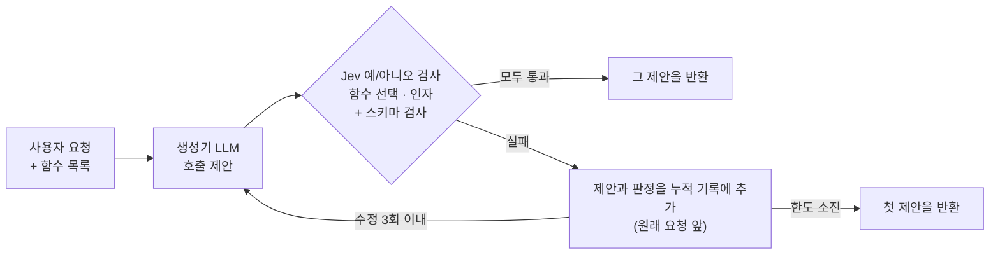
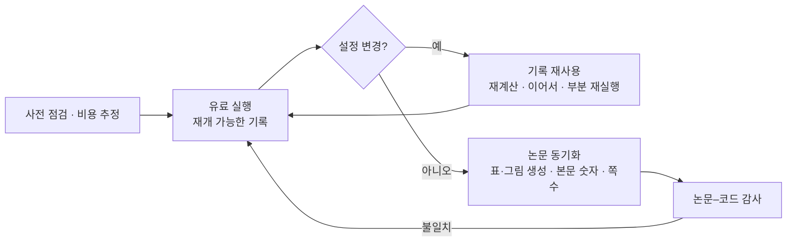

# Week 02 결과물

- 작성자: @gogoymh
- 트랙: Auto-Paper
- 원본 PR: [#21](https://github.com/Pseudo-Lab/no-more-slops/pull/21)
- 결과물: [논문 PDF](paper.pdf) — *Jev-Backed Function Calling: Agentic In-Context Learning with Cumulative Decision Feedback* (총 5쪽: 본문 1–4쪽, 참고문헌 5쪽) · [코드·논문 원본](https://github.com/gogoymh/jev-backed-function-calling/tree/76521c8) (커밋 `76521c8`)
- 상태: 작업 논문(working paper), 투고·동료 심사 전 (2026-10-18 기준). 코드와 논문 원본은 공개, 실행 기록은 외부 저장소에도 포함하지 않았다.
- 사용한 스킬: 이번 주 추가한 [llm-api-experiment-runs](../../../../skills/llm-api-experiment-runs/SKILL.md), [reuse-recorded-runs](../../../../skills/reuse-recorded-runs/SKILL.md), [sync-paper-results](../../../../skills/sync-paper-results/SKILL.md), [paper-code-audit](../../../../skills/paper-code-audit/SKILL.md)

## 무엇을 연구했나

**문제:** 함수 호출 모델은 형식이 맞아도 틀린 함수나 인자를 고르고, 호출이 필요 없는 요청에도 함수를 부른다.

**방법:** 생성기 LLM이 제안한 호출을 실행 전에 TypeSafe의 판단 모델 *Jev*로 검사한다. Jev는 함수 선택과 인자를 예/아니오 질문으로 확인하고, 실패한 제안과 판정을 누적 기록으로 원래 요청 앞에 붙여 다시 제안하게 한다. 같은 제안이 모든 검사와 스키마 검사를 통과해야 받아들이고, 수정 3회 안에 통과하지 못하면 첫 제안을 돌려준다.

**설정:** BFCL 단일 턴 Python 범주 3,051개. 생성기 `gpt-5-nano`(일곱 방법 비교)와 `gpt-5.4-mini`(Direct와 JBFC), 검증기 `jev-1.13.0`, 수정 한도 3, 판정 임계값 0.5. 모든 방법은 예제마다 같은 첫 제안에서 시작한다. 차이의 구간은 예제 단위 쌍별 부트스트랩(2,000회) 95% 구간이다.

| 논문 위치 | 비교 | 값 |
| --- | --- | --- |
| 표 1 | `gpt-5-nano`, 3회 평균 | Direct 64.1% → JBFC 74.8% (차이 +10.7, 9.7–11.6) |
| 표 1 | `gpt-5.4-mini`, 3회 평균 | Direct 81.1% → JBFC 82.1% (차이 +1.0, 0.5–1.5) |
| 표 2 | `gpt-5-nano` 1회, 일곱 방법 | JBFC 74.6%가 일곱 방법 중 가장 높다. 전체 기록 − 최근 기록만: +1.1 (0.4–1.7) |
| 표 3 | 통과한 제안이 없을 때 첫 제안 − 마지막 제안 | `gpt-5-nano` −0.35 (−0.68 – −0.03), `gpt-5.4-mini` +1.37 (0.93–1.82) |
| 그림 2 | 수정 한도 r=1 → r=10 (`gpt-5-nano` 1회) | 72.0% → 76.7% |
| 표 2 | 1,000건당 비용 (`gpt-5-nano`) | Direct $0.056, JBFC $0.211 |

한계(논문 Study Limits): 임계값 0.5와 첫 제안 규칙은 별도 검증 세트 없이 같은 예제의 결과를 본 뒤 골랐으므로 이득이 낙관적일 수 있다. 표 2와 그림 2는 1회 실행이고, 생성기 2개와 검증기 1개, 주로 영어 단일 턴 요청만 다뤘다. 공개 예제가 학습 데이터에 있을 수 있고, 문서화한 정답 오류 10개를 그대로 두었다.

## 이번 주에 한 것

논문 초안이 나온 뒤 실험 설정이 여러 번 바뀌었다. 바뀔 때마다 모델이 그 설정을 보는지, 실행이 끝나기 전에 무엇이 실행되는지를 따져, 다시 돌릴 부분만 돌렸다. 시간과 비용은 작업자 8개, 목록 가격 기준이다.

| 단계 | 바꾼 것 | 기록 재사용 방식 | 시간 | 비용 |
| --- | --- | --- | --- | --- |
| `make table2` | 일곱 방법, r=2, 임계값 0.8 | 새 실행 | 약 2시간 | $2.4 |
| `make table3` | 그림 2: JBFC를 r=10까지 | 이어서 실행 | 약 30분 | $1.4 |
| `make compare` | `gpt-5.4-mini` Direct | 새 실행 | 약 8분 | $2.2 |
| `make r3` | 기본 한도 r=2 → 3 | 이어서 실행 | 약 26분 | $3.6 |
| `make repeat` | 표 1을 3회 평균으로 | 새 첫 제안으로 새 실행 | 약 47분 | $12 |
| `make threshold` | 임계값 0.7 탐색 | 같은 첫 제안에서 JBFC만 재실행 | 약 35분 | $8.7 |
| `make threshold THRESHOLD=0.5` | 임계값 0.5 채택 | 같은 첫 제안에서 재실행 | 약 28분 | $5.4 |
| `make t05` | 표 2의 Jev 변형 3개를 0.5로, JBFC를 r=10까지 | 같은 첫 제안에서 재실행, 이어서 실행 | 약 32분 | $1.7 |
| `make final` | 통과한 제안이 없으면 첫 제안 반환 | 기록에서 정확히 재계산 | 수 분 | $0 |

위 표의 실행 비용 합계는 약 $37, 시간 합계는 약 5시간 30분이다(예비·개발 실행 제외). 수정 한도는 어떤 모델도 보지 않아 기록을 이어서 실행할 수 있었고, 최종 규칙은 기록된 시도 중 어느 것을 고르는지만 바뀌어 새 요청이 필요 없었다. 임계값은 피드백 문장에 들어가 생성기가 보기 때문에 첫 거절 이후를 새로 생성했다.

논문의 표 1–3과 그림 2 데이터는 `make final`이 생성 블록에 채우고, 본문 숫자는 따로 확인했다. 저자가 동결한 Abstract·Introduction·Related Work·Method는 설정 변경으로 틀리게 된 문장만, 저자 승인을 받아 고쳤다. 본문 4쪽은 레이아웃 대신 문장과 캡션을 줄여 지켰다.

### 재사용 스킬 4개

이번 주 작업 흐름을 다음 실험에서도 그대로 쓸 수 있게 나눴다.

| 스킬 | 언제 쓰나 | 이번 주 사례 | 도구 |
| --- | --- | --- | --- |
| [llm-api-experiment-runs](../../../../skills/llm-api-experiment-runs/SKILL.md) | 유료 LLM·검증기 API로 많은 예제를 돌리기 전후 | 비밀값을 출력하지 않는 설정 확인, 1회 사전 호출, 기록 기반 비용 추정, 잘린 응답·콘텐츠 필터를 읽을 수 없는 제안으로 기록, Jev의 결제 오류(HTTP 402)로 멈춘 실행을 남은 행만 재개 | `run_tools.py check`, `estimate` |
| [reuse-recorded-runs](../../../../skills/reuse-recorded-runs/SKILL.md) | 결과가 나온 뒤 한도·임계값·최종 규칙·반복 횟수를 바꿀 때 | 위 표의 재사용 방식 선택, 같은 첫 제안 확인, 결과를 본 뒤 고른 설정의 공개 | `reuse_runs.py derive`, `pairing`, `overlap`, `paired`, `plan` |
| [sync-paper-results](../../../../skills/sync-paper-results/SKILL.md) | 실행이 끝나거나 설정이 바뀐 뒤 논문·README를 맞출 때 | 생성 블록 4개, 동결 문장 승인, README 차트, 4쪽 유지 | `auto_blocks.py`, `stale_numbers.py`, `check_layout.py` |
| [paper-code-audit](../../../../skills/paper-code-audit/SKILL.md) | 논문이 구현·데이터·기록과 일치하는지 확인할 때 | Method보다 엄격해 공식 채점기가 맞다고 보는 정답 15개를 거절하던 스키마 검사, 단일 호출 범위와 맞지 않던 Jev 질문, 변형 간 피드백 형식 차이를 찾아 고침 | `extract_numbers.py` |

기존 스킬과의 차이는 PR 본문에 적었다. 요약하면 `paper-results-reviser`(#12)와 `experiment-to-paper`(#8)는 결과로 원고를 쓰거나 고치는 데 초점이 있고, 이번 스킬은 유료 API 실험의 기록 계약과 설정 변경 시 재사용, 생성 블록·쪽수 검사, 코드 대조 감사를 다룬다.

## 재현 및 검증

이번에 실제 실행한 것과 결과 (2026-10-18):

- 외부 저장소 `76521c8`의 오프라인 테스트: pytest 649개 통과(Python 3.11, `src` 기준), ruff `All checks passed!`.
- 표 생성기(`scripts/final_tables.py --paper`, `make final`과 같은 명령)를 기록 사본에서 다시 실행: 논문 `main.tex`가 바이트 단위로 같았고, 파생 실행 73개 파일은 경로와 설정 지문(`config_id`)을 빼면 같았다. API는 호출하지 않았다.
- `check_layout.py paper.pdf --body-pages 4 --max-pages 6 --log main.log --sections Abstract Introduction "Related Work" Method Experiments Conclusion Acknowledgements`: 5쪽, 참고문헌은 5쪽부터, 문제 없음.
- `stale_numbers.py --before <7d55b78의 main.tex> --after main.tex README.md`: 최종 설정 반영 전 블록 값이 본문·README에 남은 곳 0개.
- `paper.pdf` SHA-256 `a9090dc96e0eb40412132cc0a95a8901bc88260830ce503deeed85f3f0fd17ea`(238,494바이트), 외부 저장소 `76521c8`의 `paper/main.pdf`와 같다.
- 스킬 테스트(각 스킬 폴더에서 `python3 -B -m unittest discover -s tests`): 37개 통과. 네트워크와 API 키 없이 실행된다.

확인하지 못한 것:

- 실행 기록이 공개되지 않아 외부에서 숫자를 재현하려면 실험을 다시 돌려야 한다(Azure OpenAI·TypeSafe API 키, 약 $37). 응답이 매번 조금씩 달라 같은 숫자가 나온다는 보장은 없다.
- 별도 검증 세트, 다른 벤치마크, 다른 검증기에서의 결과.
- 스킬 도구는 JBFC 기록과 테스트용 예제로만 확인했다. 다른 기록 형식에서는 필드 경로 옵션을 맞춰야 한다.

## 지표와 레슨런

| 지표 | 값 |
| --- | --- |
| 유료 API 비용·시간 (위 표의 실행) | 약 $37, 약 5시간 30분 |
| 새 요청 없이 기록에서 계산한 것 | 최종 규칙 적용(표 1–3, 그림 2), 그림 2의 r=1·2·3·5·7(r=10까지 이은 실행을 각 한도에서 자름) |
| 논문 | 본문 4쪽 유지, 생성 블록 4개, 동결 절 수정은 승인 문장만 |
| 테스트 | 외부 저장소 649개, 스킬 37개 |

1. **설정을 바꾸기 전에 분류한다.** 모델이 보지 않는 설정(한도, 최종 규칙)은 기록에서 이어 가거나 다시 계산할 수 있다. 모델이 보는 설정(임계값)은 그럴 수 없다.
2. **결과를 본 뒤 고른 설정은 그렇게 밝힌다.** 임계값 0.5와 첫 제안 규칙이 그렇다. 바꾸기 전후를 같은 기록에서 짝지어 비교하고, 유리한 방향만 보고하지 않는다(표 3에서 `gpt-5-nano`는 첫 제안 규칙에서 0.35점 낮다).
3. **수락은 정답이 아니다.** `gpt-5-nano`에서 모든 검사를 통과한 호출(회차마다 예제의 84–85%) 중 84–85%만 정답이었다.
4. **숫자는 생성하고, 문장은 확인한다.** 표와 그림은 기록에서 생성했고, 본문 숫자와 README는 바뀐 값이 남았는지 따로 찾았다.
5. **쪽수는 글을 줄여 맞춘다.** 글꼴·여백·간격을 줄이지 않고 표와 겹치는 문장, 긴 캡션을 줄였다.

이 결과물은 가짜연구소(Pseudo Lab) No-More-Slops 그룹 활동의 일환으로 제작되었습니다.
