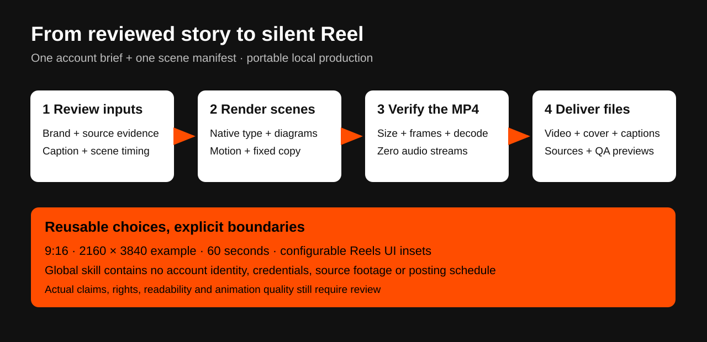
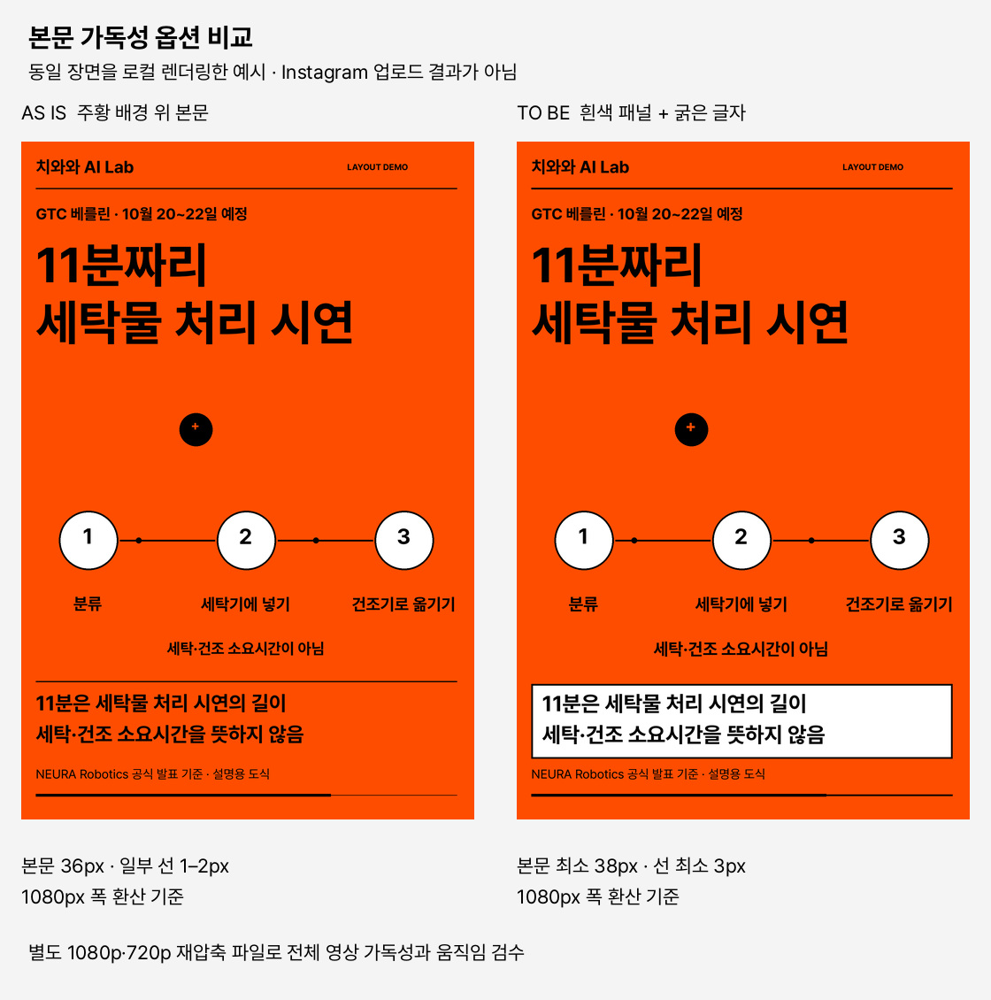
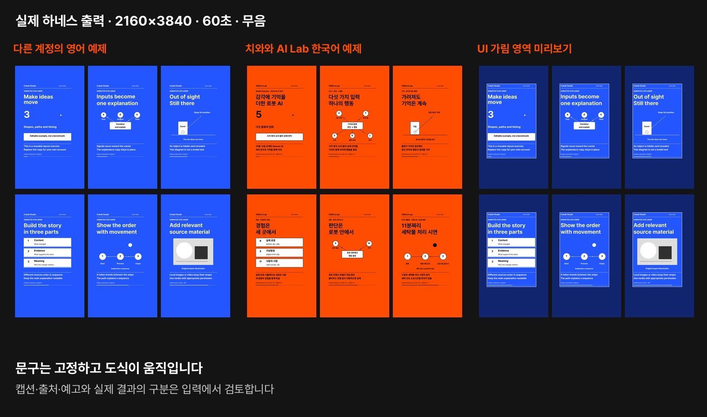

# 무음 인포그래픽 릴스 하네스

기존 `instagram-content`와 캐러셀 하네스를 확장했습니다. 이번 기여는 2026-10-15에 만든 치와와 AI Lab의 무음 영상에서 반복된 제작·검수 작업을 일반화한 스킬 개선입니다. [2주차 결과물](../outputs/week-02/README.md)로 제출하며 1주차 기록은 보존했습니다.



## 어떤 요청을 재사용하나요?

| 요청 | 저장 위치와 동작 |
| --- | --- |
| 치와와 AI Lab, 비비드 오렌지, 검정 글자 | 계정의 `reel-brief.json`에 저장합니다. 다른 계정은 자기 설정을 선택합니다. |
| 오늘이나 어제의 AI 소식 | 원문 확인·날짜·계획과 실제 결과 구분을 스킬에 명시합니다. 선택적 `freshness` 검사도 지원합니다. |
| 약 1분, 무음 | 예제는 60초이며 설명은 장면 전체에 표시합니다. 완성 파일에 음성 스트림이 없어야 통과합니다. |
| 9:16, 최소 2K | 예제는 2160×3840이고, 글자·도형을 그 해상도로 직접 그립니다. 자료 영상의 원본 해상도는 별도로 기록합니다. |
| 릴스 상하단·오른쪽 UI 고려 | 설정 가능한 여백과 모든 프레임의 글자·주요 도형 범위를 검사하고 별도 가림 영역 미리보기를 만듭니다. |
| 더 다이내믹한 움직임 | 신호 수렴, 단계 이동, 가리기와 재등장 등 의미 있는 움직임을 쓰고 설명은 고정합니다. |
| 캡션 500자 미만, 해시태그 줄이기 | 예제 계정은 크레딧·출처·Acknowledgement·줄바꿈을 포함해 최대 499자, 정확히 3개를 검사합니다. |
| 큰 제목과 짧은 캡션의 끝마침표 생략 | 기존 `design-punctuation`을 유지하고 후보를 보고합니다. 데이터와 본문 문장부호를 자동 삭제하지 않습니다. |
| 특정 프로젝트에 종속되지 않게 | 전역에 복사한 스킬을 다른 작업 폴더에서 실행하는 회귀 테스트를 포함합니다. |

## 2026-10-18 최신 선택

현재 치와와 AI Lab의 릴스는 고정된 실제 사진 위에 설명을 크게 배치하고, 정보가 한 번씩 나타난 뒤 읽는 시간을 둡니다. [편집 가이드](../../../skills/instagram-content/references/editorial-reels.md)와 [계정 프로필](../../../skills/instagram-content/references/chihuahua-ai-lab.brief.json)에 확장된 하단 공간을 저장했습니다. 캐러셀은 별도의 밝은 색상 프로필을 사용합니다. 한국어 뉴스 카피는 제작 전 [direct-news-copy](../../../skills/direct-news-copy/SKILL.md)로 반복 해명과 가상의 오해를 줄입니다.

## 2026-10-15 업로드 후 가독성 실험 기록

10월 15일에는 주황색과 흰색 본문 패널을 비교했습니다. 아래는 당시 실험을 보존한 기록이며 현재 계정의 기본 구성은 위 최신 선택을 따릅니다. 다른 계정은 해당 옵션을 선택할 때만 적용합니다. 아래 그림은 동일 장면을 로컬 렌더링한 비교 예시이며 Instagram 업로드 결과가 아닙니다.



[재압축 검수 안내](../../../skills/instagram-content/references/recompression.md)에 설정과 실행 방법이 있습니다. 새 `preview_recompression.py`는 4K 원본을 보존하고 별도의 1080p·720p 검수 영상, 비교 이미지, 측정 보고서를 만듭니다. 주황 단색이나 낮은 비트레이트만으로 화질 저하의 원인을 단정하지 않습니다. 핵심 그래픽의 지속적인 움직임과 UI 여백 기준도 유지합니다.

2026-10-15 추가 검증에서는 **34개 테스트**를 통과했습니다. 기존 60초·2160×3840 원본으로 두 검수 파일을 생성했고, 각각 1,800프레임·30fps·음성 없음·전체 디코딩과 원본 SHA-256 보존을 확인했습니다. 한국어 예제의 비미디어 장면도 시작·중간·끝 프레임의 글자·도형 범위를 확인했습니다. 비교 이미지에서는 3·30·50초를 살펴봤으며, 전체 영상의 수동 가독성·움직임 검수와 실제 Instagram 결과 확인은 별도입니다. 보고서는 이를 자동 통과로 처리하지 않습니다. 아래 28개 테스트와 기존 데모의 기록은 최초 제출 시점의 결과로 보존합니다.

새 패널의 Linux 글꼴 높이 차이로 발견한 아래 여백 문제를 수정했습니다. 글자 크기를 줄이지 않고 본문을 위로 배치한 뒤 기본 글꼴과 Noto Sans CJK에서 각각 34개 테스트를 재실행했습니다. 한국어 예제의 장면 범위도 Pretendard와 Noto Sans CJK 양쪽에서 확인했습니다.

## 재현 방법

[Reel 하네스 안내](../../../skills/instagram-content/references/reel-harness.md)에 설치 요구 사항, 실행 명령, 여섯 장면 형식과 출력 파일이 있습니다. 영어 데모는 스킬의 `references/reel.example.json`, 계정 예제는 [Neuron AI 재현 입력](../examples/chihuahua-ai/neuron-reel-2026-10-15.json)을 사용합니다.

```sh
python -m pip install -r tracks/auto-post/skills/instagram-content/scripts/requirements.txt
python -B tracks/auto-post/skills/instagram-content/scripts/run_reel.py \
  tracks/auto-post/skills/instagram-content/references/reel.example.json \
  --brief tracks/auto-post/skills/instagram-content/references/reel-brief.example.json \
  --out /path/to/reel-demo --font-regular /path/to/Regular.ttf --font-bold /path/to/Bold.ttf
python -B -m unittest discover -s tracks/auto-post/skills/instagram-content/tests -v
python3 scripts/check_repository.py
```

FFmpeg/ffprobe는 별도로 설치합니다. 입력 검사만 실행할 때는 `--out` 대신 `--validate-only`를 사용합니다. 렌더링 오류는 기존 결과물을 교체하지 않습니다.

## 이번에 실행한 검증

2026-10-15에 macOS / Python 3.12.8에서 실행한 결과입니다. 이전 기여자의 기록을 이번 검증으로 바꾸지 않았습니다.

- 기존 20개와 신규 8개를 합친 28개 테스트 통과
- Linux의 Noto Sans CJK 글꼴에서 발견한 본문 높이 차이를 반영해 여백을 조정하고 같은 글꼴로 재검증
- 영어 예제와 한국어 치와와 예제로 각각 실제 60초·2160×3840·30fps·1,800프레임 출력
- 두 MP4 모두 H.264/yuv420p, BT.709, 영상 스트림 1개와 음성 스트림 0개, 전체 디코딩 통과
- 원본에 음성이 있는 로컬 영상으로 음성 제거, 상대 경로, 다른 폴더에 복사한 스킬 실행 검증
- 캡션 경계값, 날짜 범위, 오버플로, 기존 결과 보존, 움직이는 도식과 고정된 설명 영역 검증
- [측정 요약](reel-validation.json)과 아래 실제 출력 프레임을 확인



동료 검토에서는 모바일 글자 크기, 실제 움직임과 읽는 시간, 기기별 UI 위치를 확인해 주세요. 자동 검사만으로 사실·권리·미적 품질·Instagram 업로드 결과를 보증하지 않습니다. 예제의 뉴스 날짜는 과거 재현 시점으로 고정되어 있으며 오늘의 뉴스가 아닙니다. 원본 기사 영상이나 사용자가 보낸 스크린샷, 개인 경로, 인증 정보는 커밋하지 않았습니다.

## 기존 기여와 관계

[PR #5](https://github.com/Pseudo-Lab/no-more-slops/pull/5)의 `instagram-content`·`design-punctuation`, 캐러셀·프로필 도구와 기록을 그대로 이어받았습니다. `auto-post` 브랜치는 최신 `main`의 공통 규칙과 기존 기여 이력을 포함합니다. 이번 확장은 `main`을 대상으로 하는 2주차 Draft PR로 제출하며 1주차 PR은 별도로 보존합니다.

`instagram-reel`([#9](https://github.com/Pseudo-Lab/no-more-slops/pull/9), [#15](https://github.com/Pseudo-Lab/no-more-slops/pull/15))은 촬영 영상의 행동을 중심으로 편집합니다. 이번 확장은 출처가 있는 설명 문구와 도식 JSON에서 시작해 무음 인포그래픽을 렌더하는 워크플로입니다. 같은 목적의 새 스킬을 중복 생성하지 않고 `instagram-content` 안에 선택 경로를 추가했습니다.
