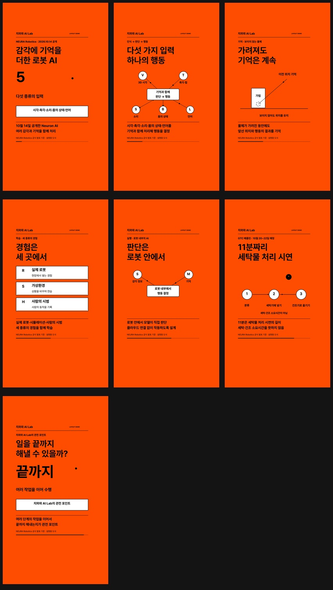

# Week 02 · 무음 인포그래픽 릴스

- 작성자: [유민형 · gogoymh](https://github.com/gogoymh)
- 트랙: Auto-Post
- 프로젝트: Instagram production
- 상태: **리뷰 대기 · Draft PR · 머지 금지**
- 이전 기여: [Week 01 / PR #5](https://github.com/Pseudo-Lab/no-more-slops/pull/5)
- 제작일: 2026-10-15

## 결과물

[60초 세로 4K 데모 영상](neuron-reel-demo/reel.mp4) · [커버](neuron-reel-demo/cover.jpg) · [장면 미리보기](neuron-reel-demo/preview.jpg) · [UI 안전 영역](neuron-reel-demo/safe-area-preview.jpg)

[캡션](neuron-reel-demo/caption.txt) · [출처](neuron-reel-demo/sources.md) · [자막](neuron-reel-demo/subtitles.srt) · [측정 보고서](neuron-reel-demo/production-report.json)

이 영상은 Neuron AI의 2026-10-14 발표를 사용한 **날짜가 있는 하네스 재현 데모**입니다. 화면과 캡션에 `LAYOUT DEMO`를 표시했으며, 현재 뉴스나 게시 완료 결과로 제시하지 않습니다. 영상에는 직접 만든 도식만 사용했습니다. 원본 기사 영상과 개인 스크린샷은 포함하지 않았습니다.

## 이번 주 추가한 제작 방법

- [instagram-content](../../../../skills/instagram-content/SKILL.md)를 확장해 사진·캐러셀·프로필에 더해 무음 인포그래픽 릴스를 제작합니다.
- 계정 설정과 기사별 장면 JSON을 분리하고, 다른 프로젝트에서도 전역 스킬로 실행할 수 있습니다.
- 9:16·2160×3840·60초·30fps 출력, 음성 스트림 제거, UI 안전 영역, 고정된 설명과 움직이는 도식을 검증합니다.
- 신호 수렴, 단계 이동, 가리기와 재등장, 정보 카드, 수치 강조, 로컬 이미지·영상의 여섯 장면 형식을 지원합니다.
- 예제 계정은 완성 캡션 500자 미만·해시태그 3개를 적용합니다. [design-punctuation](../../../../skills/design-punctuation/SKILL.md)의 제목·짧은 문구 규칙은 유지합니다.

## 재현과 검증

[그림이 포함된 제작 안내](../../docs/reel-workflow.md) · [입력 형식과 실행 명령](../../../../skills/instagram-content/references/reel-harness.md) · [계정 설정](../../examples/chihuahua-ai/reel-brief.json) · [장면 입력](../../examples/chihuahua-ai/neuron-reel-2026-10-15.json)

이번 데모의 측정값은 2160×3840, 60초, 30fps, 1,800프레임, 음성 스트림 0개, 캡션 486자, 해시태그 3개입니다. H.264/yuv420p·BT.709와 전체 디코딩을 확인했습니다. 28개 동작 테스트 및 [Python 3.10·3.12 CI](https://github.com/Pseudo-Lab/no-more-slops/actions/runs/38677937951)를 통과했습니다. 이는 1주차의 기존 검증 기록과 별개의 2주차 측정입니다.

Linux의 기본 Noto Sans CJK 글꼴이 더 큰 높이를 차지하는 문제는 글자를 줄이지 않고 설명 영역의 여백을 늘려 수정했습니다. 자동 검사만으로 기사 내용·권리·미적 품질·실제 Instagram UI를 보증하지 않으므로, 동료 리뷰에서는 휴대폰에서의 글자 크기와 읽는 시간, 움직임의 설명력, 상하단과 오른쪽 가림을 확인해 주세요.

## 리뷰 상태

사용자 요청에 따라 PR은 **Draft**로 유지합니다. 리뷰는 가능하지만 Ready for review로 전환하기 전에는 GitHub에서 머지할 수 없습니다. 자동 머지는 설정하지 않습니다. 1주차 기록은 [outputs/week-01](../week-01/README.md)에 보존했습니다.

이 결과물은 가짜연구소(Pseudo Lab) No-More-Slops 그룹 활동의 일환으로 제작되었습니다.
