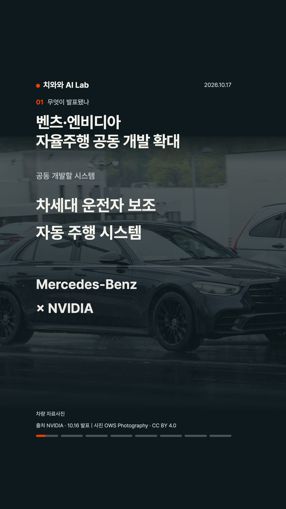

# 고정 사진과 큰 설명의 실제 릴스

작성자 @gogoymh · Auto-Post · 제작 개정일 2026-10-17 · PR 자료 추가일 2026-10-18

벤츠·NVIDIA의 차세대 운전자 보조·자동 주행 공동 개발을 설명한 영상입니다. 이름과 역할을 연결하는 표, 회사별 담당 기술, 개발 범위와 공개 상태를 8개 장면으로 전달했습니다.

[60초 MP4](reel.mp4) · [커버](cover.jpg) · [캡션](caption.txt) · [장면 문구](scene-copy.srt) · [출처와 사진 라이선스](sources.md)

[계정 입력](brand-brief.json) · [당시 측정 보고서](production-report.json) · [당시 전체 재생 검토](visual-review.json)

React/Remotion으로 고정 사진 위에 큰 설명을 출력했습니다. `instagram-content`에 저장한 편집 기준의 제작 예시이며, 도식용 Python 릴스 하네스의 출력과 구분합니다. 2160×3840·30fps·1,800프레임·음성 스트림 0개를 확인했고, 원본과 로컬 1080/720 압축본을 너비 290px·1배속으로 끝까지 검토한 기록을 보존했습니다.

이번 PR 설명 보완에서는 기존 MP4와 보고서를 그대로 복사하고 영상 SHA-256 일치를 확인했습니다. 영상은 `direct-news-copy` 추가 전의 개정본입니다. 과거 사용자 캡처를 참고해 하단 공간을 확대했으며 새 개정본의 Instagram 업로드 품질은 로컬 검토와 별도입니다.

사진: **OWS Photography · CC BY 4.0** · [원본](https://commons.wikimedia.org/w/index.php?curid=163895996) · [라이선스](https://creativecommons.org/licenses/by/4.0/). 자료사진에 고정 크롭·리사이즈·명암 오버레이와 설명을 합성했습니다. 공식 발표 원문과 장면별 근거는 `sources.md`에 보존했습니다.
