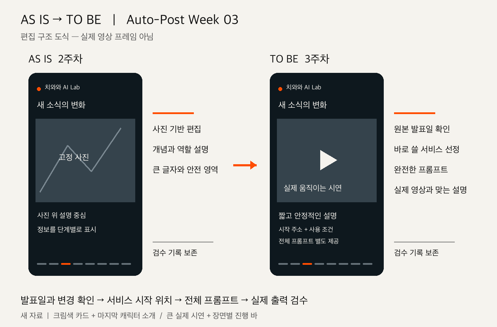
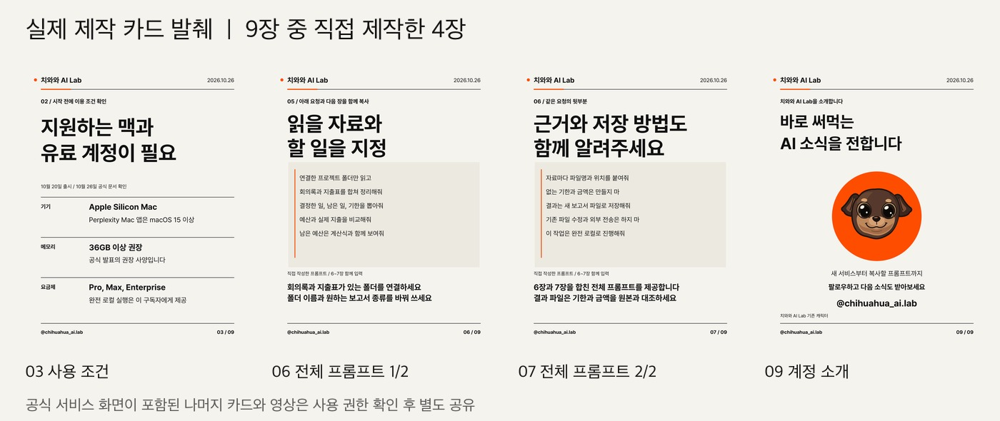

# Auto-Post Week 03: 직접 써볼 수 있는 AI 콘텐츠

작성자: [유민형 (@gogoymh)](https://github.com/gogoymh) | 프로젝트: Instagram production | 제작일: 2026-10-26

배포 대상은 [치와와 AI Lab](https://www.instagram.com/chihuahua_ai.lab/)입니다. 이번 두 콘텐츠의 Instagram 게시 여부는 확인하지 않았습니다.



위 이미지는 편집 구조를 설명하는 도식이며 실제 영상 프레임이 아닙니다.

| AS IS: 2주차 | TO BE: 3주차 |
| --- | --- |
| 소식과 개념을 설명하는 사진 기반 편집 | 실제 신규 기능을 골라 서비스 시작 위치와 전체 프롬프트 제공 |
| 고정 사진 위 설명 중심 릴스 | 크게 보여주는 실제 시연, 짧고 안정적인 설명, 장면별 진행 바 |
| 계정별 색상과 안전 영역 | 카드의 마지막 캐릭터 소개와 포맷별 계정 설정 추가 |

## 제작한 콘텐츠



| 형식 | 소재와 활용 예시 | 로컬 완성본에서 확인한 값 | 공개 자료 |
| --- | --- | --- | --- |
| 카드뉴스 | 10월 20일 출시된 Perplexity Computer의 Mac 완전 로컬 실행. 회의록과 지출 파일로 주간 보고서 초안 요청 | 9장, 1080×1350, 캡션 379자, 해시태그 3개 | 직접 제작한 [3장](carousel/03.png), [6장](carousel/06.png), [7장](carousel/07.png), [9장](carousel/09.png), [전체 프롬프트](carousel/prompt.txt), [후속 요청](carousel/followup-prompts.txt), [캡션](carousel/caption.txt) |
| 릴스 | 10월 21일 출시된 Pixazo Agent P. 대화로 장면을 계획하고 연결하는 영상 제작 요청 | 60초, 2160×3840, 30fps, 무음, 8개 장면, 캡션 361자, 해시태그 3개 | [전체 프롬프트](reel/prompt.txt), [후속 요청](reel/followup-prompts.txt), [캡션](reel/caption.txt), [검수 기록](review.md) |

공식 생성 예시와 직접 작성한 프롬프트를 구분했습니다. 두 프롬프트를 서비스에서 실행한 결과는 없습니다. 카드의 공식 홍보 이미지와 릴스의 공식 영상은 공개 저장소 재배포 권한을 확인하지 못해 제외했습니다. [출처와 확인 범위](sources.md), [로컬 완성본 해시](local-master-record.json)를 남겼으며, 공개된 카드 발췌에는 해당 외부 미디어가 없습니다.

## 재사용할 수 있는 것

기존 [instagram-content](../../../../skills/instagram-content/SKILL.md)를 업데이트했습니다. 계정 설정을 따로 선택하므로 다른 프로젝트에서도 설치해 사용할 수 있습니다.

- [실용적인 AI 소식 선정](../../../../skills/instagram-content/references/practical-ai-news.md): 원본 발표일, 실제 변경 사항, 서비스 주소, 이용 조건, 전체 프롬프트를 함께 준비합니다. 최근 수정된 안내 페이지로 기존 기능을 신규 출시처럼 다루지 않습니다.
- [실제 시연 중심 릴스](../../../../skills/instagram-content/references/demo-led-reels.md): 큰 시연 영역과 안정적인 설명, 장면별 진행 바, 전체 영상의 1배속 검수 기준을 정리했습니다.
- [카드 계정 설정](../../../../skills/instagram-content/references/chihuahua-ai-lab.carousel.brief.json): 크림색과 검정 글자, 작은 오렌지 강조, 마지막 페이지의 기존 캐릭터 소개를 저장했습니다. 릴스에는 캐릭터를 사용하지 않습니다.
- [소재 사전 점검 도구](../../../../skills/instagram-content/scripts/check_practical_news.py): 선언한 발표일과 기간, 서비스 주소, 이용 조건, 프롬프트 파일, 최종 캡션을 검사합니다. 출처의 사실 여부는 직접 확인해야 합니다.

`direct-news-copy`와 `design-punctuation`은 기존 스킬을 그대로 재사용합니다. `instagram-reel`은 가족 촬영 영상 편집용이며, 이번 작업은 새 AI 소식 선정과 서비스 활용 예시 제작에 집중합니다. 자동 게시 기능은 포함하지 않습니다.

## 재현과 검증

저장소 루트에서 실행합니다. 사전 점검은 Python 3.10 이상만 필요합니다.

```sh
python3 tracks/auto-post/skills/instagram-content/scripts/check_practical_news.py \
  tracks/auto-post/projects/instagram-production/outputs/week-03/edition.json
python3 -m pip install -r tracks/auto-post/skills/instagram-content/scripts/requirements.txt
python3 -m unittest discover -s tracks/auto-post/skills/instagram-content/tests
python3 scripts/check_repository.py
git diff --check
```

[edition.json](edition.json)은 두 소재의 선언한 원본 발표일과 시작 주소, 이용 조건, 파일을 연결합니다. 사전 점검 통과 기록은 [preflight-report.json](preflight-report.json), 측정 값은 [카드 보고서](carousel/production-report.json)와 [영상 보고서](reel/production-report.json)에 있습니다. 기존 렌더러 사용 방법은 [캐러셀 하네스](../../../../skills/instagram-content/references/harness.md)와 [릴스 하네스](../../../../skills/instagram-content/references/reel-harness.md)를 참고합니다. 원본 외부 영상이 없는 이 공개 제출만으로 동일한 릴스를 다시 인코딩할 수는 없습니다.

최근 안내 페이지를 신규 출시 근거로 삼았던 소재를 교체했습니다. 앞으로 원본 출시일과 독자가 바로 할 수 있는 일을 소재 선정 단계에서 함께 확인합니다. 이번에 확인한 값은 제작 규격과 로컬 검수 결과이며 조회수나 반응 수치를 측정하지 않았습니다.

관련 PR은 [2주차 #18](https://github.com/Pseudo-Lab/no-more-slops/pull/18)입니다. 공통 스킬과 제작 기반은 두 PR의 병합 순서에 맞춰 확인하고, 이번 주 산출물은 `outputs/week-03/`에 따로 보관합니다. 리뷰에서는 소재의 새로움, 전체 프롬프트의 유용성, 시연 중심 제작 기준을 확인해 주세요.
